# Arquitectura y contrato de datos

## Vista general

Hay dos diagramas principales y diez anexos, y todos se dibujan desde
dos modelos: `docs/arquitectura.json` (los principales) y
`docs/arquitectura-anexos.json` (los anexos). Cada caja y cada conexión
tiene ahí su texto en español e inglés, cuándo ocurre y en qué parte del
código está. Para cambiarlos se edita el modelo y se corre
`python -m tools.architecture` (desde `python/`), que vuelve a trazar las
líneas, escribe los SVG en español (`arquitectura.svg`) e inglés
(`arquitectura-en.svg`) en `docs/` y en `public/assets/` (la sección
Metodología del sitio los muestra, con un selector entre los dos), los
anexos en `docs/anexos/` y `public/assets/anexos/`, el explorador
`public/arquitectura.html` y el texto de abajo. Una prueba falla si los
modelos, los SVG, el explorador o este texto no coinciden.

- **Simplificado** (`arquitectura-simple.svg`): 9 cajas para explicar el
  sistema a cualquier persona, de arriba abajo. Las cajas llevan el número
  del paso del recorrido que las presenta y las líneas una letra con lo que
  viaja por ellas.
- **Completo** (`arquitectura.svg`): 46 cajas y 86 conexiones numeradas,
  en seis bloques (fuentes, recolectores, copias y respaldo, pipeline,
  publicación y sitio, y debajo operación, vigilancia y personas). Debajo
  del dibujo, cada número dice qué viaja, cuándo y por qué.
- **Anexos A1 a A10** (`anexos/a1.svg` … `anexos/a10.svg`): el detalle de
  cada parte, con el mismo estilo: dónde corre cada paso (GitHub Actions,
  n8n en AWS, el equipo en el Perú, Cloudflare, el navegador), con qué
  tecnología (Python, n8n, git, D1…), las conexiones numeradas y, abajo,
  qué pasa y qué respaldo entra si algo falla. Cada caja del completo está
  en exactamente un anexo; en los dos diagramas principales, la etiqueta
  A1 a A10 de cada caja abre su anexo, y cada anexo tiene un enlace para
  volver al completo y etiquetas hacia los anexos vecinos.
- **Explorador** (`public/arquitectura.html`, en el sitio como
  `arquitectura.html`): recorre los diagramas y los anexos con un clic.
  Tocar una caja de un diagrama principal abre su anexo; tiene versión en
  inglés y se puede generar en un solo archivo, sin servidor, con
  `python -m tools.architecture --explorer ruta.html`.

Las líneas son de cuatro tipos: datos (continua), respaldo que se usa si
falla lo anterior (guiones), disparo o control (puntos) y paso manual de
una persona (guion y punto). En el sitio y al abrir el SVG en el navegador,
pasar el puntero (o tocar, en el sitio) sobre una caja o una conexión
muestra su explicación completa.

### Diagrama simplificado

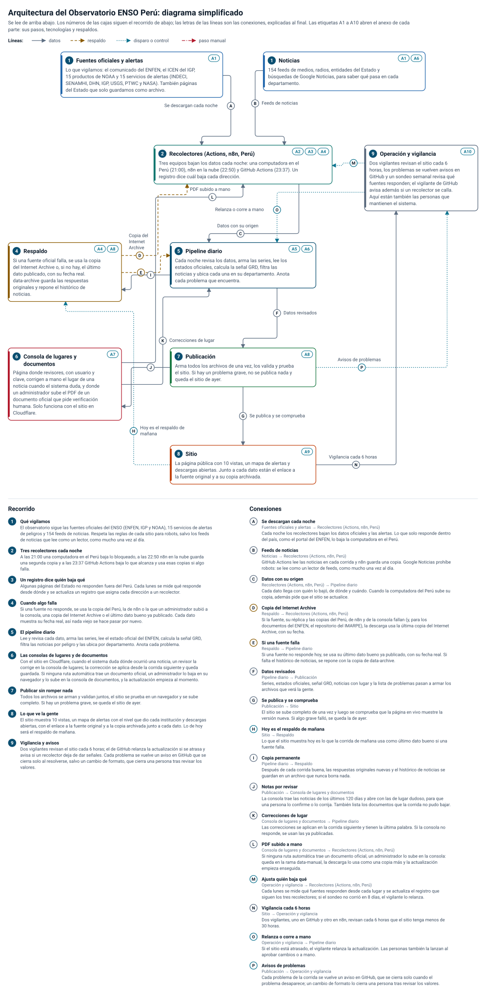

### Diagrama completo

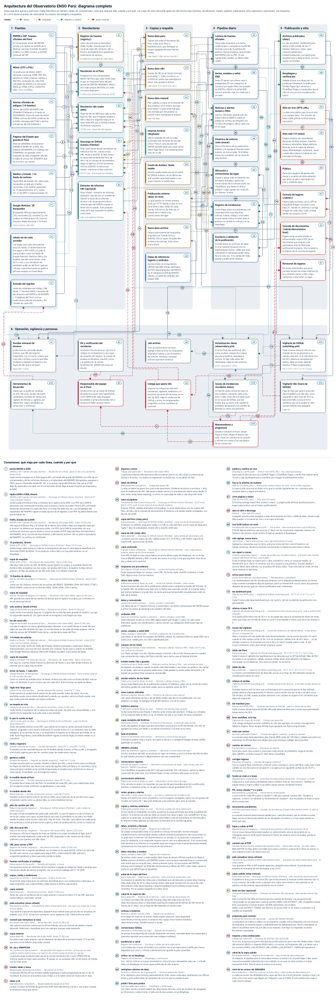

### Cómo se recorre

<!-- recorrido:inicio (generado por python -m tools.architecture) -->

**Recorrido del diagrama simplificado** (el número de cada caja es el paso que la presenta):

1. **Qué vigilamos.** El observatorio sigue las fuentes oficiales del ENSO (ENFEN, IGP y NOAA), 14 servicios de alertas de peligros y 154 feeds de noticias. Respeta las reglas de cada sitio para robots, salvo 40 feeds de noticias que lee como un lector, como mucho una vez al día. _Cajas: Fuentes oficiales y alertas (1), Noticias (1)._
2. **Tres recolectores cada noche.** A las 21:00 una computadora en el Perú baja lo bloqueado, a las 22:50 n8n en la nube guarda una segunda copia y a las 23:37 GitHub Actions baja lo que alcanza y usa esas copias si algo falla. _Cajas: Recolectores (Actions, n8n, Perú) (2), Fuentes oficiales y alertas (1), Noticias (1)._
3. **Un registro dice quién baja qué.** Algunas páginas del Estado no responden fuera del Perú. Cada lunes se mide qué responde desde dónde y se actualiza un registro que asigna cada dirección a un recolector. _Cajas: Recolectores (Actions, n8n, Perú) (2), Operación y vigilancia (9)._
4. **Cuando algo falla.** Si una fuente no responde, se usa la copia del Perú o de n8n, una copia del Internet Archive o el último dato bueno ya publicado. Cada dato muestra su fecha real, así nada viejo se hace pasar por nuevo. _Cajas: Respaldo (4), Pipeline diario (5), Recolectores (Actions, n8n, Perú) (2)._
5. **El pipeline diario.** Lee y revisa cada dato, arma las series, lee el estado oficial del ENFEN, calcula la señal GRD, filtra las noticias por peligro y las ubica por departamento. Anota cada problema. _Cajas: Pipeline diario (5)._
6. **La consola de lugares.** Con el sitio en Cloudflare, cuando el sistema duda dónde ocurrió una noticia, un revisor la corrige en la consola. La corrección se aplica desde la corrida siguiente y queda guardada. _Cajas: Consola de lugares y documentos (6), Publicación (7), Pipeline diario (5)._
7. **Publicar sin romper nada.** Todos los archivos se arman y validan juntos, el sitio se prueba en un navegador y se sube completo. Si hay un problema grave, se queda el sitio de ayer. _Cajas: Publicación (7), Sitio (8)._
8. **Lo que ve la gente.** El sitio muestra 10 vistas y descargas abiertas, con el enlace a la fuente original y a la copia archivada junto a cada dato. Lo de hoy será el respaldo de mañana. _Cajas: Sitio (8), Respaldo (4)._
9. **Vigilancia y avisos.** Dos vigilantes revisan el sitio cada 6 horas; el de GitHub relanza la actualización si se atrasa. Cada problema se vuelve un aviso en GitHub que se cierra solo al resolverse. _Cajas: Operación y vigilancia (9), Sitio (8), Pipeline diario (5)._

**Conexiones del diagrama simplificado:**

| | De → a | Qué viaja, cuándo y por qué |
|---|---|---|
| A | Fuentes oficiales y alertas → Recolectores (Actions, n8n, Perú) | **Se descargan cada noche.** Cada noche los recolectores bajan los datos oficiales y las alertas. Lo que solo responde dentro del país, como el portal del ENFEN, lo baja la computadora en el Perú. |
| B | Noticias → Recolectores (Actions, n8n, Perú) | **Feeds de noticias.** GitHub Actions lee las noticias en cada corrida y n8n guarda una copia. Google Noticias prohíbe robots: se lee como un lector de feeds, como mucho una vez al día. |
| C | Recolectores (Actions, n8n, Perú) → Pipeline diario | **Datos con su origen.** Cada dato llega con quién lo bajó, de dónde y cuándo. Cuando la computadora del Perú sube su copia, además pide que el sitio se actualice. |
| D | Respaldo → Recolectores (Actions, n8n, Perú) | **Copia del Internet Archive.** Si la fuente, su réplica y las copias del Perú y de n8n fallan, la descarga usa la última copia del Internet Archive, con su fecha. |
| E | Respaldo → Pipeline diario | **Si una fuente falla.** Si una fuente no responde hoy, se usa su último dato bueno ya publicado, con su fecha real. Si falta el histórico de noticias, se repone con la copia de data-archive. |
| F | Pipeline diario → Publicación | **Datos revisados.** Series, estados oficiales, señal GRD, noticias con lugar y la lista de problemas pasan a armar los archivos que verá la gente. |
| G | Publicación → Sitio | **Se publica y se comprueba.** El sitio se sube completo de una vez y luego se comprueba que la página en vivo muestre la versión nueva. Si algo grave falló, se queda la de ayer. |
| H | Sitio → Respaldo | **Hoy es el respaldo de mañana.** Lo que el sitio muestra hoy es lo que la corrida de mañana usa como último dato bueno si una fuente falla. |
| I | Pipeline diario → Respaldo | **Copia permanente.** Después de cada corrida buena, las respuestas originales nuevas y el histórico de noticias se guardan en un archivo que nunca borra nada. |
| J | Publicación → Consola de lugares y documentos | **Notas por revisar.** La consola trae las noticias de los últimos 120 días y abre con las de lugar dudoso, para que una persona lo confirme o lo corrija. |
| K | Consola de lugares y documentos → Pipeline diario | **Correcciones de lugar.** Las correcciones se aplican en la corrida siguiente y tienen la última palabra. Si la consola no responde, se usan las ya publicadas. |
| L | Operación y vigilancia → Recolectores (Actions, n8n, Perú) | **Ajusta quién baja qué.** Cada lunes se mide qué fuentes responden desde cada lugar y se actualiza el registro que siguen los tres recolectores. |
| M | Sitio → Operación y vigilancia | **Vigilancia cada 6 horas.** Dos vigilantes, uno en GitHub y otro en n8n, revisan cada 6 horas que el sitio tenga menos de 30 horas. |
| N | Operación y vigilancia → Pipeline diario | **Relanza o corre a mano.** Si el sitio está atrasado, el vigilante relanza la actualización. Las personas también la lanzan al aprobar cambios o a mano. |
| O | Publicación → Operación y vigilancia | **Avisos de problemas.** Cada problema de la corrida se vuelve un aviso en GitHub, que se cierra solo cuando el problema desaparece. |

**Qué cubre cada caja del simplificado en el completo:**

- **Fuentes oficiales y alertas:** ENFEN e IGP: fuentes oficiales del Perú, NOAA (CPC y PSL), Alertas oficiales de peligros (14 fuentes), Páginas del Estado solo para archivo, robots.txt de cada servidor.
- **Noticias:** Medios y Estado: 116 feeds de noticias, Google Noticias: 38 búsquedas.
- **Recolectores (Actions, n8n, Perú):** Descarga en GitHub Actions (Fetcher), Recolector en el Perú, Recolector n8n (nube AWS), Rama data-peru, Rama data-n8n, Registro de fuentes (registry/), Armado del registro, Rama data-manual.
- **Respaldo:** Internet Archive (Wayback), Publicación anterior (data/ en vivo), Rama data-archive, Job archive.
- **Pipeline diario:** Actualización diaria (observatory.yml), Lectura de fuentes oficiales, Series, estados y señal GRD, Noticias y alertas: lectura y filtro, Histórico de noticias (solo anexar), Ubicación y correcciones de lugar, Registro de incidencias, Datos de referencia: lugares y umbrales, Caché de Actions: feeds reader.
- **Publicación:** Escritura y validación de la publicación, Archivos publicados (data/), Despliegue y verificación.
- **Sitio:** Sitio en vivo (SITE_URL), Sitio web (10 vistas), Público.
- **Operación y vigilancia:** Vigilante de GitHub (watchdog.yml), Vigilante n8n (fuera de GitHub), Issues de incidencias (incidente-datos), Sondeo semanal de alcance, Herramientas de desarrollo, Kit y verificación del recolector, Mantenedores y propietario, Responsable del equipo en el Perú, Colega que opera n8n.
- **Consola de lugares y documentos:** Consola de lugares (/admin/), Revisores de lugares, Consola de documentos (/admin/documentos.html).

Las 86 conexiones del diagrama completo, en texto

| N.º | De → a | Cuándo | Qué viaja y por qué |
|---|---|---|---|
| 1 | ENFEN e IGP: fuentes oficiales del Perú → Recolector en el Perú | diario 21:00 Lima, reintentos hasta 23:30 | **portal ENFEN e ICEN https.** Cada noche el equipo en el Perú baja la API y el listado del portal del ENFEN, los PDF de los comunicados y el ICEN por https, que no responden desde EE. UU. Así el comunicado oficial llega aunque el portal no responda a la nube. |
| 2 | ENFEN e IGP: fuentes oficiales del Perú → Descarga en GitHub Actions (Fetcher) | diario 23:37 Lima, primeras fuentes | **réplica DHN e ICEN, directo.** Actions pide el ICEN por http y la réplica de la DHN, que responden desde EE. UU. Para el API y el listado del portal usa primero la copia del Perú; si no hay, los pide una vez. |
| 3 | ENFEN e IGP: fuentes oficiales del Perú → Recolector n8n (nube AWS) | diario 22:50 Lima | **copia de réplica e ICEN.** n8n baja el ICEN por http y la réplica de la DHN con sus PDF, y deja una segunda copia por si Actions no obtiene una respuesta válida. |
| 4 | NOAA (CPC y PSL) → Descarga en GitHub Actions (Fetcher) | diario 23:37 Lima | **15 productos, directo.** Actions baja cada noche los índices, la temperatura del mar, el calor bajo la superficie y la discusión ENSO de NOAA. Si un producto crítico falla y no hay dato anterior, no se despliega. |
| 5 | NOAA (CPC y PSL) → Recolector n8n (nube AWS) | diario 22:50 Lima | **copia de respaldo.** n8n baja las mismas 14 URL cada noche; si el pedido directo de Actions falla, el pipeline usa esa copia. |
| 6 | Alertas oficiales de peligros (14 fuentes) → Descarga en GitHub Actions (Fetcher) | diario 23:37 Lima | **14 fuentes de alertas.** Junto con las noticias, Actions lee los avisos del INDECI, SENAMHI, DHN, IGP, USGS, PTWC y NASA FIRMS, cada uno en su formato (RSS, JSON, HTML, CSV o texto). |
| 7 | Alertas oficiales de peligros (14 fuentes) → Recolector n8n (nube AWS) | diario 22:50 Lima | **copia de respaldo.** n8n guarda una copia de las 14 fuentes de alertas por si Actions no las alcanza esa noche. |
| 8 | Páginas del Estado solo para archivo → Recolector en el Perú | diario 21:00 Lima | **solo archivo, desde el Perú.** Cada noche el recolector baja las 12 páginas de su lista fija para guardar el original. 6 (4 web del SENAMHI y 2 de la ANA) no responden desde EE. UU. |
| 9 | Páginas del Estado solo para archivo → Recolector n8n (nube AWS) | diario 22:50 Lima | **las 6 del canal n8n.** IMARPE, CENEPRED, el observatorio del SENAMHI e IDESEP llevan el canal n8n por regla (abiertas o sin medir), así que n8n también las baja. La corrida diaria no las pide porque no tienen lector. |
| 10 | Medios y Estado: 116 feeds de noticias → Descarga en GitHub Actions (Fetcher) | diario 23:37 Lima, tras las fuentes oficiales | **116 feeds de noticias.** Actions lee cada noche los feeds del Estado, medios nacionales y regionales, radios e internacionales, uno tras otro por servidor por cortesía. Noticias ONU y Sin Rodeos se piden como lector de feeds. |
| 11 | Medios y Estado: 116 feeds de noticias → Recolector n8n (nube AWS) | diario 22:50 Lima | **copia de respaldo (114).** n8n baja los mismos feeds menos los 2 de lector de feeds; si uno falla desde Actions, el pipeline usa la copia más reciente. |
| 12 | Google Noticias: 38 búsquedas → Descarga en GitHub Actions (Fetcher) | como mucho cada 20 h; solo corridas de main | **lector de feeds, 1 cada 20 h.** Como su robots.txt prohíbe estos 38 feeds, Actions los pide como un lector de RSS: solo en main, sin reintento y como mucho una vez cada 20 h. Entre lecturas se repite la última. |
| 13 | robots.txt de cada servidor → Sondeo semanal de alcance | lunes 04:17 Lima | **regla más larga gana.** Cada semana el sondeo lee el robots.txt de cada servidor antes de medir. Una ruta prohibida queda como robots-disallowed y pierde sus canales, salvo los feeds reader. |
| 14 | robots.txt de cada servidor → Recolector en el Perú | diario 21:00 Lima | **se respeta en vivo.** Cada noche el recolector lee el robots.txt antes de pedir. No pide una ruta prohibida, y si el robots.txt no responde no le pide nada a ese servidor. |
| 15 | Sondeo semanal de alcance → Armado del registro | lunes 04:17 Lima (09:17 UTC) | **mide y regenera.** El sondeo escribe reachability.json con lo medido desde Actions, el Perú y n8n, y enseguida corre build_registry para que los canales sigan las mediciones nuevas. |
| 16 | Armado del registro → Registro de fuentes (registry/) | lunes 04:17 Lima | **genera y valida.** Escribe sources.json con estado y canales por URL. En main el sondeo hace commit de registry/; en otras ramas el resultado va a bot/registry/&lt;rama>. |
| 17 | Rama data-peru → Sondeo semanal de alcance | lunes 04:17 Lima | **lo medido desde el Perú.** El sondeo lee el index.json del Perú: el resultado de cada URL allá y sus mediciones extra. Así el registro confirma un geobloqueo o una caída; hoy no hay mediciones del Perú. |
| 18 | Rama data-n8n → Sondeo semanal de alcance | lunes 04:17 Lima | **lo medido desde n8n.** También suma el último intento de n8n en AWS como medición de la red n8n. Una copia arrastrada cuenta como su último fallo, no como medición de hoy. |
| 19 | Registro de fuentes (registry/) → Descarga en GitHub Actions (Fetcher) | cada corrida de observatory.yml | **plan de canales por URL.** En cada corrida el pipeline lee quién pide cada URL. Lo que el registro no da a Actions se lee de las copias (sin copia, se pide directo una vez), lo prohibido no se pide y los 40 reader se piden como mucho cada 20 h, solo en main. |
| 20 | Registro de fuentes (registry/) → Recolector n8n (nube AWS) | diario 22:50 Lima | **152 URL para n8n.** Al empezar, n8n lee el registro de main en GitHub (o la copia incluida en el flujo) y pide solo las URL asignadas a n8n. |
| 21 | Registro de fuentes (registry/) → Recolector en el Perú | diario 21:00 Lima | **URL peru-server y PDF.** El recolector lee el registro de GitHub con su token (o la copia del kit), suma a su lista fija las URL peru-server y sus reglas para seguir PDF, y mide hasta 60 URL unknown, suspected-geoblock o down que esta corrida no pidió. |
| 22 | Herramientas de desarrollo → Armado del registro | a mano | **fuentes verificadas al catálogo.** Una persona revisa los informes de los sondeos y agrega al código los feeds y lectores que funcionan; desde ahí entran al registro. Así se armó el catálogo del 21-10-2026. |
| 23 | Recolector en el Perú → Rama data-peru | 21:00 a 23:30 Lima | **copias, latido y mediciones.** Al terminar sube index.json, los archivos, heartbeat.json y sus mediciones a data-peru. Si nada respondió, solo sube el latido y deja intacta la última copia buena. |
| 24 | Rama data-peru → Recolector en el Perú | diario 21:00 Lima | **copia anterior.** Antes de subir, el recolector lee su copia anterior y conserva hasta 72 h las URL que esta noche fallaron, marcadas carried. |
| 25 | Recolector en el Perú → Actualización diaria (observatory.yml) | tras subir una copia (no si solo sube el latido) | **pide actualizar (enso-refresh).** Tras subir la copia envía repository_dispatch enso-refresh para que el sitio se actualice sin esperar a las 23:37. Si hay una corrida en curso, queda en cola. Viene activo en el kit. |
| 26 | Recolector n8n (nube AWS) → Rama data-n8n | diario 22:50 Lima | **commit que reemplaza la rama.** n8n sube los archivos nuevos por la API de GitHub, arma un commit sin padre y mueve data-n8n. index.json y heartbeat.json van siempre, aunque nada responda. |
| 27 | Rama data-n8n → Recolector n8n (nube AWS) | diario 22:50 Lima | **copia anterior.** Su nodo «Leer copia anterior» lee el index.json de data-n8n y conserva hasta 72 h las URL que esta noche fallaron, marcadas carried. |
| 28 | Kit y verificación del recolector → Responsable del equipo en el Perú | al fusionar en main cambios del kit, python/enso/ o el registro (el commit semanal del bot no cuenta) | **kit .zip y VERIFICAR.** La persona baja recolector-peru.zip de la versión recolector-kit y corre VERIFICAR (el informe queda en logs/ para enviarlo). El equipo no se actualiza solo: un kit nuevo se instala con ACTUALIZAR. |
| 29 | Responsable del equipo en el Perú → Recolector en el Perú |  | **instala, token y tarea.** Al ejecutar INSTALAR con el token queda registrada la tarea programada de las 21:00. El recolector le avisa en el escritorio tras 2 fallas o si el token vence en menos de 21 días. |
| 30 | Mantenedores y propietario → Responsable del equipo en el Perú |  | **token y kit.** Le dan un token de GitHub de grano fino (solo este repositorio) y el kit, y uno nuevo cuando el recolector avisa que vence. |
| 31 | Colega que opera n8n → Recolector n8n (nube AWS) |  | **importa y activa.** La persona importa n8n/dist/enso-n8n-recolector.json en su n8n, elige la credencial de GitHub y lo activa. Los nodos se regeneran con build.mjs, no se editan en n8n. |
| 32 | Mantenedores y propietario → Colega que opera n8n |  | **token de GitHub.** Le dan un token de grano fino (solo este repositorio, Contents de lectura y escritura, 1 año) para la credencial de n8n. n8n no avisa antes de que venza: al vencer, la copia deja de subir y sale relay-n8n-stale. |
| 33 | Actualización diaria (observatory.yml) → Descarga en GitHub Actions (Fetcher) | 23:37 Lima (04:37 UTC); push a main; manual; enso-refresh; vigilante | **lanza el pipeline.** El paso «Fetch, validate and build» corre python -m enso.observatory con las copias del Perú y de n8n, el histórico y el estado reader ya bajados, con 26 min de límite. |
| 34 | Rama data-peru → Descarga en GitHub Actions (Fetcher) | cada corrida de observatory.yml | **copia del Perú (relay-peru).** Si Actions no obtiene respuesta válida, o la URL es solo del Perú, usa la copia de data-peru: hasta 7 días de antigüedad, estado 200 y sha256 verificado. |
| 35 | Rama data-n8n → Descarga en GitHub Actions (Fetcher) | cada corrida de observatory.yml | **copia de n8n (relay-n8n).** Lo mismo con las copias de n8n, válidas hasta 72 h. Si el Perú y n8n tienen copia de la misma URL, gana la más reciente. |
| 36 | Internet Archive (Wayback) → Descarga en GitHub Actions (Fetcher) | solo si falla todo lo anterior, dentro de los 8 min oficiales | **copia archivada.** Si la URL, la réplica y las copias fallan, se usa la última copia del Wayback, con su fecha. Para el ENFEN (listado y PDF) se pide una nueva si no hay o si la que hay tiene más de un día. |
| 37 | Descarga en GitHub Actions (Fetcher) → Lectura de fuentes oficiales |  | **respuesta con procedencia.** Cada respuesta llega con cuerpo, canal, URL, fecha de copia, sha256 e intentos; si todo falló, llega el error con los intentos. |
| 38 | Publicación anterior (data/ en vivo) → Lectura de fuentes oficiales | cada corrida | **último dato válido.** Se lee sources/&lt;id>.json de la publicación anterior para comparar la huella del formato. Si la fuente falla, se reutiliza ese dato con su fecha real, marcado carried. |
| 39 | Lectura de fuentes oficiales → Series, estados y señal GRD |  | **datos y comunicado.** Los datos de las 17 fuentes, frescos o arrastrados, y el último comunicado del ENFEN pasan a armar las series, el semanal y los estados oficiales. |
| 40 | Datos de referencia: lugares y umbrales → Series, estados y señal GRD |  | **umbrales GRD.** Cada indicador recibe su color GRD según expert-grd-image-v1.yaml. Un valor entre intervalos queda «sin clasificación», nunca normal. Las categorías ICEN están fijas en signals.py. |
| 41 | Series, estados y señal GRD → Escritura y validación de la publicación |  | **series, estados y señal GRD.** Las series, el semanal, los estados de ENFEN y NOAA, los eventos ICEN y la señal GRD van a series.json, weekly.json, los CSV y dashboard.json. |
| 42 | Descarga en GitHub Actions (Fetcher) → Noticias y alertas: lectura y filtro | diario 23:37 Lima, tras las fuentes oficiales | **cuerpos de los feeds.** Los feeds se bajan con dos clientes propios (normal, y de un solo intento para los reader) que comparten las copias del Perú y de n8n, pero nunca usan el Internet Archive. |
| 43 | Caché de Actions: feeds reader → Noticias y alertas: lectura y filtro | solo corridas de main | **estado reader (lee y guarda).** Al empezar se restaura cuándo se pidió cada feed reader y sus notas sin publicar. Sin caché no se piden, salvo en la primera publicación. Cada pedido se anota antes de hacerlo y el estado se guarda al final aunque la corrida falle. |
| 44 | Publicación anterior (data/ en vivo) → Noticias y alertas: lectura y filtro |  | **estado anterior de los feeds.** Se lee news/feeds.json de la publicación anterior (3 intentos): junto con la caché da la hora del último pedido de cada feed reader, para no repetirlo antes de 20 h. |
| 45 | Noticias y alertas: lectura y filtro → Histórico de noticias (solo anexar) |  | **notas nuevas ubicadas.** Las notas relevantes de hoy y las de feeds reader que aún no se publicaron, con sus peligros y su lugar, se agregan al final del histórico si su id es nuevo. |
| 46 | Publicación anterior (data/ en vivo) → Histórico de noticias (solo anexar) |  | **histórico anterior.** Se lee news/items.jsonl (hasta 3 intentos ante errores del servidor). Si llega, se completa con la copia de data-archive; si no, se rehace con ella o, sin copia, se marca restarted. |
| 47 | Rama data-archive → Histórico de noticias (solo anexar) | al inicio de cada corrida | **copia completa del histórico.** Antes del pipeline se baja sources/news/items.jsonl.gz por la API de GitHub. Con ella se agregan las notas que falten o se rehace el histórico si el sitio no lo sirvió. |
| 48 | Histórico de noticias (solo anexar) → Ubicación y correcciones de lugar |  | **todo el histórico.** El histórico entero, viejo y nuevo, se vuelve a ubicar y a corregir en bloque; el texto JSONL guardado no cambia. |
| 49 | Datos de referencia: lugares y umbrales → Ubicación y correcciones de lugar |  | **UBIGEO y límites.** Con los nombres del INEI se reconoce un lugar en el texto, y con los límites del IGN se sabe en qué distrito, provincia o departamento cae una coordenada. |
| 50 | Consola de lugares (/admin/) → Ubicación y correcciones de lugar | cada corrida, solo con DEPLOY_TARGET=cloudflare | **correcciones vigentes.** Con Cloudflare, el pipeline pide GET /api/geo/overrides (20 s de plazo) y aplica la última corrección de cada nota. Con GitHub Pages no hay consola y este paso no ocurre. |
| 51 | Publicación anterior (data/ en vivo) → Ubicación y correcciones de lugar |  | **correcciones anteriores.** Si la consola no está o no responde, se usan las de geo/overrides.json de la publicación anterior; si tampoco se lee, no se aplica ninguna (siguen guardadas en D1). |
| 52 | Ubicación y correcciones de lugar → Escritura y validación de la publicación |  | **notas, grupos y alertas.** Pasan el histórico tal como se guardó y, con los lugares corregidos, items.csv, los grupos de 14 días, los avisos de 7 días para feed.json y los archivos geo/ para la consola. |
| 53 | Publicación anterior (data/ en vivo) → Escritura y validación de la publicación |  | **copias y noticias anteriores.** Si una fuente no respondió, se vuelve a publicar la copia archivada que tenía la publicación anterior. Si la lectura de noticias falló, se reusan sus news/ y geo/ con carriedFrom. |
| 54 | Lectura de fuentes oficiales → Registro de incidencias |  | **fallos, arrastres y formato.** Se anotan unreachable (error si la fuente es crítica), format-drift, format-changed, carried-forward y communique-unread, outlook-unread (la perspectiva del comunicado no se pudo leer) e informe-* (el informe técnico no se bajó, no se pudo leer o una parte no pasó la validación; si no responde ninguna ruta es solo una advertencia). Si el comunicado más reciente o su informe no se pueden bajar por ninguna ruta, manual-download-needed (advertencia) los lista para la consola de documentos. |
| 55 | Series, estados y señal GRD → Registro de incidencias |  | **datos vencidos y estados.** Se anotan stale-&lt;serie> y stale-weekly (dato fuera de plazo), official-overdue (no llegó el boletín previsto de NOAA o del ENFEN), newer-communique-unparsed (hay un comunicado más nuevo que no se pudo leer), status-unknown (error: no hay estado del ENFEN), informe-icen-mismatch (el ICEN del informe técnico difiere del IGP) y late-&lt;dato> (pasó la fecha en que debía llegar el siguiente). |
| 56 | Rama data-peru → Registro de incidencias | cada corrida de observatory.yml | **salud de la copia del Perú.** Al empezar, el pipeline lee index.json y heartbeat.json de data-peru y anota relay-missing, relay-stale (más de 36 h), relay-sources-down, relay-goal-missed o relay-token-expiring. Así un equipo apagado se vuelve issue. |
| 57 | Rama data-n8n → Registro de incidencias | cada corrida de observatory.yml | **salud de la copia de n8n.** Lo mismo con data-n8n: relay-n8n-missing, relay-n8n-stale (más de 36 h) o relay-n8n-sources-down. Así un flujo de n8n detenido se vuelve issue. |
| 58 | Noticias y alertas: lectura y filtro → Registro de incidencias |  | **noticias e histórico.** En la etapa de noticias se anotan feeds-reader-unknown, news-degraded, news-history-missing (error si tampoco hay copia), news-history-restored y news-history-large. También pasan a issues. |
| 59 | Ubicación y correcciones de lugar → Registro de incidencias |  | **correcciones fallidas.** Se anotan overrides-http (la consola respondió con error), overrides-down (no respondió) y overrides-rejected (una corrección trae códigos inválidos). |
| 60 | Registro de incidencias → Escritura y validación de la publicación |  | **incidencias y salud.** Las incidencias, la peor severidad y los conteos van a run-report.json; health.json marca degraded (con error o critical) y dashboard.json guarda la peor severidad. |
| 61 | Registro de incidencias → Despliegue y verificación |  | **crítico: no se despliega.** Con --fail-on critical, si la peor severidad es critical el paso del pipeline sale con 1, el build falla y el despliegue no corre; sigue publicado el sitio anterior. |
| 62 | Escritura y validación de la publicación → Archivos publicados (data/) |  | **reemplazo atómico de data/.** Si la validación pasa (mismo publicationId en todo, series ordenadas, dashboard con official, series y grd), public/data se reemplaza de una vez por la carpeta nueva. |
| 63 | Archivos publicados (data/) → Despliegue y verificación |  | **public/ listo para probar.** Con data/ escrita, el build adapta las direcciones del sitio, corre las pruebas de navegador en Chromium y sube el sitio; si falla uno de esos pasos, no se despliega. |
| 64 | Despliegue y verificación → Sitio en vivo (SITE_URL) | tras cada build exitoso | **publica y verifica en vivo.** Sube todo el sitio de una vez a GitHub Pages o Cloudflare Pages, y verify_live espera hasta 10 min a que dashboard.json y manifest.json traigan el publicationId nuevo. |
| 65 | Sitio en vivo (SITE_URL) → Publicación anterior (data/ en vivo) | en la corrida siguiente | **hoy es la anterior de mañana.** Lo que el sitio sirve hoy en data/ es lo que la corrida siguiente lee con --previous para arrastrar datos y seguir el histórico. |
| 66 | Sitio en vivo (SITE_URL) → Sitio web (10 vistas) |  | **sirve páginas y datos.** El hosting entrega index.html, assets/ y data/. La página pide primero dashboard.json y luego cada archivo con el mismo publicationId. |
| 67 | Público → Sitio web (10 vistas) |  | **abre el sitio o descarga.** Cualquier persona abre la página o baja directamente los CSV y JSON de data/; desde cada dato puede ir a la fuente en vivo o a la copia archivada. |
| 68 | Actualización diaria (observatory.yml) → Job archive | cada corrida de main cuyo build pasa | **tras build exitoso en main.** El build deja el artefacto raw-sources (7 días) con las respuestas originales nuevas y el histórico de noticias; el job archive lo baja en paralelo al despliegue. |
| 69 | Job archive → Rama data-archive | tras cada build exitoso en main | **solo agrega, nunca borra.** Agrega las respuestas que no tenía, suma las notas del día y une el histórico con merge_history.py. Rechaza commits con borrados e intenta el push hasta 3 veces. |
| 70 | Archivos publicados (data/) → Issues de incidencias (incidente-datos) | al final de cada corrida, aunque falle | **run-report a issues.** El job incidents baja run-report.json y abre, actualiza o cierra un issue por huella. Si build, deploy o archive fallan, abre además «La actualización diaria falló». |
| 71 | Issues de incidencias (incidente-datos) → Mantenedores y propietario |  | **avisos para revisar.** Los mantenedores ven las incidencias abiertas con la etiqueta incidente-datos; se cierran solas cuando el problema deja de aparecer. |
| 72 | Sitio en vivo (SITE_URL) → Vigilante de GitHub (watchdog.yml) | 19:17, 01:17, 07:17 y 13:17 Lima | **lee dashboard.json.** Cada 6 horas pide data/dashboard.json sin caché y calcula la edad de la publicación con generatedAt. |
| 73 | Vigilante de GitHub (watchdog.yml) → Actualización diaria (observatory.yml) | solo si el sitio está atrasado | **relanza si pasa 30 h.** Si la publicación tiene más de 30 h o no se puede leer, lanza la actualización diaria, salvo que haya una en curso o una lanzada a mano o por él en las últimas 6 h. |
| 74 | Vigilante de GitHub (watchdog.yml) → Issues de incidencias (incidente-datos) | si hay atraso o se recupera | **issue «sitio desactualizado».** Abre o comenta «El sitio publicado está desactualizado» con la acción tomada y lo cierra cuando el sitio vuelve a estar al día. |
| 75 | Sitio en vivo (SITE_URL) → Vigilante n8n (fuera de GitHub) | cada 6 h (intervalo de n8n) | **lee manifest.json.** Cada 6 horas, desde fuera de GitHub, n8n pide data/manifest.json y revisa que generatedAt tenga menos de 30 h. |
| 76 | Vigilante n8n (fuera de GitHub) → Colega que opera n8n |  | **Error workflow, si lo hay.** Si el colega configuró un Error workflow en n8n (por ejemplo, un correo), una ejecución fallida lo dispara. Sirve aunque GitHub haya apagado sus flujos programados. |
| 77 | Archivos publicados (data/) → Consola de lugares (/admin/) | al abrir la consola | **notas por revisar.** La consola carga data/geo/items.json (hasta 4000 notas de 120 días) y ubigeo.json para sus selectores; la API también usa ubigeo.json para rechazar códigos desconocidos. |
| 78 | Mantenedores y propietario → Revisores de lugares |  | **cuentas de revisor.** tools.geo_users crea usuario y clave para cada revisor; el propietario carga el secreto GEO_USERS y vincula la base D1 GEO_DB en Cloudflare. |
| 79 | Revisores de lugares → Consola de lugares (/admin/) |  | **corrigen lugares.** Con su usuario fijan, confirman o marcan como nacional o «no es del Perú» cada nota. Cada cambio es una fila nueva en la base D1 y se aplica en la siguiente corrida (la de 23:37 u otra antes). |
| 80 | Mantenedores y propietario → Actualización diaria (observatory.yml) | al fusionar o a mano | **fusión en main o a mano.** Cada push a main publica enseguida (salvo cambios solo en .md o docs/). También se puede lanzar a mano y elegir si se piden copias nuevas al Internet Archive. |
| 81 | Mantenedores y propietario → Herramientas de desarrollo |  | **PR, ramas claude/** o a mano.** ci.yml corre en cada PR y push a claude/**; n8n.yml, cuando cambia n8n/. Sondeos y capturas: a mano o al cambiar su herramienta en claude/**. Sus resultados se traen a mano de las ramas bot/. |
| 82 | Archivos publicados (data/) → Consola de documentos (/admin/documentos.html) | al abrir la consola | **documentos pendientes.** La consola muestra data/manual-needed.json: cada documento que la corrida no pudo bajar, con los enlaces para abrirlo en un navegador, el motivo y, si una copia subida no sirvió, por qué. |
| 83 | Mantenedores y propietario → Consola de documentos (/admin/documentos.html) |  | **bajan y suben el PDF.** Con el issue manual-download-needed, un administrador abre el documento en su navegador, pasa la verificación humana él mismo (el sistema nunca la evade), guarda el PDF y lo sube. |
| 84 | Consola de documentos (/admin/documentos.html) → Rama data-manual | en cada subida | **commit con el PDF.** Blob del PDF en flujo, árbol con index.json nuevo, commit y avance de la rama sin forzar; si otra subida la movió, se rehace una vez. |
| 85 | Consola de documentos (/admin/documentos.html) → Actualización diaria (observatory.yml) | en cada subida | **pide actualizar (enso-refresh).** Tras guardar el PDF, la API manda repository_dispatch enso-refresh: la actualización empieza al momento en vez de esperar a las 23:37. |
| 86 | Rama data-manual → Descarga en GitHub Actions (Fetcher) | cada corrida de observatory.yml | **copia subida (relay-manual).** El pipeline la busca con la misma URL que el documento (o manual://enfen-informe/&lt;id> si no se conoce). Se valida como cualquier otra copia: otro número u otro periodo no se publica y el documento sigue pendiente con el motivo. |

Las 46 cajas del diagrama completo, en texto

**1 · Fuentes**

| Caja | Qué es y qué hace | Detalle |
|---|---|---|
| **ENFEN e IGP: fuentes oficiales del Perú** | El comunicado oficial del ENFEN (portal y su réplica en la DHN de la Marina), que trae el estado de alerta El Niño o La Niña Costero, y el ICEN mensual del IGP. | 3 URL del ENFEN: wp-json y /comunicados/ las baja el Perú (su DNS no resuelve desde EE. UU.); sin esa copia, Actions hace un solo intento. La réplica de la DHN pide verificación humana a los servidores. El repositorio del IMARPE (DSpace, /server/api) recibe cada comunicado e informe técnico unos 3 días después y responde a Actions: es la ruta oficial sin verificación (feeds/imarpe_repo.py). Por la misma API se lee cada domingo el boletín semanal del IMARPE (BS-OBP: anomalía subsuperficial frente a Paita y Chicama, con su cita; feeds/imarpe_bsobp.py → imarpe-bsobp.json). La API se quedó en el N° 13-2026 (desde el 14 el ENFEN publica solo el PDF en el listado): su entrada es apenas un candidato, se contrasta con el listado del portal o de la DHN y se sondean los números siguientes al último conocido mientras aparezcan (hasta 6; dos ausencias seguidas cortan). ICEN: http abierto (actions+n8n); el https, igual que el portal del ENFEN. Se piden primero (OFFICIAL_FIRST). Solo el ENFEN usa Save Page Now. |
| **NOAA (CPC y PSL)** | 15 productos de NOAA: OISST semanal y mensual, RONI, ONI, SOI, presión en Tahití y Darwin, vientos a 850 hPa, contenido de calor, la D20 de GODAS y la discusión ENSO en HTML (CPC), y ERSSTv6 Niño 1+2 y 3.4 (PSL). | Críticos: cpc-wksst, cpc-roni y cpc-ensodisc. Si uno falla y no hay dato anterior, la corrida termina en critical y no se despliega. Las 15 URL son abiertas (actions+n8n). |
| **Alertas oficiales de peligros (14 fuentes)** | Avisos del COEN del INDECI, del SENAMHI (Telegram y 4 capas en GEOSINPAD), focos de calor de NASA FIRMS, sismos del USGS, boletines de la DHN, mensajes del PTWC y alertas volcánicas del IGP (CENVUL). | Son 14 de los 168 feeds (los que tienen covers): indeci-coen, senamhi-quebradas, senamhi-hidrologicos, senamhi-incendios, senamhi-lluvias, senamhi-telegram, firms-focos, usgs-sismos, dhn-tsunamis, dhn-avisos, ptwc-mensajes, ptwc-wepa40, igp-cenvul-boletines, igp-cenvul-alertas. Abiertas (actions+n8n). Se omiten los simulacros de la DHN y del COEN. Los PDF de boletines de la DHN tienen verificación antirobots y no se piden. En la última medición el robots.txt del INDECI dio 5xx (estado down). |
| **Páginas del Estado solo para archivo** | Web del SENAMHI, el GeoServer IDESEP, el SNIRH de la ANA, dos páginas del IMARPE y el catálogo del CENEPRED. Se guardan como respaldo; el pipeline todavía no las interpreta. | 12 URL de la lista fija del recolector del Perú. 6 no responden desde EE. UU. y solo las baja el Perú (4 de www.senamhi.gob.pe y 2 de la ANA, suspected-geoblock). Las otras 6 (IMARPE, CENEPRED, observatorio del SENAMHI, IDESEP) son abiertas o sin medir y n8n también las baja. La corrida diaria no las pide porque no tienen lector; el sondeo semanal sí las mide. feed.json solo muestra cuántas bajó el Perú. |
| **Medios y Estado: 116 feeds de noticias** | Feeds RSS del Estado (33, sobre todo búsquedas en gob.pe), medios nacionales (14), medios regionales de 19 departamentos (27), radios (37, 27 de RPP) e internacionales (5). | Medios generales (Andina incluida): la nota cuenta si habla del ENSO o trae el peligro en el titular. Medios locales, del Estado y feeds de peligros del Perú: basta un peligro. Feeds temáticos del mundo: si no tratan del ENSO, solo si nombran al Perú. 2 feeds (Noticias ONU y Sin Rodeos Cajamarca) prohíben robots y se leen como lector de feeds, solo desde Actions. El robots.txt de gob.pe solo prohíbe /admin/ y las URL con sheet=. |
| **Google Noticias: 38 búsquedas** | Búsquedas RSS por departamento (25), nacionales (2), mundial (1) y de medios sin feed propio (10, como El Peruano, Radio Nacional o TV Perú). _como mucho cada 20 h._ | El robots.txt de news.google.com prohíbe estos feeds. Desde la decisión del 21-10-2026 se leen como un lector de feeds: solo en corridas de main con --reader-state, un intento y como mucho una vez cada 20 h. n8n y el Perú no los piden. |
| **robots.txt de cada servidor** | Las reglas que cada sitio publica para los robots. El observatorio las lee según la RFC 9309 y no pide lo que prohíben, salvo 40 feeds de noticias que lee como lector, cada 20 h o más. | Gana la regla más larga y un empate lo gana Allow. Los leen en vivo el sondeo semanal, el recolector del Perú y la escalera de extracción: si el robots.txt da 5xx, no responde o trae una verificación antirobots sin código 4xx, no le piden nada a ese servidor; un 4xx, aunque sea una verificación, cuenta como «todo permitido» (RFC 9309), y la verificación que aparezca después se anota, nunca se evade. La corrida diaria y n8n no los leen: siguen el registro. |
| **Armado del registro** | Junta los catálogos del código (168 feeds, 17 fuentes ENSO y 12 páginas del Perú) con las mediciones y decide el estado y los canales de cada URL. | Regla: peru-server si y solo si la URL está geobloqueada o lo parece; sin canales si robots.txt la prohíbe, salvo los 40 reader (solo actions, cada 20 h o más); en lo demás, actions y n8n, menos la red que no responde cuando la otra sí. tools.build_registry --check falla si el archivo no está al día y una prueba lo exige. |

**2 · Recolectores**

| Caja | Qué es y qué hace | Detalle |
|---|---|---|
| **Registro de fuentes (registry/)** | Lista única de qué se descarga y quién lo pide: sources.json da el canal de cada URL (Actions, n8n o Perú) y reachability.json guarda las mediciones de alcance. _201 URL: 152 Actions y n8n, 40 solo Actions, 9 solo Perú._ | 198 fuentes y 201 URL: 152 actions+n8n, 40 solo actions (feeds reader), 9 solo peru-server. Estado por URL: open 144, robots-disallowed 40, suspected-geoblock 9, unknown 7, down 1. reachability.json: 311 URL medidas desde Actions y n8n, todavía ninguna desde el Perú, así que ningún geobloqueo está confirmado. Generado el 21-10-2026 a las 05:15 UTC. |
| **Recolector en el Perú** | Programa en una computadora dentro del Perú que cada noche baja lo que no responde fuera del país (portal del ENFEN, SENAMHI, ANA, ICEN por https) y lo sube a la rama data-peru. _21:00 Lima; reintentos hasta las 23:30._ | Tarea programada (Windows, macOS o Linux): 21:00 Lima, reintentos cada 30 min hasta las 23:30 y al encender; solo recolecta si falta la copia de esa noche. 16 URL (15 de su lista fija y el ICEN https del registro) más los PDF del ENFEN (comunicados y los dos últimos informes técnicos, hasta 20 MB). Usa el mismo clasificador de alcance (reach.py), respeta robots.txt en vivo, no guarda páginas antirobots, conserva 72 h la última copia buena, 25 min de plazo y mide hasta 60 URL sin medición del Perú. Avisa en el escritorio tras 2 fallas o si el token vence en menos de 21 días. |
| **Recolector n8n (nube AWS)** | Flujo de n8n en AWS que cada noche baja las 152 URL que el registro asigna a n8n y deja una segunda copia en la rama data-n8n, por si GitHub Actions no obtiene respuesta. _22:50 Lima · 152 URL._ | Flujo «ENSO · Recolector n8n (fuentes no bloqueadas)», 22:50 Lima (cron 50 22 * * *, zona America/Lima). Lee el registro de main o la copia incluida al construir. Omite las URL sin canales, las robots-disallowed, las reader y las solo peru-server. Baja todo su alcance cada noche, falle o no Actions. Una URL a la vez (40 s), segunda pasada tras 30 s, sigue los PDF del ENFEN, conserva 72 h la copia buena. Su nodo «Avisar al sitio» (enso-refresh) viene desactivado. |
| **Descarga en GitHub Actions (Fetcher)** | Pide cada fuente desde servidores de GitHub en EE. UU. y anota canal, URL, fecha y sha256. Si falla, busca la copia más reciente del Perú o de n8n, luego la réplica y al final el Internet Archive. _23:37 Lima · 8 min para las oficiales._ | Canales: direct, mirror, relay-peru, relay-n8n, archive, archive-fresh. Fuentes oficiales: 8 min en total, 5 min por pedido, 3 intentos, 0,8 s entre pedidos al mismo servidor; servidor con 3 fallos: 1 intento, con 5: se omite. Noticias: 8 hilos, en serie por servidor, 60 s por feed, 10 min para empezar. URL que el registro no da a actions: se lee la copia y, solo si no hay, se hace un intento directo. Abre data-peru (hasta 7 días) y data-n8n (hasta 72 h). No usa navegador ni lee robots.txt durante la corrida. TLS: las raíces de siempre más los intermedios públicos de enso/data/ca-intermedios.pem, para servidores que no los envían (el repositorio del IMARPE); la verificación sigue activa. |

**3 · Copias y respaldo**

| Caja | Qué es y qué hace | Detalle |
|---|---|---|
| **Rama data-peru** | Copias que sube el recolector del Perú: index.json, files/ y heartbeat.json, que distingue un equipo apagado de unas fuentes caídas. _vale hasta 7 días; aviso a las 36 h._ | Formato enso-relay/1. Cada subida reemplaza el contenido y el historial de git guarda las anteriores. El pipeline usa copias de hasta 7 días con estado 200 y sha256 verificado, y avisa a las 36 h. Si nada respondió, solo se sube el latido «sin-fuentes». |
| **Rama data-n8n** | Copias de n8n en el mismo formato enso-relay/1. Cada corrida es un commit sin padre que reemplaza la rama: solo guarda la última. _vale hasta 72 h; aviso a las 36 h._ | index.json y heartbeat.json se publican siempre, aunque nada responda. El pipeline acepta copias de hasta 72 h (canal relay-n8n) y avisa a las 36 h. |
| **Rama data-manual** | PDF subidos a mano en la consola de documentos, en el mismo formato enso-relay/1 (canal relay-manual). Una entrada por documento; la subida nueva reemplaza la anterior. _vale 120 días._ | La crea la primera subida. Cada entrada lleva las URL con que el pipeline busca el documento (la principal y sus alias), el sha256 y quién la subió. Que la rama no exista es lo normal. |
| **Internet Archive (Wayback)** | Último respaldo de red: la copia archivada más reciente de una URL oficial. Para el comunicado del ENFEN también pide una copia nueva (Save Page Now) si la existente tiene más de un día. | Consulta CDX y baja la copia con estado 200 sin cambios (id_). Busca los PDF del ENFEN por prefijo (hasta 4 copias). Save Page Now solo con ENSO_ARCHIVE_SAVE=1, que vale en todas las corridas salvo una manual con archive_save desmarcado. Las noticias nunca lo usan. Pasados los 8 min de las fuentes oficiales ya no se consulta. |
| **Caché de Actions: feeds reader** | Archivo reader-state.json en la caché de GitHub Actions con la última vez que se pidió cada uno de los 40 feeds reader y sus notas todavía no publicadas. | Solo en main: se restaura la clave enso-reader-state-* más reciente y se guarda al final aunque la corrida falle. Mínimo 20 h entre pedidos; notas guardadas hasta 14 días. Fuera de main esos feeds no se piden. |
| **Publicación anterior (data/ en vivo)** | Lo que publicó la corrida anterior, leído por HTTP desde el sitio en vivo. Da el último dato válido de cada fuente, el histórico de noticias, el estado de los feeds y las correcciones de lugar. | --previous ${SITE_URL}data. Lee sources/&lt;id>.json, news/items.jsonl y news/feeds.json (3 intentos), geo/overrides.json y archive/sources/. Distingue ok, missing (404/410) y unreachable. El tope de 8 min de las fuentes oficiales no las corta, pero las de sources/ consumen ese tiempo. |
| **Rama data-archive** | Corpus permanente de respuestas originales por fuente, fecha y sha256, más la copia completa del histórico de noticias. Solo crece: nunca borra. | sources/&lt;fuente>/&lt;día>-&lt;sha12>.&lt;ext>, sources/news/&lt;día>.jsonl y sources/news/items.jsonl.gz. Solo la escribe el job archive en main. El pipeline solo lee de vuelta items.jsonl.gz; el job archive baja sources/news/ para agregarle. |
| **Datos de referencia: lugares y umbrales** | Archivos fijos en el repositorio: UBIGEO del INEI, límites distritales del IGN, departamentos del INDECI, las 8 categorías ICEN del ENFEN (2024) y la tabla de umbrales del equipo GRD. | ubigeo.json (1891 distritos), limites-ign.json.gz (polígonos de 1873 distritos, más provincias y departamentos, límites de 2020), departamentos.geojson (25). Se arman a mano con tools.build_ubigeo, tools.build_limites y (departamentos) tools.scrape_ladder, no en cada corrida. ICEN: Nota Técnica ENFEN 01-2024. La tabla GRD es un borrador transcrito de una imagen recibida el 06-08-2026, no un sistema oficial. |

**4 · Pipeline diario**

| Caja | Qué es y qué hace | Detalle |
|---|---|---|
| **Lectura de fuentes oficiales** | Pasa cada respuesta a su lector, valida rangos y compara la huella del formato con la de la publicación anterior. Busca el último comunicado del ENFEN y lee su PDF. Si una fuente falla, reutiliza su último dato válido. | acquire, feeds/cpc.py, feeds/peru.py y enfen_latest. ENFEN, ICEN y la discusión ENSO van primero. Del PDF saca número, estado (Alerta, Vigilancia, No activo), nivel, fechas y resumen. Un dato reutilizado se marca carried con su fecha real. Códigos: format-drift, format-changed, unreachable, carried-forward, probe-found, communique-unread. Del comunicado también lee la perspectiva por región (magnitud y hasta cuándo). Con el comunicado nuevo baja una vez su informe técnico (reports.py; portal, repositorio del IMARPE, réplica de la DHN, copia del Perú o de la consola, o Internet Archive), elegido por fecha y no por número: ICEN temporal y probabilidades mensuales, validados con esquema, sumas al 100 %, saltos y el ICEN del IGP, con la página y la cita de origen; si falla, conserva el último bueno (enfen-informe). Un modelo de lenguaje opcional (ENSO_LLM_EXTRACT_URL) solo deja una propuesta para revisión. |
| **Series, estados y señal GRD** | Arma 23 series con último valor y antigüedad (20 con categoría), el semanal por región Niño, los estados de ENFEN y NOAA y la señal GRD: normal, amarillo, rojo, sin clasificar o sin dato. | Builder y signals.py. Evento costero: ICEN sobre +0,5 o bajo −0,7 al menos 3 meses seguidos. Las categorías, los estados y la señal GRD salen de Python; el navegador solo agrega ayudas de lectura: colores por umbral o por signo (franja semanal ±0,5, escala del mapa de −2 a +4 °C, minigráficos, áreas de los gráficos y valor del viento), la dirección del viento y N/D si el dato semanal tiene más de 16 días. La termoclina usa la anomalía de D20 que el observatorio calcula con GODAS en Niño 1+2 y Niño 3.4. freshness.py da a cada dato su vigencia (al día, atrasado, vencido, sin dato) según el calendario de su institución y la agrupa por vista en dashboard.json. |
| **Noticias y alertas: lectura y filtro** | Lee los 168 feeds, guarda solo las notas sobre el ENSO o sobre un peligro en el Perú, las etiqueta con 13 tipos de peligro y ubica cada una en su lugar. | feedparse lee RSS, Atom, JSON Feed y listados de gob.pe; hazardparse convierte USGS, DHN, PTWC, CENVUL, Telegram, ArcGIS, COEN y FIRMS. Descarta empleo, accidentes, sismos menores de 4 y los simulacros de la DHN y del COEN. Feeds reader: como mucho cada 20 h. Si toda la lectura falla, se usan las alertas de la publicación anterior y las 14 fuentes figuran como no leídas, para que el silencio no parezca calma. |
| **Histórico de noticias (solo anexar)** | Toma el histórico de la publicación anterior y le agrega al final las notas nuevas, sin borrar nada. Si le faltan notas, las completa con la copia de data-archive. | news/items.jsonl, una nota por id (sha256 del enlace y el titular). Si no puede leerlo ni rehacerlo, publica solo las de hoy marcado «restarted». Aviso news-history-large a los 20 MiB (Cloudflare sirve hasta 25 MiB por archivo). |
| **Ubicación y correcciones de lugar** | Vuelve a ubicar todo el histórico con las reglas actuales y aplica las correcciones de la consola (solo con Cloudflare), que tienen la última palabra. Luego agrupa las notas de los últimos 14 días. | geo.py, limites.py, geopoly.py y geo_overrides.py. Confianza de 0,35 a 0,97 (1 con set o confirm); se publica desde 0,5 y va a revisión lo menor a 0,8. Acciones: set, confirm, none y foreign; gana el rev mayor. Grupos: 3 palabras en común y 60 % del titular más corto. |
| **Registro de incidencias** | Cada etapa anota sus problemas con severidad (info, warning, error, critical), fuente, código y una huella. Si una fuente crítica no tiene dato ni anterior, la corrida es critical y no se despliega. | Incluye la salud de las copias: relay-missing, relay-stale (más de 36 h), relay-sources-down, relay-goal-missed (falta el PDF del comunicado o del informe más reciente), relay-token-expiring (menos de 21 días) y relay-n8n-missing, -stale y -sources-down. Huella: sha1 de fuente\|etapa\|código. |
| **Escritura y validación de la publicación** | Escribe todos los archivos de data/ en una carpeta temporal con un publicationId común, valida que sean coherentes y reemplaza public/data de una sola vez. Si la validación falla, queda la publicación anterior. | write_publication y validate_publication. También arma feed.json con sourcefeed.build sin descargar nada, con el estado de las 14 fuentes de alertas, y guarda en raw/ las respuestas nuevas para data-archive (archive_raw). |

**5 · Publicación y sitio**

| Caja | Qué es y qué hace | Detalle |
|---|---|---|
| **Archivos publicados (data/)** | Lo que se publica: dashboard.json, series y CSV, estado de las 17 fuentes, feed.json, news/, geo/, run-report.json, manifest.json y data/archive/ con las copias archivadas. | Cada JSON propio (no las copias de terceros) lleva schema observatorio-enso/4, publicationId y generatedAt. data/archive/: respuesta original y PDF de cada fuente oficial (archive/sources/), cada feed bajado (archive/feeds/) y una página por día de noticias (60 días); máx. 20 MiB por copia. geo/items.json: 120 días, máx. 4000 notas. |
| **Despliegue y verificación** | Adapta el sitio a su dirección, lo prueba en Chromium, lo publica en GitHub Pages (por omisión) o Cloudflare Pages y comprueba que el sitio en vivo ya sirve la publicación nueva. | prepare_site.py (con Cloudflare quita los enlaces al repositorio y escribe _headers), pytest -m browser, deploy-pages o wrangler (que sube también functions/), verify_live cada 20 s hasta 10 min. El destino lo fija la variable DEPLOY_TARGET; con Cloudflare, cloudflare_pages.py crea el proyecto si falta. |
| **Sitio en vivo (SITE_URL)** | La dirección pública que sirve el sitio y su carpeta data/. Por omisión es https://pillb.github.io/observatorio-enso-peru/. | Con Cloudflare: &lt;proyecto>.pages.dev o SITE_URL, más /api/geo/* y CORS abierto en /data/*. Lo leen el público, la corrida siguiente, verify_live, los dos vigilantes y la consola. Qué destino está activo depende de una variable del repositorio que no está en el código. |
| **Sitio web (10 vistas)** | Página estática sin compilación: Resumen, El Niño Costero, Pacífico, Océano y atmósfera, Mapa, Historia, Noticias, Datos, Metodología y Asistente. Junto a cada dato enlaza la fuente en vivo y la copia archivada. | Carga primero dashboard.json; su publicationId es la referencia y no muestra archivos de otra publicación. Avisa si la publicación tiene más de 36 h o si worst es error o critical. El Asistente usa reglas fijas, no un modelo de lenguaje. Metodología muestra el diagrama simplificado y, con un botón, el completo (copias de docs/). |
| **Público** | Personas, equipos de gestión del riesgo y usuarios de datos abiertos que abren el sitio o descargan los CSV y JSON de data/. |  |
| **Consola de lugares (/admin/)** | Página para revisores con su API en Cloudflare (Pages Function) y una base D1, donde se confirma o corrige el lugar de cada nota. Cada cambio queda con usuario y hora. | /api/geo/*: login, corrections, audit y overrides (pública, sin usuarios ni comentarios). Base D1 GEO_DB (nunca borra correcciones) y secreto GEO_USERS con hashes PBKDF2; tools.geo_users crea un admin y revisor01 a revisor10, y el propietario carga el secreto en el panel. Solo funciona con Cloudflare; en GitHub Pages la página existe pero no tiene API. |
| **Consola de documentos (/admin/documentos.html)** | Página de la consola donde un administrador sube el PDF de un documento que ninguna ruta automática trae (la DHN pide verificación humana). Usa la sesión y el registro de la consola de lugares. | /api/docs/status y /api/docs/upload. Solo acepta documentos de data/manual-needed.json, PDF que empiezan con %PDF- y terminan con %%EOF, hasta 20 MB y 10 por hora; por omisión solo el rol admin (DOCS_UPLOAD_ROLES). El PDF pasa en flujo a GitHub sin decodificarse (10 ms de CPU del plan gratuito). Secreto DOCS_GITHUB_TOKEN (Contents: Read and write solo en este repositorio). |
| **Revisores de lugares** | Personas autorizadas que en la consola revisan las notas dudosas (p. ej. confianza menor a 0,8) y fijan, confirman o descartan su lugar. |  |

**6 · Operación, vigilancia y personas**

| Caja | Qué es y qué hace | Detalle |
|---|---|---|
| **Sondeo semanal de alcance** | probe-sources.yml mide desde Actions qué URL del registro responden, con las mismas clases que usan n8n y el Perú, suma lo que ellos midieron y regenera el registro. _lunes 04:17 Lima._ | Lunes 04:17 Lima (cron 17 9 * * 1), a mano o al cambiar el medidor en ramas claude/**. Lee robots.txt antes de medir. Clases: ok, empty, http-403, http-4xx, http-5xx, timeout, connect, dns, tls, challenge, robots; una verificación antirobots se anota y nunca se evade. Las mediciones del flujo de validación de n8n (su CSV, o el JSON que deja n8n.yml los lunes) entran a mano con --import. En main hace commit de registry/; en otras ramas va a bot/registry/&lt;rama>. |
| **Kit y verificación del recolector** | recolector-kit.yml arma un .zip con el código, los instaladores y una copia de respaldo del registro, lo instala de prueba en Windows, macOS y Linux y lo publica en la versión recolector-kit. VERIFICAR revisa el equipo. | Se publica al fusionar en main cambios del kit, del recolector, de python/enso/, de config/ o de registry/. El commit semanal del registro no lo dispara (lo sube el bot con el token de Actions); no hace falta, porque el recolector lee el registro de GitHub y la copia del kit solo se usa cuando no puede leer el de GitHub (sin token, una respuesta distinta de 200, otro esquema o sin respuesta); avisa si esa copia tiene más de 14 días. El equipo no se actualiza solo: un kit nuevo se instala con ACTUALIZAR. VERIFICAR (collector_check.py) revisa Python, git, token, acceso a las fuentes, la tarea programada y la edad de la última copia en data-peru (aviso a las 36 h); con --probar-tarea dispara la tarea real. |
| **Job archive** | Tras un build exitoso en main, agrega a data-archive las respuestas originales nuevas y une el histórico de noticias. Rechaza cualquier commit que borre archivos. | Baja el artefacto raw-sources (7 días). No repite fuente + sha12. merge_history.py: una nota por id, límite 90 MiB. 3 intentos de push. Corre en paralelo con el despliegue. |
| **Actualización diaria (observatory.yml)** | El único flujo que publica el sitio: corre pruebas, prepara las copias, ejecuta el pipeline, despliega y archiva. Si algo falla antes del despliegue, sigue el sitio anterior. _23:37 Lima (04:37 UTC)._ | 23:37 Lima (cron 37 4 * * *, 04:37 UTC), al fusionar en main (salvo .md y docs/), a mano, por enso-refresh y a pedido del vigilante. Una corrida a la vez y una en espera (grupo enso-production-publication; la que está en curso no se cancela). Jobs: build 36 min (pipeline 26), deploy 15, archive, incidents y keepalive, que reactiva 3 flujos programados. |
| **Vigilante de GitHub (watchdog.yml)** | Cada 6 horas lee data/dashboard.json del sitio en vivo. Si tiene más de 30 h, relanza la actualización diaria y abre un issue; además reactiva 3 flujos programados. _19:17, 01:17, 07:17 y 13:17 Lima._ | 19:17, 01:17, 07:17 y 13:17 Lima (cron 17 */6 * * *). No relanza si hay una corrida en curso o una lanzada a mano o por él en las últimas 6 h. Reactiva observatory, watchdog y probe-sources para que GitHub no los apague tras 60 días sin actividad (el job keepalive del flujo diario hace lo mismo). Con Cloudflare exige la variable SITE_URL. |
| **Herramientas de desarrollo** | Flujos que no publican: pruebas (ci.yml, n8n.yml), sondeo de feeds candidatos, escalera de extracción, captura de fixtures y capturas por dispositivo. Dejan resultados en ramas bot/ y artefactos. | probe-feeds: 170 candidatos. scrape-ladder: 50 candidatos sin feed; prueba robots.txt, GET simple, cabeceras de navegador, Chromium y Firecrawl (si hay clave); consulta robots.txt también en cada redirección y en lo que carga la página (sin pedir imágenes) y se detiene ante cualquier verificación antirobots. device-screens: 16 dispositivos. n8n.yml prueba los flujos en n8n real y corre la validación de fuentes los lunes 08:17 Lima; ese cron no lo reactiva nadie. Ningún paso del pipeline diario los llama. |
| **Responsable del equipo en el Perú** | Instala el kit con un token de GitHub de grano fino (solo este repositorio), corre VERIFICAR, deja el equipo encendido a la hora de recolección y renueva el token cuando vence. |  |
| **Colega que opera n8n** | Importa los 4 flujos de n8n/dist (recolector, vigilante, validación y el extractor opcional de informes) en su n8n de AWS, elige la credencial de GitHub y activa los programados; asignarles un Error workflow es opcional. |  |
| **Issues de incidencias (incidente-datos)** | Al final de cada corrida, el job incidents convierte cada aviso, error o falla crítica de run-report.json en un issue de GitHub, uno por huella, que se cierra solo cuando el problema desaparece. | tools.sync_issues ignora info y los códigos esperados (archive-channel, carried-forward, probe-found). Avisos de documentos: manual-download-needed y, del boletín del IMARPE, bsobp-unreadable (también en la consola de documentos), bsobp-overdue (12 días sin boletín) y bsobp-unreachable. Al terminar, tools.alert_email manda un correo con lo nuevo, lo repetido y lo resuelto a las direcciones de la variable ALERT_EMAILS (SMTP en secretos). Aparte hay dos issues fijos: «La actualización diaria falló» (build, deploy o archive fallan) y «El sitio publicado está desactualizado» (vigilante). |
| **Vigilante n8n (fuera de GitHub)** | Flujo de n8n que cada 6 horas lee data/manifest.json del sitio. Si no responde o tiene más de 30 h, la ejecución falla y avisa el Error workflow que se le asigne en n8n, aunque GitHub esté apagado. _cada 6 h._ | enso-n8n-vigilante.json. Dirección fija https://pillb.github.io/observatorio-enso-peru/: hay que cambiarla a mano si el sitio pasa a Cloudflare. No relanza nada en GitHub. |
| **Mantenedores y propietario** | Quienes fusionan en main, lanzan flujos a mano, eligen el destino del sitio, crean las cuentas de la consola y revisan los issues y los resultados de las ramas bot/. |  |

<!-- recorrido:fin -->

### Anexos: cómo funciona cada parte

<!-- anexos:inicio (generado por python -m tools.architecture) -->

| Anexo | Qué detalla | Cajas del completo | Cajas del simplificado |
|---|---|---|---|
| [A1 · Fuentes, alcance y registro](#a1) | Las fuentes oficiales, de alertas y de noticias; el sondeo semanal que mide su alcance desde cada red y el registro que reparte cada URL entre GitHub Actions, n8n y el equipo del Perú. | ENFEN e IGP: fuentes oficiales del Perú, NOAA (CPC y PSL), Alertas oficiales de peligros (14 fuentes), Páginas del Estado solo para archivo, Medios y Estado: 116 feeds de noticias, Google Noticias: 38 búsquedas, robots.txt de cada servidor, Armado del registro, Registro de fuentes (registry/), Sondeo semanal de alcance | Fuentes oficiales y alertas, Noticias |
| [A2 · Recolector en el Perú: el servidor local](#a2) | El recolector del Perú: kit e instalación, tarea programada con reintentos, descarga con robots.txt y clasificador, PDF del ENFEN, mediciones extra, subida a data-peru, latido y aviso al sitio. | Recolector en el Perú, Rama data-peru, Kit y verificación del recolector, Responsable del equipo en el Perú | Recolectores (Actions, n8n, Perú) |
| [A3 · n8n en la nube (AWS): segunda copia y flujos auxiliares](#a3) | El recolector de n8n nodo por nodo (registro, dos pasadas, copia, commit sin padre en data-n8n) y los flujos de vigilancia, validación y extracción, con su construcción y prueba desde el repositorio. | Recolector n8n (nube AWS), Rama data-n8n, Colega que opera n8n | Recolectores (Actions, n8n, Perú) |
| [A4 · Descarga en GitHub Actions y respaldo por fuente](#a4) | La escalera de respaldo de cada fuente en la corrida diaria: URL oficial, copias del Perú, de n8n y de la consola, espejos, Internet Archive y publicación anterior, con sus plazos y su procedencia. | Descarga en GitHub Actions (Fetcher), Internet Archive (Wayback), Publicación anterior (data/ en vivo), Caché de Actions: feeds reader | Recolectores (Actions, n8n, Perú), Respaldo |
| [A5 · Actualización diaria: fuentes oficiales, series y señales](#a5) | La actualización diaria: disparadores, preparación del job build, lectura del ENFEN y su informe técnico, NOAA, IGP e IMARPE, series, señal GRD, vigencia e incidencias. | Actualización diaria (observatory.yml), Lectura de fuentes oficiales, Series, estados y señal GRD, Registro de incidencias, Datos de referencia: lugares y umbrales | Pipeline diario |
| [A6 · Noticias y alertas: lectura, filtro, histórico y lugar](#a6) | Las noticias y alertas en la corrida diaria: descarga, lectura tolerante, filtro de relevancia y peligros, histórico de solo anexar con su copia y ubicación por UBIGEO con las correcciones de la consola. | Noticias y alertas: lectura y filtro, Histórico de noticias (solo anexar), Ubicación y correcciones de lugar | Noticias, Pipeline diario |
| [A7 · Consolas de revisión en Cloudflare](#a7) | Cuentas y sesión, correcciones de lugares guardadas en D1 y leídas por el pipeline, y la subida de PDF a la rama data-manual con su aviso de actualización. | Consola de lugares (/admin/), Consola de documentos (/admin/documentos.html), Revisores de lugares, Rama data-manual | Consola de lugares y documentos |
| [A8 · Publicación, despliegue y archivo](#a8) | Escritura y validación de data/, pruebas en el navegador, artefactos, despliegue y verificación, y el job archive que solo agrega a data-archive. | Escritura y validación de la publicación, Archivos publicados (data/), Despliegue y verificación, Job archive, Rama data-archive | Publicación, Respaldo |
| [A9 · El sitio en el navegador](#a9) | Dónde se aloja, cómo carga los datos y comprueba su coherencia, sus 10 vistas con la procedencia de cada valor y quién lo usa. | Sitio en vivo (SITE_URL), Sitio web (10 vistas), Público | Sitio |
| [A10 · Vigilancia, avisos y mantenimiento](#a10) | Informe de la corrida, issues por huella, vigilantes, correo, mantenimiento de los flujos programados y las herramientas de desarrollo. | Vigilante de GitHub (watchdog.yml), Vigilante n8n (fuera de GitHub), Issues de incidencias (incidente-datos), Herramientas de desarrollo, Mantenedores y propietario | Operación y vigilancia |

#### Anexo A1 · Fuentes, alcance y registro

Qué vigila el observatorio y cómo se decide, URL por URL, quién la descarga. Cada lunes se mide desde dónde responde cada dirección (GitHub Actions en Azure, n8n en AWS y el equipo en el Perú) y el registro asigna cada una a un recolector. Nadie pide lo que robots.txt prohíbe, salvo 40 feeds de noticias que se leen como un lector.

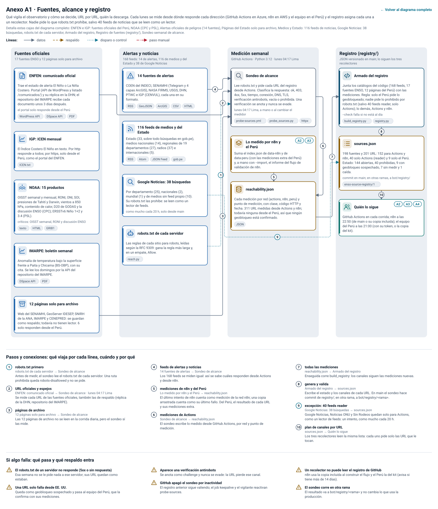

_In English: [anexos/a1-en.svg](anexos/a1-en.svg)._

A1 en texto: 15 pasos, 10 conexiones y 6 casos de falla

| Paso | Dónde | Qué hace | Tecnología |
|---|---|---|---|
| **ENFEN: comunicado oficial** | Fuentes oficiales | Trae el estado de alerta El Niño o La Niña Costero. Portal (API de WordPress y listado /comunicados/) y su réplica en la DHN; el repositorio del IMARPE recibe cada documento unos 3 días después. _el portal solo responde desde el Perú._ | WordPress API, DSpace API, PDF |
| **IGP: ICEN mensual** | Fuentes oficiales | El Índice Costero El Niño en texto. Por http responde a todos; por https, solo desde el Perú, como el portal del ENFEN. | ICEN.txt |
| **NOAA: 15 productos** | Fuentes oficiales | OISST semanal y mensual, RONI, ONI, SOI, presiones de Tahití y Darwin, vientos a 850 hPa, contenido de calor, D20 de GODAS y la discusión ENSO (CPC); ERSSTv6 Niño 1+2 y 3.4 (PSL). _críticos: OISST semanal, RONI y discusión ENSO._ | texto, HTML, GRIB1 |
| **IMARPE: boletín semanal** | Fuentes oficiales | Anomalía de temperatura bajo la superficie frente a Paita y Chicama (BS-OBP), con su cita. Se lee los domingos por la API del repositorio del IMARPE. | DSpace API, PDF |
| **12 páginas solo para archivo** | Fuentes oficiales | Web del SENAMHI, GeoServer IDESEP, SNIRH de la ANA, IMARPE y CENEPRED: se guardan como respaldo; todavía no tienen lector. 6 solo responden desde el Perú. |  |
| **14 fuentes de alertas** | Alertas y noticias | COEN del INDECI, SENAMHI (Telegram y 4 capas ArcGIS), NASA FIRMS, USGS, DHN, PTWC e IGP (CENVUL), cada una en su formato. | RSS, GeoJSON, ArcGIS, CSV, HTML |
| **116 feeds de medios y del Estado** | Alertas y noticias | Estado (33, sobre todo búsquedas en gob.pe), medios nacionales (14), regionales de 19 departamentos (27), radios (37) e internacionales (5). | RSS, Atom, JSON Feed, gob.pe |
| **Google Noticias: 38 búsquedas** | Alertas y noticias | Por departamento (25), nacionales (2), mundial (1) y de medios sin feed propio (10). Su robots.txt las prohíbe: se leen como un lector de feeds. _como mucho cada 20 h, solo desde main._ |  |
| **robots.txt de cada servidor** | Alertas y noticias | Las reglas de cada sitio para robots, leídas según la RFC 9309: gana la regla más larga y, en un empate, Allow. | reach.py |
| **Sondeo de alcance** | Medición semanal | Lee robots.txt y pide cada URL del registro desde Actions. Clasifica la respuesta: ok, 403, 4xx, 5xx, tiempo, conexión, DNS, TLS, verificación antirobots, vacía o prohibida. Una verificación se anota y nunca se evade. _lunes 04:17 Lima, a mano o al cambiar el medidor._ | probe-sources.yml, probe_sources.py, httpx |
| **Lo medido por n8n y el Perú** | Medición semanal | Suma el index.json de data-n8n y de data-peru (con las mediciones extra del Perú) y, a mano con --import, el informe del flujo de validación de n8n. Ver [A2](#a2), [A3](#a3). |  |
| **reachability.json** | Medición semanal | Cada medición por red (actions, n8n, peru) y punto de medición, con clase, código HTTP y fecha. 311 URL medidas desde Actions y n8n; todavía ninguna desde el Perú, así que ningún geobloqueo está confirmado. | JSON |
| **Armado del registro** | Registro (registry/) | Junta los catálogos del código (168 feeds, 17 fuentes ENSO, 12 páginas del Perú) con las mediciones. Regla: solo el Perú pide lo geobloqueado; nadie pide lo prohibido por robots.txt (salvo 40 feeds reader, solo Actions); lo demás, Actions y n8n. _--check falla si no está al día._ | build_registry.py, registry.py |
| **sources.json** | Registro (registry/) | 198 fuentes y 201 URL: 152 para Actions y n8n, 40 solo Actions (reader) y 9 solo el Perú. Estado: 144 abiertas, 40 prohibidas, 9 con geobloqueo sospechado, 7 sin medir y 1 caída. _commit en main; en otras ramas, a bot/registry/._ | enso-source-registry/1 |
| **Quién lo sigue** | Registro (registry/) | GitHub Actions en cada corrida; n8n a las 22:50 (de main o su copia incluida); el equipo del Perú a las 21:00 (con su token, o la copia del kit). Ver [A2](#a2), [A3](#a3), [A4](#a4). |  |

| N.º | De → a | Qué viaja, cuándo y por qué |
|---|---|---|
| 1 | robots.txt de cada servidor → Sondeo de alcance | **robots.txt primero.** Antes de medir, el sondeo lee el robots.txt de cada servidor. Una ruta prohibida queda robots-disallowed y no se pide. |
| 2 | ENFEN: comunicado oficial → Sondeo de alcance | **URL oficiales y espejos.** Se mide cada URL de las fuentes oficiales, también las de respaldo (réplica de la DHN, repositorio del IMARPE). _lunes 04:17 Lima._ |
| 3 | 12 páginas solo para archivo → Sondeo de alcance | **páginas de archivo.** Las 12 páginas de archivo no se leen en la corrida diaria, pero el sondeo sí las mide. |
| 4 | 14 fuentes de alertas → Sondeo de alcance | **feeds de alertas y noticias.** Los 168 feeds se miden igual: así se sabe cuáles responden desde Actions y desde n8n. |
| 5 | Lo medido por n8n y el Perú → reachability.json | **mediciones de n8n y del Perú.** El último intento de n8n cuenta como medición de la red n8n; una copia arrastrada cuenta como su último fallo. Del Perú, el resultado de cada URL y sus mediciones extra. |
| 6 | Sondeo de alcance → reachability.json | **mediciones de Actions.** El sondeo escribe lo medido desde GitHub Actions, por red y punto de medición. |
| 7 | reachability.json → Armado del registro | **todas las mediciones.** Enseguida corre build_registry: los canales siguen las mediciones nuevas. |
| 8 | Armado del registro → sources.json | **genera y valida.** Escribe el estado y los canales de cada URL. En main el sondeo hace commit de registry/; en otra rama, a bot/registry/&lt;rama>. |
| 9 | Google Noticias: 38 búsquedas → sources.json | **excepción: 40 feeds reader.** Google Noticias, Noticias ONU y Sin Rodeos quedan solo para Actions, como un lector de feeds: un intento, como mucho cada 20 h. |
| 10 | sources.json → Quién lo sigue | **plan de canales por URL.** Los tres recolectores leen la misma lista: cada uno pide solo las URL que le tocan. |

**Si algo falla:**

- **El robots.txt de un servidor no responde (5xx o sin respuesta).** Esa semana no se le pide nada a ese servidor; sus URL quedan como estaban.
- **Una URL solo falla desde EE. UU..** Queda como geobloqueo sospechado y pasa al equipo del Perú, que la confirma con sus mediciones.
- **Aparece una verificación antirobots.** Se anota como challenge y nunca se evade: la URL pierde ese canal.
- **GitHub apagó el sondeo por inactividad.** El registro anterior sigue valiendo; el job keepalive y el vigilante reactivan probe-sources.
- **Un recolector no puede leer el registro de GitHub.** n8n usa la copia incluida al construir el flujo y el Perú la del kit (avisa si tiene más de 14 días).
- **El sondeo corre en otra rama.** El resultado va a bot/registry/<rama> y no cambia lo que usa la producción.

#### Anexo A2 · Recolector en el Perú: el servidor local

Un programa en Python en una computadora dentro del Perú (Windows, macOS o Linux) baja cada noche lo que no responde fuera del país y lo sube a la rama data-peru. Una persona lo instala con el kit; si el equipo estuvo apagado, la recolección se recupera sola.

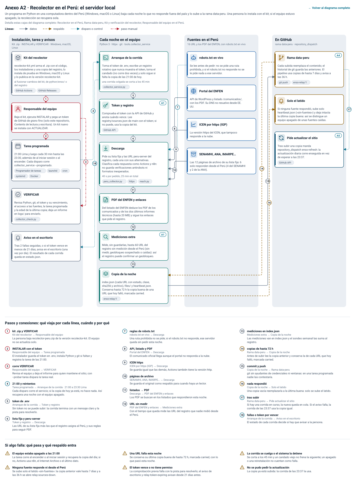

_In English: [anexos/a2-en.svg](anexos/a2-en.svg)._

A2 en texto: 18 pasos, 18 conexiones y 6 casos de falla

| Paso | Dónde | Qué hace | Tecnología |
|---|---|---|---|
| **Kit del recolector** | Instalación, tarea y avisos | recolector-kit.yml arma el .zip con el código, los instaladores y una copia del registro, lo instala de prueba en Windows, macOS y Linux y lo publica en la versión recolector-kit. _al fusionar cambios del kit, de python/enso/ o del registro._ | GitHub Actions, GitHub Releases |
| **Responsable del equipo** | Instalación, tarea y avisos | Baja el kit, ejecuta INSTALAR y pega un token de GitHub de grano fino (solo este repositorio, Contents de lectura y escritura). Un kit nuevo se instala con ACTUALIZAR. |  |
| **Tarea programada** | Instalación, tarea y avisos | 21:00 Lima y luego cada 30 min hasta las 23:30, además de al iniciar sesión o al encender. Cada disparo corre collector_service --programado. | Programador de tareas, launchd, cron, systemd, Docker |
| **VERIFICAR** | Instalación, tarea y avisos | Revisa Python, git, el token y su vencimiento, el acceso a las fuentes, la tarea programada y la edad de la última copia; deja un informe en logs/ para enviarlo. | collector_check.py |
| **Aviso en el escritorio** | Instalación, tarea y avisos | Tras 2 fallas seguidas, o si el token vence en menos de 21 días, avisa en el escritorio (una vez por día). El resultado de cada corrida queda en estado.json. |  |
| **Arranque de la corrida** | Cada noche en el equipo | Toma el token de .env, escribe un registro rotativo que nunca muestra el token, toma el candado (no corre dos veces) y solo sigue si falta la copia de las 21:00 de hoy. _una corrida colgada se corta a los 45 min._ | collector_service.py |
| **Token y registro** | Cada noche en el equipo | Comprueba el token con la API de GitHub y anota cuándo vence. Lee registry/sources.json de main con el token; si no puede, usa la copia del kit. Ver [A1](#a1). | GitHub API |
| **Descarga** | Cada noche en el equipo | Pide su lista fija y las URL peru-server del registro, cada una con sus alternativas. Clasifica cada respuesta como Actions y n8n: no guarda verificaciones antirobots ni formatos inesperados. _40 s por pedido, 25 min en total._ | peru_collector.py, httpx, reach.py |
| **PDF del ENFEN y enlaces** | Cada noche en el equipo | Del listado del ENFEN deduce los PDF de los comunicados y de los dos últimos informes técnicos (hasta 20 MB) y sigue los enlaces que pide el registro. |  |
| **Mediciones extra** | Cada noche en el equipo | Mide, sin guardarlas, hasta 60 URL del registro sin medición desde el Perú (sin medir, geobloqueo sospechado o caídas): así el registro puede confirmar un geobloqueo. Ver [A1](#a1). |  |
| **Copia de la noche** | Cada noche en el equipo | index.json (cada URL con estado, clase, sha256 y archivo), files/ y heartbeat.json. Conserva hasta 72 h la copia buena de una URL que hoy falló, marcada carried. | enso-relay/1 |
| **robots.txt en vivo** | Fuentes en el Perú | Se lee antes de pedir: no se pide una ruta prohibida, y si el robots.txt no responde no se le pide nada a ese servidor. |  |
| **Portal del ENFEN** | Fuentes en el Perú | API de WordPress y listado /comunicados/, con los PDF. Su DNS no resuelve desde EE. UU. |  |
| **ICEN por https (IGP)** | Fuentes en el Perú | La versión https del ICEN, que tampoco responde a la nube. |  |
| **SENAMHI, ANA, IMARPE…** | Fuentes en el Perú | Las 12 páginas de archivo de su lista fija: 6 solo responden desde el Perú (4 del SENAMHI y 2 de la ANA). |  |
| **Rama data-peru** | En GitHub | Cada subida reemplaza el contenido; el historial de git guarda las anteriores. El pipeline usa copias de hasta 7 días y avisa a las 36 h. Ver [A4](#a4). | git push, enso-relay/1 |
| **Solo el latido** | En GitHub | Si ninguna fuente respondió, sube solo heartbeat.json («sin-fuentes») y deja intacta la última copia buena: así se distingue un equipo apagado de unas fuentes caídas. |  |
| **Pide actualizar el sitio** | En GitHub | Tras subir una copia manda repository_dispatch enso-refresh: la actualización diaria corre enseguida en vez de esperar a las 23:37. Ver [A5](#a5). | GitHub API |

| N.º | De → a | Qué viaja, cuándo y por qué |
|---|---|---|
| 1 | Kit del recolector → Responsable del equipo | **kit .zip y VERIFICAR.** La persona baja recolector-peru.zip de la versión recolector-kit. El equipo no se actualiza solo. |
| 2 | Responsable del equipo → Tarea programada | **INSTALAR con el token.** El instalador guarda el token en .env, instala Python y git si faltan y registra la tarea de las 21:00. |
| 3 | Responsable del equipo → VERIFICAR | **corre VERIFICAR.** Revisa el equipo y deja el informe para quien mantiene el sitio; con --probar-tarea dispara la tarea real. |
| 4 | Tarea programada → Arranque de la corrida | **21:00 y reintentos.** Cada disparo corre el servicio; si la copia de hoy ya está, no hace nada. Así recupera una noche con el equipo apagado. _21:00 a 23:30 Lima._ |
| 5 | Arranque de la corrida → Token y registro | **token de .env.** Sin token no se puede subir: la corrida termina con un mensaje claro y la pista para resolverlo. |
| 6 | Token y registro → Descarga | **lista fija y peru-server.** Las URL de su lista fija más las que el registro asigna al Perú, y sus reglas para seguir PDF. |
| 7 | robots.txt en vivo → Descarga | **reglas de robots.txt.** Una ruta prohibida no se pide; si el robots.txt no responde, ese servidor queda sin pedir esta noche. |
| 8 | Portal del ENFEN → Descarga | **API, listado y PDF.** El comunicado oficial llega aunque el portal no responda a la nube. |
| 9 | ICEN por https (IGP) → Descarga | **ICEN https.** Se guarda igual que las demás; Actions también tiene la versión http. |
| 10 | SENAMHI, ANA, IMARPE… → Descarga | **páginas de archivo.** Se guarda el original como respaldo para cuando haya un lector. |
| 11 | Descarga → PDF del ENFEN y enlaces | **listados → PDF.** Los PDF se buscan en los listados que respondieron esta noche. |
| 12 | PDF del ENFEN y enlaces → Mediciones extra | **URL sin medir.** Con el tiempo que queda mide las URL del registro que nadie midió desde el Perú. |
| 13 | Mediciones extra → Copia de la noche | **mediciones en index.json.** Las mediciones van en index.json y el sondeo semanal las suma al registro. |
| 14 | Rama data-peru → Copia de la noche | **copias de hasta 72 h.** Antes de subir lee la copia anterior y conserva la de cada URL que hoy falló, marcada carried. |
| 15 | Copia de la noche → Rama data-peru | **commit y push.** git sin ayudantes de credenciales ni ventanas: en una tarea programada nadie las contestaría. |
| 16 | Copia de la noche → Solo el latido | **nada respondió.** Una copia vacía reemplazaría a la última buena: solo se sube el latido. |
| 17 | Rama data-peru → Pide actualizar el sitio | **tras subir.** Si hay una corrida en curso, la nueva queda en cola. Si el aviso falla, la corrida de las 23:37 usa la copia igual. |
| 18 | Arranque de la corrida → Aviso en el escritorio | **fallas o token por vencer.** El estado de cada corrida decide si hay que avisar a la persona. |

**Si algo falla:**

- **El equipo estaba apagado a las 21:00.** La tarea corre al encender o al iniciar sesión y recupera la copia del día; si no, Actions usa n8n, el Internet Archive o el último dato.
- **Ninguna fuente responde ni desde el Perú.** Se sube solo el latido «sin-fuentes»: la copia anterior vale hasta 7 días y a las 36 h se abre relay-sources-down.
- **Una URL falla esta noche.** Se conserva su última copia buena de hasta 72 h, marcada carried, con lo que pasó esta noche.
- **El token vence o no tiene permiso.** La comprobación previa falla con la pista para resolverlo; el aviso de escritorio y relay-token-expiring avisan desde 21 días antes.
- **La corrida se cuelga o el sistema la detiene.** Se corta a los 45 min y un candado viejo no frena la siguiente; un apagado o una reinstalación no cuentan como falla.
- **No se pudo pedir la actualización.** La copia ya está subida: la corrida de las 23:37 la usa.

#### Anexo A3 · n8n en la nube (AWS): segunda copia y flujos auxiliares

Cuatro flujos de n8n corren fuera de GitHub, en el n8n de un colega en AWS (EE. UU.). El recolector deja cada noche una segunda copia de todo lo que no está bloqueado ni prohibido, falle o no Actions; los otros vigilan el sitio, miden el alcance a pedido y ayudan a leer informes con un modelo de lenguaje. El código de cada nodo vive en el repositorio (n8n/) y se arma con build.mjs.

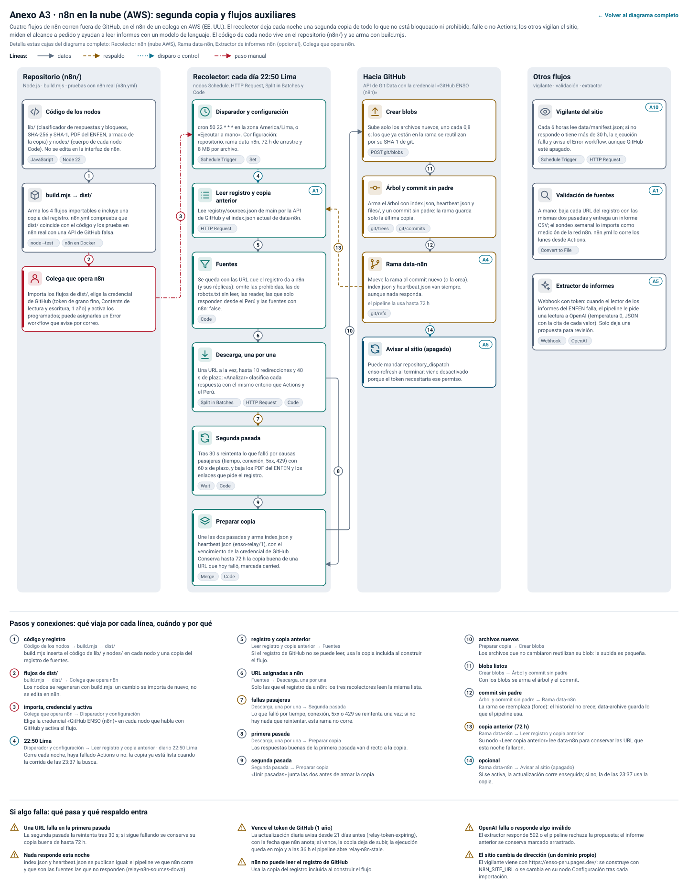

_In English: [anexos/a3-en.svg](anexos/a3-en.svg)._

A3 en texto: 16 pasos, 14 conexiones y 6 casos de falla

| Paso | Dónde | Qué hace | Tecnología |
|---|---|---|---|
| **Código de los nodos** | Repositorio (n8n/) | lib/ (clasificador de respuestas y bloqueos, SHA-256 y SHA-1, PDF del ENFEN, armado de la copia) y nodes/ (cuerpo de cada nodo Code). No se edita en la interfaz de n8n. | JavaScript, Node 22 |
| **build.mjs → dist/** | Repositorio (n8n/) | Arma los 4 flujos importables e incluye una copia del registro. n8n.yml comprueba que dist/ coincide con el código y los prueba en n8n real con una API de GitHub falsa. | node --test, n8n en Docker |
| **Colega que opera n8n** | Repositorio (n8n/) | Importa los flujos de dist/, elige la credencial de GitHub (token de grano fino, Contents de lectura y escritura, 1 año) y activa los programados; puede asignarles un Error workflow que avise por correo. |  |
| **Disparador y configuración** | Recolector: cada día 22:50 Lima | cron 50 22 * * * en la zona America/Lima, o «Ejecutar a mano». Configuración: repositorio, rama data-n8n, 72 h de arrastre y 8 MB por archivo. | Schedule Trigger, Set |
| **Leer registro y copia anterior** | Recolector: cada día 22:50 Lima | Lee registry/sources.json de main por la API de GitHub y el index.json actual de data-n8n. Ver [A1](#a1). | HTTP Request |
| **Fuentes** | Recolector: cada día 22:50 Lima | Se queda con las URL que el registro da a n8n (y sus réplicas): omite las prohibidas, las reader y las que solo responden desde el Perú. _152 URL._ | Code |
| **Descarga, una por una** | Recolector: cada día 22:50 Lima | Una URL a la vez, hasta 10 redirecciones y 40 s de plazo; «Analizar» clasifica cada respuesta con el mismo criterio que Actions y el Perú. | Split in Batches, HTTP Request, Code |
| **Segunda pasada** | Recolector: cada día 22:50 Lima | Tras 30 s reintenta lo que falló por causas pasajeras (tiempo, conexión, 5xx, 429) con 60 s de plazo, y baja los PDF del ENFEN y los enlaces que pide el registro. | Wait, Code |
| **Preparar copia** | Recolector: cada día 22:50 Lima | Une las dos pasadas y arma index.json y heartbeat.json (enso-relay/1). Conserva hasta 72 h la copia buena de una URL que hoy falló, marcada carried. | Merge, Code |
| **Crear blobs** | Hacia GitHub | Sube solo los archivos nuevos, uno cada 0,8 s; los que ya están en la rama se reutilizan por su SHA-1 de git. | POST git/blobs |
| **Árbol y commit sin padre** | Hacia GitHub | Arma el árbol con index.json, heartbeat.json y files/, y un commit sin padre: la rama guarda solo la última copia. | git/trees, git/commits |
| **Rama data-n8n** | Hacia GitHub | Mueve la rama al commit nuevo (o la crea). index.json y heartbeat.json van siempre, aunque nada responda. _el pipeline la usa hasta 72 h._ Ver [A4](#a4). | git/refs |
| **Avisar al sitio (apagado)** | Hacia GitHub | Puede mandar repository_dispatch enso-refresh al terminar; viene desactivado porque el token necesitaría ese permiso. Ver [A5](#a5). |  |
| **Vigilante del sitio** | Otros flujos | Cada 6 horas lee data/manifest.json; si no responde o tiene más de 30 h, la ejecución falla y avisa el Error workflow, aunque GitHub esté apagado. Ver [A10](#a10). | Schedule Trigger, HTTP Request |
| **Validación de fuentes** | Otros flujos | A mano: baja cada URL del registro con las mismas dos pasadas y entrega un informe CSV; el sondeo semanal lo importa como medición de la red n8n. n8n.yml lo corre los lunes desde Actions. Ver [A1](#a1). | Convert to File |
| **Extractor de informes** | Otros flujos | Webhook con token: cuando el lector de los informes del ENFEN falla, el pipeline le pide una lectura a OpenAI (temperatura 0, JSON con la cita de cada valor). Solo deja una propuesta para revisión. Ver [A5](#a5). | Webhook, OpenAI |

| N.º | De → a | Qué viaja, cuándo y por qué |
|---|---|---|
| 1 | Código de los nodos → build.mjs → dist/ | **código y registro.** build.mjs inserta el código de lib/ y nodes/ en cada nodo y una copia del registro de fuentes. |
| 2 | build.mjs → dist/ → Colega que opera n8n | **flujos de dist/.** Los nodos se regeneran con build.mjs: un cambio se importa de nuevo, no se edita en n8n. |
| 3 | Colega que opera n8n → Disparador y configuración | **importa, credencial y activa.** Elige la credencial «GitHub ENSO (n8n)» en cada nodo que habla con GitHub y activa el flujo. |
| 4 | Disparador y configuración → Leer registro y copia anterior | **22:50 Lima.** Corre cada noche, haya fallado Actions o no: la copia ya está lista cuando la corrida de las 23:37 la busca. _diario 22:50 Lima._ |
| 5 | Leer registro y copia anterior → Fuentes | **registro y copia anterior.** Si el registro de GitHub no se puede leer, usa la copia incluida al construir el flujo. |
| 6 | Fuentes → Descarga, una por una | **URL asignadas a n8n.** Solo las que el registro da a n8n: los tres recolectores leen la misma lista. |
| 7 | Descarga, una por una → Segunda pasada | **fallas pasajeras.** Lo que falló por tiempo, conexión, 5xx o 429 se reintenta una vez; si no hay nada que reintentar, esta rama no corre. |
| 8 | Descarga, una por una → Preparar copia | **primera pasada.** Las respuestas buenas de la primera pasada van directo a la copia. |
| 9 | Segunda pasada → Preparar copia | **segunda pasada.** «Unir pasadas» junta las dos antes de armar la copia. |
| 10 | Preparar copia → Crear blobs | **archivos nuevos.** Los archivos que no cambiaron reutilizan su blob: la subida es pequeña. |
| 11 | Crear blobs → Árbol y commit sin padre | **blobs listos.** Con los blobs se arma el árbol y el commit. |
| 12 | Árbol y commit sin padre → Rama data-n8n | **commit sin padre.** La rama se reemplaza (force): el historial no crece; data-archive guarda lo que el pipeline usa. |
| 13 | Rama data-n8n → Leer registro y copia anterior | **copia anterior (72 h).** Su nodo «Leer copia anterior» lee data-n8n para conservar las URL que esta noche fallaron. |
| 14 | Rama data-n8n → Avisar al sitio (apagado) | **opcional.** Si se activa, la actualización corre enseguida; si no, la de las 23:37 usa la copia. |

**Si algo falla:**

- **Una URL falla en la primera pasada.** La segunda pasada la reintenta tras 30 s; si sigue fallando se conserva su copia buena de hasta 72 h.
- **Nada responde esta noche.** index.json y heartbeat.json se publican igual: el pipeline ve que n8n corre y que son las fuentes las que no responden (relay-n8n-sources-down).
- **Vence el token de GitHub (1 año).** La copia deja de subir y la ejecución queda en rojo; a las 36 h el pipeline abre relay-n8n-stale. n8n no avisa antes.
- **n8n no puede leer el registro de GitHub.** Usa la copia del registro incluida al construir el flujo.
- **OpenAI falla o responde algo inválido.** El extractor responde 502 o el pipeline rechaza la propuesta; el informe anterior se conserva marcado arrastrado.
- **El sitio pasa a Cloudflare.** El vigilante tiene la dirección fija: hay que cambiarla a mano en su nodo Configuración.

#### Anexo A4 · Descarga en GitHub Actions y respaldo por fuente

Cómo la actualización diaria consigue cada dato: sigue el registro, pide la URL oficial desde servidores de GitHub en EE. UU. y, si no responde, baja una escalera de respaldos hasta el último dato bueno ya publicado. Cada respuesta queda con su canal, URL, fecha y sha256.

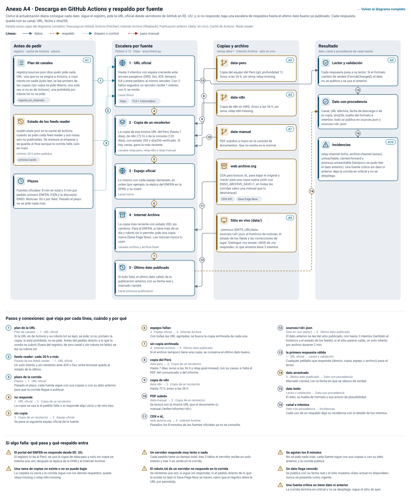

_In English: [anexos/a4-en.svg](anexos/a4-en.svg)._

A4 en texto: 16 pasos, 16 conexiones y 6 casos de falla

| Paso | Dónde | Qué hace | Tecnología |
|---|---|---|---|
| **Plan de canales** | Antes de pedir | registry/sources.json dice quién pide cada URL: una que no se asigna a Actions se lee primero de las copias (sin copia, un solo intento directo); una prohibida por robots.txt no se pide. Ver [A1](#a1). | registry.url_channels |
| **Estado de los feeds reader** | Antes de pedir | reader-state.json en la caché de Actions: cuándo se pidió cada uno de los 40 feeds reader y sus notas aún no publicadas. Se restaura al empezar y se guarda al final aunque la corrida falle; solo en main. _mínimo 20 h entre pedidos._ | actions/cache |
| **Plazos** | Antes de pedir | Fuentes oficiales: 8 min en total y 5 min por pedido; primero ENFEN, ICEN y la discusión ENSO. Noticias: 60 s por feed. Pasado el plazo no se pide nada más. |  |
| **1 · URL oficial** | Escalera por fuente | Hasta 3 intentos con espera creciente ante errores pasajeros (DNS, 5xx, 429, tiempo); 0,8 s entre pedidos al mismo servidor. Con 3 fallos seguidos un servidor recibe 1 intento; con 5, se omite. _canal direct._ | httpx, TLS + intermedios |
| **2 · Copia de un recolector** | Escalera por fuente | La copia de esa misma URL del Perú (hasta 7 días), de n8n (72 h) o de la consola (120 días), con estado 200 y sha256 verificado. Si hay varias, gana la más reciente. _canales relay-peru, relay-n8n y relay-manual._ |  |
| **3 · Espejo oficial** | Escalera por fuente | Lo mismo con cada espejo declarado, en orden (por ejemplo, la réplica del ENFEN en la DHN), y su copia. _canal mirror._ |  |
| **4 · Internet Archive** | Escalera por fuente | La copia más reciente con estado 200, sin cambios. Para el ENFEN, si tiene más de un día, pide una copia nueva (Save Page Now). Las noticias nunca lo usan. _canales archive y archive-fresh._ |  |
| **5 · Último dato publicado** | Escalera por fuente | Si todo falla, el último dato válido de la publicación anterior, con su fecha real y marcado carried. _canal previous-publication._ |  |
| **data-peru** | Copias y archivo | Copia del equipo del Perú (git, profundidad 1). Aviso a las 36 h; sin rama, relay-missing. Ver [A2](#a2). |  |
| **data-n8n** | Copias y archivo | Copia de n8n en AWS. Aviso a las 36 h; sin rama, relay-n8n-missing. Ver [A3](#a3). |  |
| **data-manual** | Copias y archivo | PDF subidos a mano en la consola de documentos. Que no exista es lo normal. Ver [A7](#a7). |  |
| **web.archive.org** | Copias y archivo | CDX para buscar, id_ para bajar el original y /save/ para una copia nueva (solo con ENSO_ARCHIVE_SAVE=1, en todas las corridas salvo una manual que lo desmarque). | CDX API, Save Page Now |
| **Sitio en vivo (data/)** | Copias y archivo | --previous ${SITE_URL}data: sources/&lt;id>.json, el histórico de noticias, el estado de los feeds y las correcciones de lugar. Distingue «no existe» (404) de «no responde». Ver [A9](#a9). |  |
| **Lector y validación** | Resultado | Cada respuesta pasa a su lector. Si el formato cambió de verdad (FormatChanged), el dato no se publica y se usa el anterior. Ver [A5](#a5). |  |
| **Dato con procedencia** | Resultado | Canal, URL efectiva, fecha de descarga o de la copia, sha256, huella del formato e intentos: todo se publica en sources.json y sources/&lt;id>.json. |  |
| **Incidencias** | Resultado | relay-channel (info), archive-channel (aviso), unreachable y carried-forward. Una fuente crítica sin dato ni anterior deja la corrida en critical y no se despliega. Ver [A10](#a10). |  |

| N.º | De → a | Qué viaja, cuándo y por qué |
|---|---|---|
| 1 | Plan de canales → 1 · URL oficial | **plan de la URL.** Si la URL es de Actions se pide; si no, primero la copia; si está prohibida, no se pide. |
| 2 | Estado de los feeds reader → 1 · URL oficial | **feeds reader: cada 20 h o más.** Un solo intento y sin reintento ante 429 o 5xx; entre lecturas queda el estado de la última. |
| 3 | Plazos → 1 · URL oficial | **plazo de la corrida.** Pasado el plazo, cada fuente sigue con sus copias o con su dato anterior, para que la corrida llegue a publicar. |
| 4 | 1 · URL oficial → 2 · Copia de un recolector | **no responde.** La copia se usa si el pedido falla o si responde algo vacío o de otro tipo. |
| 5 | 2 · Copia de un recolector → 3 · Espejo oficial | **sin copia.** Se pasa al siguiente espejo oficial de la fuente. |
| 6 | 3 · Espejo oficial → 4 · Internet Archive | **espejos fallan.** Con todas las URL agotadas, se busca la copia archivada de cada una. |
| 7 | 4 · Internet Archive → 5 · Último dato publicado | **sin copia archivada.** Si el archivo tampoco tiene una copia, se conserva el último dato bueno. |
| 8 | data-peru → 2 · Copia de un recolector | **copia del Perú.** Hasta 7 días; aviso a las 36 h y relay-goal-missed si falta el PDF del comunicado o del informe. |
| 9 | data-n8n → 2 · Copia de un recolector | **copia de n8n.** Hasta 72 h; aviso a las 36 h. |
| 10 | data-manual → 2 · Copia de un recolector | **PDF subido.** Se busca con la misma URL que el documento (o manual://enfen-informe/&lt;id>). |
| 11 | web.archive.org → 4 · Internet Archive | **CDX e id_.** Pasados los 8 minutos de las fuentes oficiales ya no se consulta. |
| 12 | Sitio en vivo (data/) → 5 · Último dato publicado | **sources/&lt;id>.json.** El dato anterior se lee del sitio publicado; hasta 3 intentos para el histórico y el estado de los feeds. |
| 13 | 1 · URL oficial → Lector y validación | **la primera respuesta válida.** Cualquier peldaño que responda (directo, copia, espejo o archivo) pasa al lector. |
| 14 | 5 · Último dato publicado → Dato con procedencia | **dato arrastrado.** Marcado carried, con la fecha en que se obtuvo de verdad. |
| 15 | Lector y validación → Dato con procedencia | **dato leído.** El dato, su huella de formato y sus avisos de plausibilidad. |
| 16 | Dato con procedencia → Incidencias | **canal e intentos.** Cada uso de un respaldo deja su incidencia con el detalle de los intentos. |

**Si algo falla:**

- **El portal del ENFEN no responde desde EE. UU..** El registro lo da al Perú: se usa la copia de data-peru y solo sin copia se intenta una vez; después la réplica de la DHN y el Internet Archive.
- **Una rama de copias no existe o no se puede bajar.** La carpeta va vacía y la corrida sigue con los demás respaldos; queda relay-missing o relay-n8n-missing.
- **Un servidor responde muy lento o nada.** Cada pedido tiene un tiempo total; tras 3 fallos el servidor recibe un solo intento y tras 5 se omite en la corrida.
- **Se agotan los 8 minutos.** No se pide nada más: cada fuente sigue con sus copias o con su dato anterior, y la corrida publica.
- **Un dato llega vencido.** Se publica con su fecha real y el sitio muestra «Dato actual no disponible»: nunca se presenta como vigente.
- **Una fuente crítica no tiene dato ni anterior.** La corrida termina en critical y no se despliega: sigue el sitio de ayer.

#### Anexo A5 · Actualización diaria: fuentes oficiales, series y señales

observatory.yml corre el pipeline de Python (python -m enso.observatory) cada noche a las 23:37 Lima y cada vez que alguien lo pide. Lee cada fuente oficial, valida, arma las series y los estados y anota cada problema. Las noticias y los lugares están en el anexo A6; la publicación, en el A8.

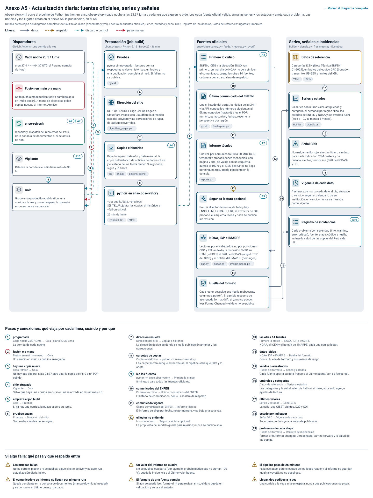

_In English: [anexos/a5-en.svg](anexos/a5-en.svg)._

A5 en texto: 20 pasos, 19 conexiones y 6 casos de falla

| Paso | Dónde | Qué hace | Tecnología |
|---|---|---|---|
| **Cada noche 23:37 Lima** | Disparadores | cron 37 4 * * * (04:37 UTC; el Perú no cambia de hora). |  |
| **Fusión en main o a mano** | Disparadores | Cada push a main publica (salvo cambios solo en .md o docs/). A mano se elige si se piden copias nuevas al Internet Archive. |  |
| **enso-refresh** | Disparadores | repository_dispatch del recolector del Perú, de la consola de documentos o, si se activa, de n8n. Ver [A2](#a2), [A7](#a7). |  |
| **Vigilante** | Disparadores | Relanza la corrida si el sitio tiene más de 30 h. Ver [A10](#a10). |  |
| **Cola** | Disparadores | Grupo enso-production-publication: una corrida a la vez y una en espera; la que está en curso nunca se cancela. |  |
| **Pruebas** | Preparación (job build) | pytest sin navegador: lectores contra respuestas reales e históricas, umbrales y una publicación completa sin red. Si fallan, no se publica. | pytest |
| **Dirección del sitio** | Preparación (job build) | DEPLOY_TARGET elige GitHub Pages o Cloudflare Pages; con Cloudflare la dirección sale del proyecto y las correcciones de lugar, de /api/geo/overrides. | cloudflare_pages.py |
| **Copias e histórico** | Preparación (job build) | Baja data-peru, data-n8n y data-manual, la copia del histórico de noticias de data-archive y el estado de los feeds reader. Si algo falta, sigue y lo anota. Ver [A4](#a4). | git, gh api, actions/cache |
| **python -m enso.observatory** | Preparación (job build) | --out public/data, --previous ${SITE_URL}data, las copias, el histórico y --fail-on critical. _26 min de límite._ | Python 3.12, httpx |
| **Primero lo crítico** | Fuentes oficiales | ENFEN, ICEN y la discusión ENSO van primero: un mal día de NOAA no deja sin leer el comunicado. Luego las otras 14 fuentes, cada una con su escalera de respaldo. Ver [A4](#a4). |  |
| **Último comunicado del ENFEN** | Fuentes oficiales | Une el listado del portal, la réplica de la DHN y la API; sondea los números siguientes al último conocido (hasta 6) y lee el PDF: número, estado, nivel, fechas, resumen y perspectiva por región. | pypdf, feeds/peru.py |
| **Informe técnico** | Fuentes oficiales | Una vez por comunicado (10 a 20 MB): ICEN temporal y probabilidades mensuales, con página y cita. Se valida con un esquema, sumas al 100 % y el ICEN del IGP; si no llega por ninguna ruta, queda pendiente en la consola. Ver [A7](#a7). | reports.py |
| **Segunda lectura opcional** | Fuentes oficiales | Solo si el lector determinista falla y hay ENSO_LLM_EXTRACT_URL: el extractor de n8n propone, el esquema revisa y nada se publica sin revisión. Ver [A3](#a3). |  |
| **NOAA, IGP e IMARPE** | Fuentes oficiales | Lectores por encabezados, no por posiciones: CPC y PSL en texto, la discusión ENSO en HTML, el ICEN, el D20 de GODAS (rango HTTP del GRIB) y el boletín del IMARPE (domingos). | cpc.py, godas.py, imarpe_bsobp.py |
| **Huella del formato** | Fuentes oficiales | Cada lector devuelve una huella (cabeceras, columnas, patrón). Si cambia respecto de ayer queda format-drift; si ya no se puede leer, FormatChanged y el dato no se publica. |  |
| **Datos de referencia** | Series, señales e incidencias | Categorías ICEN (Nota Técnica ENFEN 01-2024), umbrales del equipo GRD (borrador transcrito), UBIGEO y límites del IGN. | YAML, JSON |
| **Series y estados** | Series, señales e incidencias | 23 series con último valor, antigüedad y categoría, el semanal por región Niño, los estados de ENFEN y NOAA y los eventos ICEN (+0,5 o −0,7 al menos 3 meses). | Builder, signals.py |
| **Señal GRD** | Series, señales e incidencias | Normal, amarillo, rojo, sin clasificar o sin dato para cada indicador: TSM costera y de cuenca, vientos, termoclina (D20 de GODAS) y SOI. |  |
| **Vigencia de cada dato** | Series, señales e incidencias | freshness.py marca cada dato al día, atrasado o vencido según el calendario de su institución; un vencido nunca se muestra como vigente. |  |
| **Registro de incidencias** | Series, señales e incidencias | Cada problema con severidad (info, warning, error, critical), fuente, etapa, código y huella; incluye la salud de las copias del Perú y de n8n. Ver [A10](#a10). |  |

| N.º | De → a | Qué viaja, cuándo y por qué |
|---|---|---|
| 1 | Cada noche 23:37 Lima → Cola | **programada.** La corrida de cada noche. _diario 23:37 Lima._ |
| 2 | Fusión en main o a mano → Cola | **fusión o a mano.** Un cambio en main se publica enseguida. |
| 3 | enso-refresh → Cola | **hay una copia nueva.** No hay que esperar a las 23:37 para usar la copia del Perú o un PDF subido. |
| 4 | Vigilante → Cola | **sitio atrasado.** Salvo que haya una corrida en curso o una relanzada en las últimas 6 h. |
| 5 | Cola → Pruebas | **empieza el job build.** Si ya hay una corrida, la nueva espera su turno. |
| 6 | Pruebas → Dirección del sitio | **pruebas pasan.** Sin pruebas verdes no se sigue. |
| 7 | Dirección del sitio → Copias e histórico | **dirección resuelta.** La dirección decide de dónde se lee la publicación anterior y las correcciones. |
| 8 | Copias e histórico → python -m enso.observatory | **carpetas de copias.** Las carpetas van aunque estén vacías: el pipeline sabe qué falta y lo anota. |
| 9 | python -m enso.observatory → Primero lo crítico | **lee las fuentes.** 8 minutos para todas las fuentes oficiales. |
| 10 | Primero lo crítico → Último comunicado del ENFEN | **comunicados del ENFEN.** El listado de comunicados, con su escalera de respaldo. |
| 11 | Último comunicado del ENFEN → Informe técnico | **comunicado vigente.** El informe se elige por fecha, no por número, y se baja una sola vez. |
| 12 | Informe técnico → Segunda lectura opcional | **el lector no entiende.** La propuesta del modelo queda para revisión; nunca se publica sola. |
| 13 | Primero lo crítico → NOAA, IGP e IMARPE | **las otras 14 fuentes.** NOAA, el ICEN y el boletín del IMARPE, cada una con su lector. |
| 14 | NOAA, IGP e IMARPE → Huella del formato | **datos leídos.** Con su huella de formato y sus avisos de rango. |
| 15 | Huella del formato → Series y estados | **válidos o arrastrados.** Cada fuente aporta su dato fresco o el último bueno, con su fecha real. |
| 16 | Datos de referencia → Series y estados | **umbrales y categorías.** Las categorías y la señal salen de Python; el navegador solo agrega ayudas de lectura. |
| 17 | Series y estados → Señal GRD | **últimos valores.** La señal usa OISST, vientos, D20 y SOI. |
| 18 | Señal GRD → Vigencia de cada dato | **estado por indicador.** Todo pasa por la vigencia antes de publicarse. |
| 19 | Huella del formato → Registro de incidencias | **problemas de cada etapa.** format-drift, format-changed, unreachable, carried-forward y la salud de las copias. |

**Si algo falla:**

- **Las pruebas fallan.** No se corre el pipeline ni se publica; sigue el sitio de ayer y se abre «La actualización diaria falló».
- **El comunicado o su informe no llegan por ninguna ruta.** Queda pendiente en la consola de documentos (manual-download-needed) y se conserva el último bueno, marcado.
- **Un valor del informe no cuadra.** No se publica esa parte (por ejemplo, probabilidades que no suman 100 %); queda la incidencia y el último valor bueno.
- **El formato de una fuente cambia.** Si aún se puede leer, format-drift para revisar; si no, el dato queda en validación y se usa el anterior.
- **El pipeline pasa de 26 minutos.** Falla ese paso, pero el estado de los feeds reader y el informe se guardan igual (always()); no se despliega.
- **Llegan dos pedidos a la vez.** Una corrida a la vez y una en espera: nunca dos publicaciones se pisan.

#### Anexo A6 · Noticias y alertas: lectura, filtro, histórico y lugar

Cada corrida lee 168 feeds, se queda con las notas sobre El Niño o sobre un peligro en el Perú, las suma a un histórico que nunca borra y ubica cada una en su departamento, provincia y distrito. Los revisores corrigen el lugar en la consola (anexo A7).

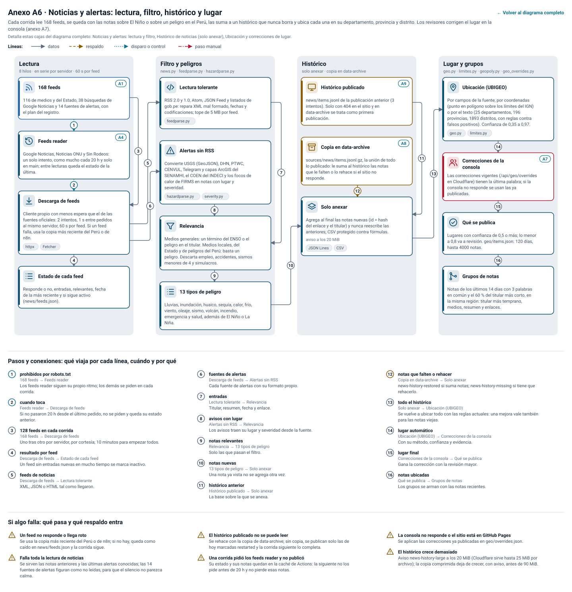

_In English: [anexos/a6-en.svg](anexos/a6-en.svg)._

A6 en texto: 15 pasos, 16 conexiones y 6 casos de falla

| Paso | Dónde | Qué hace | Tecnología |
|---|---|---|---|
| **168 feeds** | Lectura | 116 de medios y del Estado, 38 búsquedas de Google Noticias y 14 fuentes de alertas, con el plan del registro. Ver [A1](#a1). |  |
| **Feeds reader** | Lectura | Google Noticias, Noticias ONU y Sin Rodeos: un solo intento, como mucho cada 20 h y solo en main; entre lecturas queda el estado de la última. Ver [A4](#a4). |  |
| **Descarga de feeds** | Lectura | Cliente propio con menos espera que el de las fuentes oficiales: 2 intentos, 1 s entre pedidos al mismo servidor, 60 s por feed. Si un feed falla, usa la copia más reciente del Perú o de n8n. | httpx, Fetcher |
| **Estado de cada feed** | Lectura | Responde o no, entradas, relevantes, fecha de la más reciente y si sigue activo (news/feeds.json). |  |
| **Lectura tolerante** | Filtro y peligros | RSS 2.0 y 1.0, Atom, JSON Feed y listados de gob.pe: repara XML mal formado, fechas y codificaciones; tope de 5 MB por feed. | feedparse.py |
| **Alertas sin RSS** | Filtro y peligros | Convierte USGS (GeoJSON), DHN, PTWC, CENVUL, Telegram y capas ArcGIS del SENAMHI, el COEN del INDECI y los focos de calor de FIRMS en notas con lugar y severidad. | hazardparse.py, severity.py |
| **Relevancia** | Filtro y peligros | Medios generales: un término del ENSO o el peligro en el titular. Medios locales, del Estado y de peligros del Perú: basta un peligro. Descarta empleo, accidentes, sismos menores de 4 y simulacros. |  |
| **13 tipos de peligro** | Filtro y peligros | Lluvias, inundación, huaico, sequía, calor, frío, viento, oleaje, sismo, volcán, incendio, emergencia y salud, además de El Niño o La Niña. |  |
| **Histórico publicado** | Histórico | news/items.jsonl de la publicación anterior (3 intentos). Solo con 404 en el sitio y en data-archive se trata como primera publicación. Ver [A9](#a9). |  |
| **Copia en data-archive** | Histórico | sources/news/items.jsonl.gz, la unión de todo lo publicado: le suma al histórico las notas que le falten o lo rehace si el sitio no responde. Ver [A8](#a8). |  |
| **Solo anexar** | Histórico | Agrega al final las notas nuevas (id = hash del enlace y el titular) y nunca reescribe las anteriores; CSV protegido contra fórmulas. _aviso a los 20 MiB._ | JSON Lines, CSV |
| **Ubicación (UBIGEO)** | Lugar y grupos | Por campos de la fuente, por coordenadas (punto en polígono sobre los límites del IGN) o por el texto (25 departamentos, 196 provincias, 1893 distritos, con reglas contra falsos positivos). Confianza de 0,35 a 0,97. | geo.py, limites.py |
| **Correcciones de la consola** | Lugar y grupos | Las correcciones vigentes (/api/geo/overrides en Cloudflare) tienen la última palabra; si la consola no responde se usan las ya publicadas. Ver [A7](#a7). |  |
| **Qué se publica** | Lugar y grupos | Lugares con confianza de 0,5 o más; lo menor a 0,8 va a revisión. geo/items.json: 120 días, hasta 4000 notas. |  |
| **Grupos de notas** | Lugar y grupos | Notas de los últimos 14 días con 3 palabras en común y el 60 % del titular más corto, en la misma región: titular más temprano, medios, resumen y enlaces. |  |

| N.º | De → a | Qué viaja, cuándo y por qué |
|---|---|---|
| 1 | 168 feeds → Feeds reader | **40 prohibidos por robots.txt.** Los feeds reader siguen su propio ritmo; los demás se piden en cada corrida. |
| 2 | Feeds reader → Descarga de feeds | **cuando toca.** Si no pasaron 20 h desde el último pedido, no se piden y queda su estado anterior. |
| 3 | 168 feeds → Descarga de feeds | **128 feeds en cada corrida.** Uno tras otro por servidor, por cortesía; 10 minutos para empezar todos. |
| 4 | Descarga de feeds → Estado de cada feed | **resultado por feed.** Un feed sin entradas nuevas en mucho tiempo se marca inactivo. |
| 5 | Descarga de feeds → Lectura tolerante | **feeds de noticias.** XML, JSON o HTML tal como llegaron. |
| 6 | Descarga de feeds → Alertas sin RSS | **fuentes de alertas.** Cada fuente de alertas con su formato propio. |
| 7 | Lectura tolerante → Relevancia | **entradas.** Titular, resumen, fecha y enlace. |
| 8 | Alertas sin RSS → Relevancia | **avisos con lugar.** Los avisos traen su lugar y severidad desde la fuente. |
| 9 | Relevancia → 13 tipos de peligro | **notas relevantes.** Solo las que pasan el filtro. |
| 10 | 13 tipos de peligro → Solo anexar | **notas nuevas.** Una nota ya vista no se agrega otra vez. |
| 11 | Histórico publicado → Solo anexar | **histórico anterior.** La base sobre la que se anexa. |
| 12 | Copia en data-archive → Solo anexar | **notas que falten o rehacer.** news-history-restored si suma notas; news-history-missing si tiene que rehacerlo. |
| 13 | Solo anexar → Ubicación (UBIGEO) | **todo el histórico.** Se vuelve a ubicar todo con las reglas actuales: una mejora vale también para las notas viejas. |
| 14 | Ubicación (UBIGEO) → Correcciones de la consola | **lugar automático.** Con su método, confianza y evidencia. |
| 15 | Correcciones de la consola → Qué se publica | **lugar final.** Gana la corrección con la revisión mayor. |
| 16 | Qué se publica → Grupos de notas | **notas ubicadas.** Los grupos se arman con las notas recientes. |

**Si algo falla:**

- **Un feed no responde o llega roto.** Se usa la copia más reciente del Perú o de n8n; si no hay, queda como caído en news/feeds.json y la corrida sigue.
- **Falla toda la lectura de noticias.** Se sirven las notas anteriores y las últimas alertas conocidas; las 14 fuentes de alertas figuran como no leídas, para que el silencio no parezca calma.
- **El histórico publicado no se puede leer.** Se rehace con la copia de data-archive; sin copia, se publican solo las de hoy marcadas restarted y la corrida siguiente lo completa.
- **Una corrida pidió los feeds reader y no publicó.** Su estado y sus notas quedan en la caché de Actions: la siguiente no los pide antes de 20 h y no pierde esas notas.
- **La consola no responde o el sitio está en GitHub Pages.** Se aplican las correcciones ya publicadas en geo/overrides.json.
- **El histórico crece demasiado.** Aviso news-history-large a los 20 MiB (Cloudflare sirve hasta 25 MiB por archivo); la copia comprimida deja de crecer, con aviso, antes de 90 MiB.

#### Anexo A7 · Consolas de revisión en Cloudflare

Dos páginas para personas autorizadas, servidas por el mismo sitio: la consola de lugares, donde se confirma o corrige el lugar de cada nota, y la de documentos, donde un administrador sube el PDF que ninguna ruta automática trae. Sus API son Pages Functions de Cloudflare con una base D1; nada de esto corre en GitHub Pages.

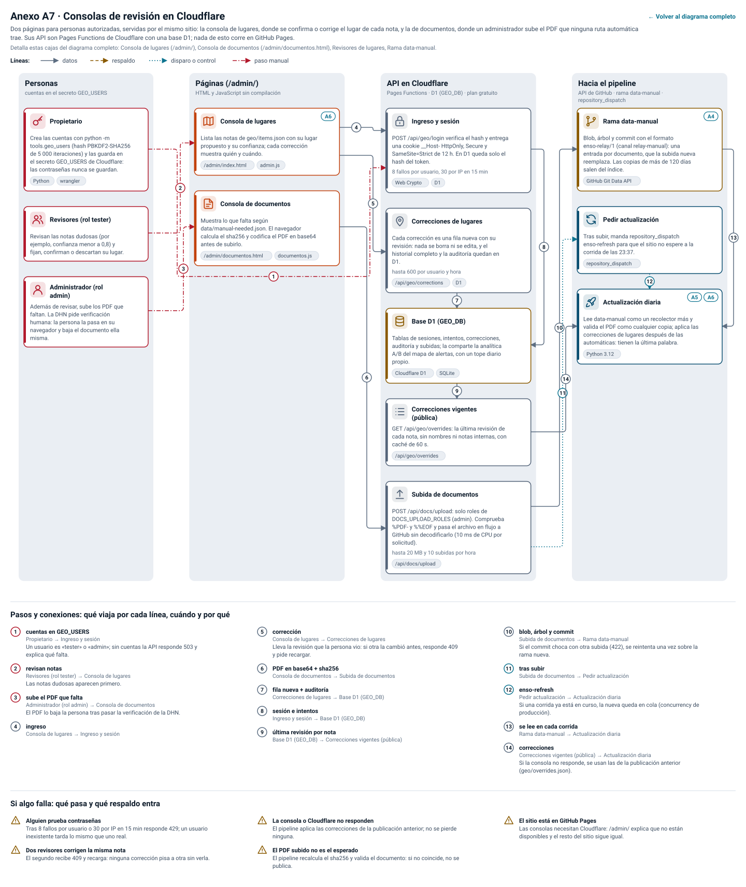

_In English: [anexos/a7-en.svg](anexos/a7-en.svg)._

A7 en texto: 13 pasos, 14 conexiones y 5 casos de falla

| Paso | Dónde | Qué hace | Tecnología |
|---|---|---|---|
| **Propietario** | Personas | Crea las cuentas con python -m tools.geo_users (hash PBKDF2-SHA256 de 5 000 iteraciones) y las guarda en el secreto GEO_USERS de Cloudflare: las contraseñas nunca se guardan. | Python, wrangler |
| **Revisores (rol tester)** | Personas | Revisan las notas dudosas (por ejemplo, confianza menor a 0,8) y fijan, confirman o descartan su lugar. |  |
| **Administrador (rol admin)** | Personas | Además de revisar, sube los PDF que faltan. La DHN pide verificación humana: la persona la pasa en su navegador y baja el documento ella misma. |  |
| **Consola de lugares** | Páginas (/admin/) | Lista las notas de geo/items.json con su lugar propuesto y su confianza; cada corrección muestra quién y cuándo. Ver [A6](#a6). | /admin/index.html, admin.js |
| **Consola de documentos** | Páginas (/admin/) | Muestra lo que falta según data/manual-needed.json. El navegador calcula el sha256 y codifica el PDF en base64 antes de subirlo. | /admin/documentos.html, documentos.js |
| **Ingreso y sesión** | API en Cloudflare | POST /api/geo/login verifica el hash y entrega una cookie __Host- HttpOnly, Secure y SameSite=Strict de 12 h. En D1 queda solo el hash del token. _8 fallos por usuario, 30 por IP en 15 min._ | Web Crypto, D1 |
| **Correcciones de lugares** | API en Cloudflare | Cada corrección es una fila nueva con su revisión: nada se borra ni se edita, y el historial completo y la auditoría quedan en D1. _hasta 600 por usuario y hora._ | /api/geo/corrections, D1 |
| **Base D1 (GEO_DB)** | API en Cloudflare | Tablas de sesiones, intentos, correcciones, auditoría y subidas; la comparte la analítica A/B del mapa de alertas, con un tope diario propio. | Cloudflare D1, SQLite |
| **Correcciones vigentes (pública)** | API en Cloudflare | GET /api/geo/overrides: la última revisión de cada nota, sin nombres ni notas internas, con caché de 60 s. | /api/geo/overrides |
| **Subida de documentos** | API en Cloudflare | POST /api/docs/upload: solo roles de DOCS_UPLOAD_ROLES (admin). Comprueba %PDF- y %%EOF y pasa el archivo en flujo a GitHub sin decodificarlo (10 ms de CPU por solicitud). _hasta 25 MB y 10 subidas por hora._ | /api/docs/upload |
| **Rama data-manual** | Hacia el pipeline | Blob, árbol y commit con el formato enso-relay/1 (canal relay-manual): una entrada por documento, que la subida nueva reemplaza. Las copias de más de 120 días salen del índice. Ver [A4](#a4). | GitHub Git Data API |
| **Pedir actualización** | Hacia el pipeline | Tras subir, manda repository_dispatch enso-refresh para que el sitio no espere a la corrida de las 23:37. | repository_dispatch |
| **Actualización diaria** | Hacia el pipeline | Lee data-manual como un recolector más y valida el PDF como cualquier copia; aplica las correcciones de lugares después de las automáticas: tienen la última palabra. Ver [A5](#a5), [A6](#a6). | Python 3.12 |

| N.º | De → a | Qué viaja, cuándo y por qué |
|---|---|---|
| 1 | Propietario → Ingreso y sesión | **cuentas en GEO_USERS.** Un usuario es «tester» o «admin»; sin cuentas la API responde 503 y explica qué falta. |
| 2 | Revisores (rol tester) → Consola de lugares | **revisan notas.** Las notas dudosas aparecen primero. |
| 3 | Administrador (rol admin) → Consola de documentos | **sube el PDF que falta.** El PDF lo baja la persona tras pasar la verificación de la DHN. |
| 4 | Consola de lugares → Ingreso y sesión | **ingreso.** |
| 5 | Consola de lugares → Correcciones de lugares | **corrección.** Lleva la revisión que la persona vio: si otra la cambió antes, responde 409 y pide recargar. |
| 6 | Consola de documentos → Subida de documentos | **PDF en base64 + sha256.** |
| 7 | Correcciones de lugares → Base D1 (GEO_DB) | **fila nueva + auditoría.** |
| 8 | Ingreso y sesión → Base D1 (GEO_DB) | **sesión e intentos.** |
| 9 | Base D1 (GEO_DB) → Correcciones vigentes (pública) | **última revisión por nota.** |
| 10 | Subida de documentos → Rama data-manual | **blob, árbol y commit.** Si el commit choca con otra subida (422), se reintenta una vez sobre la rama nueva. |
| 11 | Subida de documentos → Pedir actualización | **tras subir.** |
| 12 | Pedir actualización → Actualización diaria | **enso-refresh.** Si una corrida ya está en curso, la nueva queda en cola (concurrency de producción). |
| 13 | Rama data-manual → Actualización diaria | **se lee en cada corrida.** |
| 14 | Correcciones vigentes (pública) → Actualización diaria | **correcciones.** Si la consola no responde, se usan las de la publicación anterior (geo/overrides.json). |

**Si algo falla:**

- **Alguien prueba contraseñas.** Tras 8 fallos por usuario o 30 por IP en 15 min responde 429; un usuario inexistente tarda lo mismo que uno real.
- **Dos revisores corrigen la misma nota.** El segundo recibe 409 y recarga: ninguna corrección pisa a otra sin verla.
- **La consola o Cloudflare no responden.** El pipeline aplica las correcciones de la publicación anterior; no se pierde ninguna.
- **El PDF subido no es el esperado.** El pipeline recalcula el sha256 y valida el documento: si no coincide, no se publica.
- **El sitio está en GitHub Pages.** Las consolas necesitan Cloudflare: /admin/ explica que no están disponibles y el resto del sitio sigue igual.

#### Anexo A8 · Publicación, despliegue y archivo

Cómo una corrida convierte lo validado en el sitio en vivo sin dejarlo nunca a medias: la publicación se escribe aparte y reemplaza a la anterior de una vez, se prueba en Chromium, se despliega en GitHub Pages o Cloudflare Pages y se comprueba que el sitio en vivo ya la sirve. Las respuestas originales quedan para siempre en data-archive.

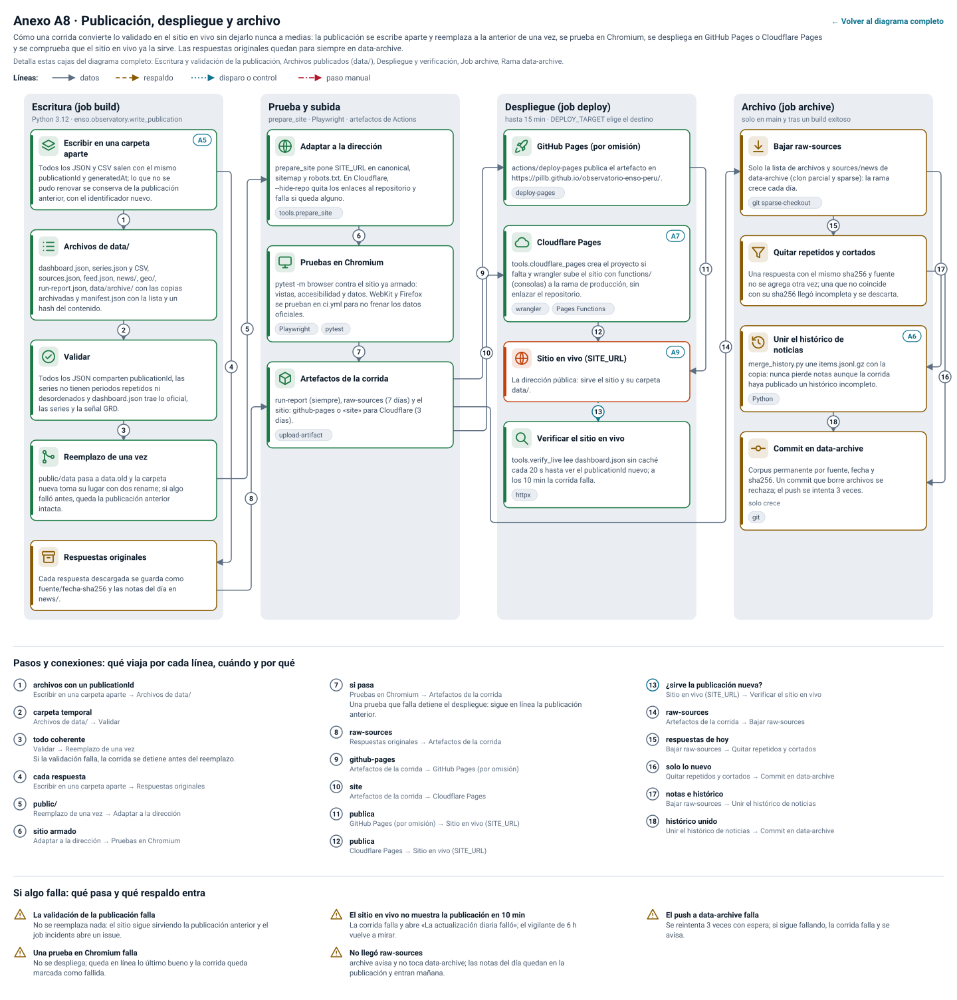

_In English: [anexos/a8-en.svg](anexos/a8-en.svg)._

A8 en texto: 16 pasos, 18 conexiones y 5 casos de falla

| Paso | Dónde | Qué hace | Tecnología |
|---|---|---|---|
| **Escribir en una carpeta aparte** | Escritura (job build) | Todos los JSON y CSV salen con el mismo publicationId y generatedAt; lo que no se pudo renovar se conserva de la publicación anterior, con el identificador nuevo. Ver [A5](#a5). |  |
| **Archivos de data/** | Escritura (job build) | dashboard.json, series.json y CSV, sources.json, feed.json, news/, geo/, run-report.json, data/archive/ con las copias archivadas y manifest.json con la lista y un hash del contenido. |  |
| **Validar** | Escritura (job build) | Todos los JSON comparten publicationId, las series no tienen periodos repetidos ni desordenados y dashboard.json trae lo oficial, las series y la señal GRD. |  |
| **Reemplazo de una vez** | Escritura (job build) | public/data pasa a data.old y la carpeta nueva toma su lugar con dos rename; si algo falló antes, queda la publicación anterior intacta. |  |
| **Respuestas originales** | Escritura (job build) | Cada respuesta descargada se guarda como fuente/fecha-sha256 y las notas del día en news/. |  |
| **Adaptar a la dirección** | Prueba y subida | prepare_site pone SITE_URL en canonical, sitemap y robots.txt. En Cloudflare, --hide-repo quita los enlaces al repositorio y falla si queda alguno. | tools.prepare_site |
| **Pruebas en Chromium** | Prueba y subida | pytest -m browser contra el sitio ya armado: vistas, accesibilidad y datos. WebKit y Firefox se prueban en ci.yml para no frenar los datos oficiales. | Playwright, pytest |
| **Artefactos de la corrida** | Prueba y subida | run-report (siempre), raw-sources (7 días) y el sitio: github-pages o «site» para Cloudflare (3 días). | upload-artifact |
| **GitHub Pages (por omisión)** | Despliegue (job deploy) | actions/deploy-pages publica el artefacto en https://pillb.github.io/observatorio-enso-peru/. | deploy-pages |
| **Cloudflare Pages** | Despliegue (job deploy) | tools.cloudflare_pages crea el proyecto si falta y wrangler sube el sitio con functions/ (consolas) a la rama de producción, sin enlazar el repositorio. Ver [A7](#a7). | wrangler, Pages Functions |
| **Sitio en vivo (SITE_URL)** | Despliegue (job deploy) | La dirección pública: sirve el sitio y su carpeta data/. Ver [A9](#a9). |  |
| **Verificar el sitio en vivo** | Despliegue (job deploy) | tools.verify_live lee dashboard.json sin caché cada 20 s hasta ver el publicationId nuevo; a los 10 min la corrida falla. | httpx |
| **Bajar raw-sources** | Archivo (job archive) | Solo la lista de archivos y sources/news de data-archive (clon parcial y sparse): la rama crece cada día. | git sparse-checkout |
| **Quitar repetidos y cortados** | Archivo (job archive) | Una respuesta con el mismo sha256 y fuente no se agrega otra vez; una que no coincide con su sha256 llegó incompleta y se descarta. |  |
| **Unir el histórico de noticias** | Archivo (job archive) | merge_history.py une items.jsonl.gz con la copia: nunca pierde notas aunque la corrida haya publicado un histórico incompleto. Ver [A6](#a6). | Python |
| **Commit en data-archive** | Archivo (job archive) | Corpus permanente por fuente, fecha y sha256. Un commit que borre archivos se rechaza; el push se intenta 3 veces. _solo crece._ | git |

| N.º | De → a | Qué viaja, cuándo y por qué |
|---|---|---|
| 1 | Escribir en una carpeta aparte → Archivos de data/ | **archivos con un publicationId.** |
| 2 | Archivos de data/ → Validar | **carpeta temporal.** |
| 3 | Validar → Reemplazo de una vez | **todo coherente.** Si la validación falla, la corrida se detiene antes del reemplazo. |
| 4 | Escribir en una carpeta aparte → Respuestas originales | **cada respuesta.** |
| 5 | Reemplazo de una vez → Adaptar a la dirección | **public/.** |
| 6 | Adaptar a la dirección → Pruebas en Chromium | **sitio armado.** |
| 7 | Pruebas en Chromium → Artefactos de la corrida | **si pasa.** Una prueba que falla detiene el despliegue: sigue en línea la publicación anterior. |
| 8 | Respuestas originales → Artefactos de la corrida | **raw-sources.** |
| 9 | Artefactos de la corrida → GitHub Pages (por omisión) | **github-pages.** |
| 10 | Artefactos de la corrida → Cloudflare Pages | **site.** |
| 11 | GitHub Pages (por omisión) → Sitio en vivo (SITE_URL) | **publica.** |
| 12 | Cloudflare Pages → Sitio en vivo (SITE_URL) | **publica.** |
| 13 | Sitio en vivo (SITE_URL) → Verificar el sitio en vivo | **¿sirve la publicación nueva?.** |
| 14 | Artefactos de la corrida → Bajar raw-sources | **raw-sources.** |
| 15 | Bajar raw-sources → Quitar repetidos y cortados | **respuestas de hoy.** |
| 16 | Quitar repetidos y cortados → Commit en data-archive | **solo lo nuevo.** |
| 17 | Bajar raw-sources → Unir el histórico de noticias | **notas e histórico.** |
| 18 | Unir el histórico de noticias → Commit en data-archive | **histórico unido.** |

**Si algo falla:**

- **La validación de la publicación falla.** No se reemplaza nada: el sitio sigue sirviendo la publicación anterior y el job incidents abre un issue.
- **Una prueba en Chromium falla.** No se despliega; queda en línea lo último bueno y la corrida queda marcada como fallida.
- **El sitio en vivo no muestra la publicación en 10 min.** La corrida falla y abre «La actualización diaria falló»; el vigilante de 6 h vuelve a mirar.
- **No llegó raw-sources.** archive avisa y no toca data-archive; las notas del día quedan en la publicación y entran mañana.
- **El push a data-archive falla.** Se reintenta 3 veces con espera; si sigue fallando, la corrida falla y se avisa.

#### Anexo A9 · El sitio en el navegador

El sitio es una página estática, sin compilación ni servidor propio: todo lo que muestra sale de los archivos de data/ de una misma publicación. El navegador comprueba que cada archivo sea de esa publicación y, si no puede, lo dice en vez de mezclar datos.

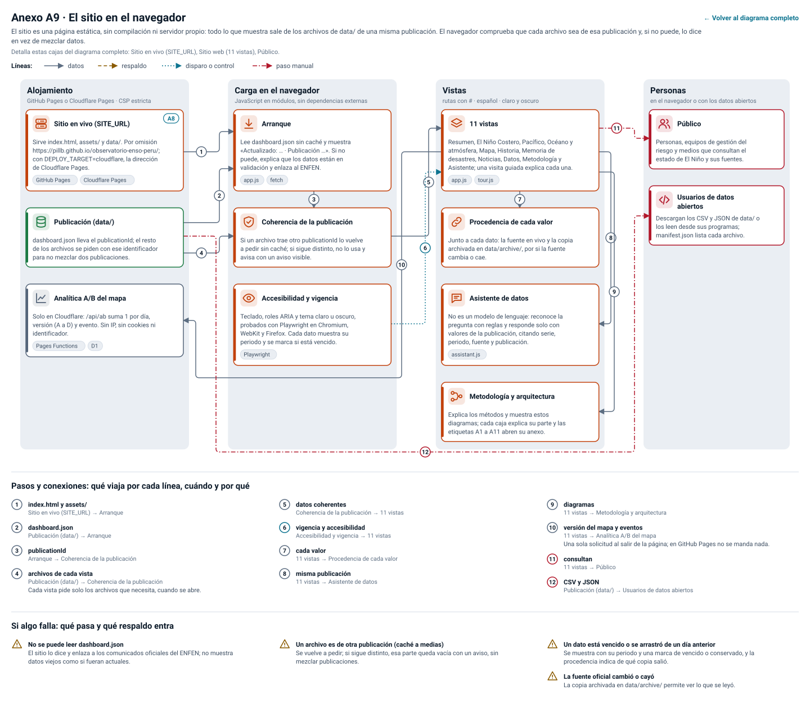

_In English: [anexos/a9-en.svg](anexos/a9-en.svg)._

A9 en texto: 12 pasos, 12 conexiones y 4 casos de falla

| Paso | Dónde | Qué hace | Tecnología |
|---|---|---|---|
| **Sitio en vivo (SITE_URL)** | Alojamiento | Sirve index.html, assets/ y data/. Por omisión https://pillb.github.io/observatorio-enso-peru/; con DEPLOY_TARGET=cloudflare, la dirección de Cloudflare Pages. Ver [A8](#a8). | GitHub Pages, Cloudflare Pages |
| **Publicación (data/)** | Alojamiento | dashboard.json lleva el publicationId; el resto de los archivos se piden con ese identificador para no mezclar dos publicaciones. |  |
| **Analítica A/B del mapa** | Alojamiento | Solo en Cloudflare: /api/ab suma 1 por día, versión (A a D) y evento. Sin IP, sin cookies ni identificador. | Pages Functions, D1 |
| **Arranque** | Carga en el navegador | Lee dashboard.json sin caché y muestra «Actualizado: … · Publicación …». Si no puede, explica que los datos están en validación y enlaza al ENFEN. | app.js, fetch |
| **Coherencia de la publicación** | Carga en el navegador | Si un archivo trae otro publicationId lo vuelve a pedir sin caché; si sigue distinto, no lo usa y avisa con un aviso visible. |  |
| **Accesibilidad y vigencia** | Carga en el navegador | Teclado, roles ARIA y tema claro u oscuro, probados con Playwright en Chromium, WebKit y Firefox. Cada dato muestra su periodo y se marca si está vencido. | Playwright |
| **10 vistas** | Vistas | Resumen, El Niño Costero, Pacífico, Océano y atmósfera, Mapa, Historia, Noticias, Datos, Metodología y Asistente; una visita guiada explica cada una. | app.js, tour.js |
| **Procedencia de cada valor** | Vistas | Junto a cada dato: la fuente en vivo y la copia archivada en data/archive/, por si la fuente cambia o cae. |  |
| **Asistente de datos** | Vistas | No es un modelo de lenguaje: reconoce la pregunta con reglas y responde solo con valores de la publicación, citando serie, periodo, fuente y publicación. | assistant.js |
| **Metodología y arquitectura** | Vistas | Explica los métodos y muestra estos diagramas; cada caja explica su parte y las etiquetas A1 a A10 abren su anexo. |  |
| **Público** | Personas | Personas, equipos de gestión del riesgo y medios que consultan el estado de El Niño y sus fuentes. |  |
| **Usuarios de datos abiertos** | Personas | Descargan los CSV y JSON de data/ o los leen desde sus programas; manifest.json lista cada archivo. |  |

| N.º | De → a | Qué viaja, cuándo y por qué |
|---|---|---|
| 1 | Sitio en vivo (SITE_URL) → Arranque | **index.html y assets/.** |
| 2 | Publicación (data/) → Arranque | **dashboard.json.** |
| 3 | Arranque → Coherencia de la publicación | **publicationId.** |
| 4 | Publicación (data/) → Coherencia de la publicación | **archivos de cada vista.** Cada vista pide solo los archivos que necesita, cuando se abre. |
| 5 | Coherencia de la publicación → 10 vistas | **datos coherentes.** |
| 6 | Accesibilidad y vigencia → 10 vistas | **vigencia y accesibilidad.** |
| 7 | 10 vistas → Procedencia de cada valor | **cada valor.** |
| 8 | 10 vistas → Asistente de datos | **misma publicación.** |
| 9 | 10 vistas → Metodología y arquitectura | **diagramas.** |
| 10 | 10 vistas → Analítica A/B del mapa | **versión del mapa y eventos.** Una sola solicitud al salir de la página; en GitHub Pages no se manda nada. |
| 11 | 10 vistas → Público | **consultan.** |
| 12 | Publicación (data/) → Usuarios de datos abiertos | **CSV y JSON.** |

**Si algo falla:**

- **No se puede leer dashboard.json.** El sitio lo dice y enlaza a los comunicados oficiales del ENFEN; no muestra datos viejos como si fueran actuales.
- **Un archivo es de otra publicación (caché a medias).** Se vuelve a pedir; si sigue distinto, esa parte queda vacía con un aviso, sin mezclar publicaciones.
- **Un dato está vencido o se arrastró de un día anterior.** Se muestra con su periodo y una marca de vencido o conservado, y la procedencia indica de qué copia salió.
- **La fuente oficial cambió o cayó.** La copia archivada en data/archive/ permite ver lo que se leyó.

#### Anexo A10 · Vigilancia, avisos y mantenimiento

Quién se entera cuando algo sale mal y cómo. Cada corrida deja un informe; sus problemas se vuelven issues que se cierran solos, y dos vigilantes independientes (uno en GitHub, otro en n8n) miran el sitio en vivo cada 6 horas. Los avisos llegan por GitHub y, si se configura, por correo.

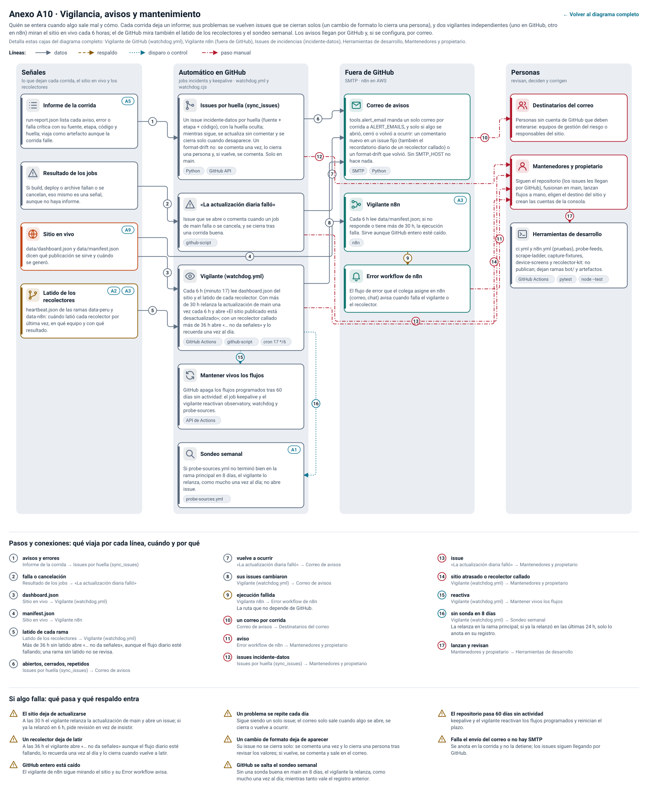

_In English: [anexos/a10-en.svg](anexos/a10-en.svg)._

A10 en texto: 13 pasos, 15 conexiones y 5 casos de falla

| Paso | Dónde | Qué hace | Tecnología |
|---|---|---|---|
| **Informe de la corrida** | Señales | run-report.json lista cada aviso, error o falla crítica con su fuente, etapa, código y huella; viaja como artefacto aunque la corrida falle. Ver [A5](#a5). |  |
| **Resultado de los jobs** | Señales | Si build, deploy o archive fallan o se cancelan, eso mismo es una señal, aunque no haya informe. |  |
| **Sitio en vivo** | Señales | data/dashboard.json y data/manifest.json dicen qué publicación se sirve y cuándo se generó. Ver [A9](#a9). |  |
| **Issues por huella (sync_issues)** | Automático en GitHub | Un issue incidente-datos por huella (fuente + etapa + código), con la huella oculta; se comenta si vuelve y se cierra solo cuando desaparece. | Python, GitHub API |
| **«La actualización diaria falló»** | Automático en GitHub | Issue que se abre o comenta cuando un job falla y se cierra tras una corrida buena. | github-script |
| **Vigilante (watchdog.yml)** | Automático en GitHub | Cada 6 h (minuto 17) lee dashboard.json del sitio. Con más de 30 h relanza la actualización una vez cada 6 h y abre «El sitio publicado está desactualizado». | GitHub Actions, cron 17 */6 |
| **Mantener vivos los flujos** | Automático en GitHub | GitHub apaga los flujos programados tras 60 días sin actividad: el job keepalive y el vigilante reactivan observatory, watchdog y probe-sources. | API de Actions |
| **Correo de avisos** | Fuera de GitHub | tools.alert_email manda un solo correo por corrida a ALERT_EMAILS, y solo si algo se abrió, cerró o volvió a ocurrir. Sin SMTP_HOST no hace nada. | SMTP, Python |
| **Vigilante n8n** | Fuera de GitHub | Cada 6 h lee data/manifest.json; si no responde o tiene más de 30 h, la ejecución falla. Sirve aunque GitHub entero esté caído. Ver [A3](#a3). | n8n |
| **Error workflow de n8n** | Fuera de GitHub | El flujo de error que el colega asigne en n8n (correo, chat) avisa cuando falla el vigilante o el recolector. |  |
| **Destinatarios del correo** | Personas | Personas sin cuenta de GitHub que deben enterarse: equipos de gestión del riesgo o responsables del sitio. |  |
| **Mantenedores y propietario** | Personas | Siguen el repositorio (los issues les llegan por GitHub), fusionan en main, lanzan flujos a mano, eligen el destino del sitio y crean las cuentas de la consola. |  |
| **Herramientas de desarrollo** | Personas | ci.yml y n8n.yml (pruebas), probe-feeds, scrape-ladder, capture-fixtures, device-screens y recolector-kit: no publican; dejan ramas bot/ y artefactos. | GitHub Actions, pytest, node --test |

| N.º | De → a | Qué viaja, cuándo y por qué |
|---|---|---|
| 1 | Informe de la corrida → Issues por huella (sync_issues) | **avisos y errores.** |
| 2 | Resultado de los jobs → «La actualización diaria falló» | **falla o cancelación.** |
| 3 | Sitio en vivo → Vigilante (watchdog.yml) | **dashboard.json.** |
| 4 | Sitio en vivo → Vigilante n8n | **manifest.json.** |
| 5 | Issues por huella (sync_issues) → Correo de avisos | **abiertos, cerrados, repetidos.** |
| 6 | «La actualización diaria falló» → Correo de avisos | **vuelve a ocurrir.** |
| 7 | Vigilante (watchdog.yml) → Correo de avisos | **su issue cambió.** |
| 8 | Vigilante n8n → Error workflow de n8n | **ejecución fallida.** La ruta que no depende de GitHub. |
| 9 | Correo de avisos → Destinatarios del correo | **un correo por corrida.** |
| 10 | Error workflow de n8n → Mantenedores y propietario | **aviso.** |
| 11 | Issues por huella (sync_issues) → Mantenedores y propietario | **issues incidente-datos.** |
| 12 | «La actualización diaria falló» → Mantenedores y propietario | **issue.** |
| 13 | Vigilante (watchdog.yml) → Mantenedores y propietario | **issue sitio desactualizado.** |
| 14 | Vigilante (watchdog.yml) → Mantener vivos los flujos | **reactiva.** |
| 15 | Mantenedores y propietario → Herramientas de desarrollo | **lanzan y revisan.** |

**Si algo falla:**

- **El sitio deja de actualizarse.** A las 30 h el vigilante relanza la actualización y abre un issue; si ya la relanzó en 6 h, pide revisión en vez de insistir.
- **GitHub entero está caído.** El vigilante de n8n sigue mirando el sitio y su Error workflow avisa.
- **Un problema se repite cada día.** Sigue siendo un solo issue; el correo solo sale cuando algo se abre, se cierra o vuelve a ocurrir.
- **El repositorio pasa 60 días sin actividad.** keepalive y el vigilante reactivan los flujos programados y reinician el plazo.
- **Falla el envío del correo o no hay SMTP.** Se anota en la corrida y no la detiene; los issues siguen llegando por GitHub.

<!-- anexos:fin -->

### Lo esencial

- **Tres recolectores leen la misma lista.** `registry/sources.json` dice
  quién pide cada URL. GitHub Actions baja casi todo a las 23:37; n8n en la
  nube baja cada noche (22:50) una segunda copia de todo lo que no está
  prohibido ni bloqueado, haya fallado Actions o no; el equipo en el Perú
  (21:00) baja lo que no responde fuera del país y el resto de su lista fija. La corrida diaria
  no lee `robots.txt` ni usa un navegador: sigue el registro, que el
  sondeo semanal arma con lo que mide (y ahí sí se lee `robots.txt`). La
  escalera de extracción (`scrape-ladder.yml`: `robots.txt` → petición
  simple → cabeceras de navegador → Chromium → Firecrawl, que se detiene
  ante cualquier verificación anti-robots) es una herramienta para
  investigar fuentes nuevas, no un paso de la corrida.
- **Nada se publica a medias.** Si algo falla antes del despliegue sigue
  publicado el sitio anterior, y cada dato muestra su fecha real.
- **Servidor y base de datos, solo para la consola.** El sitio es estático;
  la consola de lugares usa una función de Cloudflare Pages con una base
  D1, y solo funciona con el sitio en Cloudflare (en GitHub Pages queda sin API).

## Pipeline (`python/enso/`)

| Módulo | Función |
|---|---|
| `fetch.py` | Descarga con reintentos, plazos de tiempo (no de tamaño: el tope de 5 MB por feed lo aplica `feedparse.py` al leer y el de 20 MiB por copia, `archive.py`) y respaldo en el Internet Archive (CDX y, si se activa con `ENSO_ARCHIVE_SAVE=1`, Save Page Now). El tiempo está acotado: conectar, 15 s; cada pedido, 5 min las fuentes oficiales y 1 min cada feed en total (el plazo del cliente es por lectura y un servidor que manda la respuesta de a pocos bytes no lo agota), sin reintento si se agota; cada servidor lleva la cuenta de sus fallos seguidos (un pedido sin respuesta suma uno, una respuesta que no termina a tiempo dos, una URL que solo recibió 429 o 5xx uno, y cualquier otra respuesta la pone en cero; Save Page Now lleva la suya): con 3 recibe un solo intento por URL, y con 5 ya no se le pide nada en la corrida; tras el último intento no se espera. Todas las fuentes oficiales juntas, 8 min (`OFFICIAL_BUDGET_S`), empezando por el ENFEN (listado y último comunicado), el ICEN y la ENSO Diagnostic Discussion (`OFFICIAL_FIRST`); pasado ese tiempo, las que falten siguen solo con las copias del Perú y de n8n o con su dato anterior (ya no se pide al Internet Archive). Una respuesta rota (gzip mal declarado, redirecciones sin fin) es una URL fallida más, no un error que detenga la corrida |
| `feeds/cpc.py` | Lectores de los archivos de texto de NOAA/CPC: semanal OISST, mensual por región, RONI/ONI, matrices año×mes (SOI, presiones, vientos), contenido de calor y la ENSO Diagnostic Discussion |
| `feeds/peru.py` | Lectores del ICEN del IGP, del listado de comunicados del ENFEN (HTML y WordPress JSON) y del texto de cada comunicado (PDF) |
| `signals.py` | Categorías ICEN 2024, eventos ICEN, categorías ONI/RONI y la señal del equipo GRD |
| `observatory.py` | Catálogo de fuentes, adquisición con respaldo, armado de la publicación, registro de incidencias y CLI |
| `reach.py` | `robots.txt` según RFC 9309 (la regla más larga gana) y clases de alcance por red (Actions, n8n, Perú) |
| `feedparse.py` | Lector tolerante de RSS 2.0/1.0, Atom, JSON Feed y listados de gob.pe: repara XML mal formado, fechas y codificaciones |
| `hazardparse.py` | Lectores de alertas sin RSS: GeoJSON de USGS, boletines y avisos especiales de la DHN, mensajes del PTWC, boletines del CENVUL, canal de Telegram y capas ArcGIS del SENAMHI (copia del INDECI), reportes del COEN y focos de calor de FIRMS |
| `geo.py`, `limites.py`, `geopoly.py`, `geo_overrides.py` | Ubicación por distrito, provincia y departamento (UBIGEO del INEI): por el texto, por los campos de la fuente o por coordenadas (límites del IGN en `limites.py`; departamentos del INDECI en `geopoly.py` para focos de calor y polígonos), más las correcciones de la consola |
| `news.py` | Feeds RSS/Atom de noticias: estado de cada feed, filtro de relevancia, agrupación de notas similares, histórico de solo anexar y CSV |
| `sourcefeed.py` | Alertas y reportes de peligros de los últimos 7 días (con las fuentes de alertas que no respondieron) y la última novedad de cada fuente oficial, agrupada por tipo |

Cada lector devuelve los datos junto con una **huella del formato**
(cabeceras, columnas y patrón de filas). Si la huella cambia respecto de
la publicación anterior, y la dio la misma URL, se registra `format-drift`
(una fuente con varias URL, como la API de WordPress del ENFEN y su listado
del portal, tiene una huella por formato); si el formato ya no se puede
leer se lanza `FormatChanged` y el dato no se publica.

### Canales por URL

`registry/sources.json` dice, para cada URL de cada fuente (la principal y sus
réplicas, campo `by_url`), qué recolector la pide: `actions`, `n8n` o
`peru-server`. Una URL va al servidor del Perú si y solo si no responde desde
ninguna red de EE. UU. que la midió (GitHub Actions en Azure, n8n en AWS) y
además responde desde el Perú, o falla allá por bloqueo (403, tiempo,
conexión, desafío anti-robots o DNS) y aún no se midió desde el Perú; los
canales de la fuente son la unión. El pipeline lee el registro en cada corrida:

- una URL que el registro no da a Actions se lee de la copia del Perú o de n8n;
  solo si no hay copia se pide directo, una sola vez;
- una URL cuyo `robots.txt` lo prohíbe no se pide (sin canales), salvo los
  feeds de noticias marcados `reader` (Google Noticias, Noticias ONU, Sin
  Rodeos): se leen como un lector de feeds, solo desde las corridas de
  `observatory.yml` en `main` y como mucho una vez cada 20 horas desde el
  último pedido, haya respondido o no, sin reintento; entre dos pedidos
  queda el estado del último, y las notas de la última lectura buena se
  guardan con él en la caché de Actions por si esa corrida no llega a
  publicar;
- si hay varias copias de una URL (Perú y n8n), gana la más reciente, también
  para las noticias y las alertas.

El recolector del Perú baja las fuentes `peru-server` y n8n las `n8n`, así que
los tres canales leen la misma lista. `probe-sources.yml` mide cada semana
desde Actions y suma lo que bajaron el Perú y n8n.

### Orden de respaldo por fuente

1. URL oficial y, si no responde, la copia de esa misma URL que bajaron el
   recolector del Perú o n8n (gana la más reciente). Una URL que según el
   registro no da a Actions se lee de esas copias y, solo si no hay, se pide
   directo una vez.
2. Lo mismo con cada espejo oficial, en orden (por ejemplo, la réplica del
   ENFEN en la DHN).
3. Copia más reciente del Internet Archive.
4. Copia nueva pedida al Internet Archive (Save Page Now): solo para el
   listado y el PDF de los comunicados del ENFEN (no para los números que
   se sondean antes de que aparezcan), en las corridas de Actions con
   `ENSO_ARCHIVE_SAVE=1` (todas salvo una manual con `archive_save`
   desmarcado), cuando la copia existente tiene más de un día.
5. Último dato válido de la publicación anterior, marcado `carried: true`.

Cuando todo falla para una fuente crítica, la corrida termina en
`critical` y no se despliega.

## Contrato de la publicación (`public/data/`)

Todos los JSON llevan el mismo `publicationId` (`AAAAMMDDTHHMMZ-hash8`).
El navegador compara el de cada archivo con el de `dashboard.json` y,
si no coinciden, muestra un aviso en lugar de mezclar datos.

| Archivo | Contenido |
|---|---|
| `dashboard.json` | Estado oficial (ENFEN, NOAA), último valor de cada serie con su categoría y antigüedad, señal GRD, eventos ICEN y salud de la corrida |
| `series.json` | Series mensuales completas |
| `weekly.json` | Anomalías semanales por región Niño (últimas semanas) |
| `sources.json`, `sources/*.json` | Por fuente: URL usada, canal (directo, archivo, anterior), fecha de descarga, SHA-256, huella del formato y datos leídos |
| `run-report.json` | Todas las incidencias de la corrida con severidad, etapa, código y huella |
| `health.json` | Resumen de la corrida (ningún vigilante lo lee hoy: el de GitHub lee `dashboard.json` y el de n8n `manifest.json`) |
| `manifest.json` | Lista de archivos, versión del pipeline, commit (`gitSha`), series y `contentHash` |
| `feed.json` | Alertas de peligros (últimos 7 días, con el estado de cada fuente de alertas) y novedades de las fuentes oficiales agrupadas por tipo: título, fecha, valor, categoría, cambio, enlace en vivo, copia archivada y respuesta original |
| `news/feeds.json` | Estado de cada feed de noticias en esta corrida: responde, entradas, relevantes, fecha de la más reciente, activo |
| `news/clusters.json` | Notas de los últimos 14 días agrupadas por similitud del titular: titular más temprano, medios, resumen y enlaces |
| `news/items.jsonl` | Histórico de noticias de solo anexar: cada corrida agrega las notas nuevas al final y nunca reescribe las anteriores |
| `news/items.csv` | El mismo histórico en CSV, protegido contra fórmulas |
| `geo/items.json`, `geo/ubigeo.json` | Notas recientes con su lugar (hasta 120 días y 4000 notas) y el nomenclátor de departamentos, provincias y distritos, para la consola de lugares |
| `geo/overrides.json`, `geo/quality.json` | Correcciones de lugar aplicadas (sin nombres de revisores) y cuántas notas tienen lugar, con qué método y confianza ([georreferenciacion](georreferenciacion.md)) |
| `archive/sources/<fuente>/<sha12>.<ext>` | La respuesta original de cada fuente oficial y los PDF de los comunicados, byte por byte |
| `archive/feeds/<feed>.txt` | Cada feed de noticias tal como se bajó en esta corrida (como texto, para que sus scripts no corran en el sitio) |
| `archive/news/<día>.html` | Por día (60 días), lo que dijo el feed de cada noticia vista por primera vez ese día: el enlace «copia archivada» |
| `archive/index.json` | Los archivos copiados con su URL de origen, fecha, canal y SHA-256 |
| `csv/*.csv` | Descargas con cabecera `periodo,valor,unidad,serie,fuente,publicacion`; los textos que empiezan con `=`, `@`, `+` o `-` no numéricos se neutralizan contra inyección de fórmulas |

Cada último valor publicado incluye `period`, `value`, `ageDays`,
`stale` y `carried`. Un valor vencido se muestra como «Dato actual no
disponible», nunca como vigente.

## Sitio (`public/`)

- HTML, CSS y módulos ES sin dependencias ni paso de compilación.
- Política de seguridad de contenido estricta (`script-src 'self'`), sin
  scripts en línea; las respuestas del asistente escapan todo el texto.
- Rutas por hash: Resumen, El Niño Costero, Pacífico, Océano y atmósfera,
  Mapa, Historia, Noticias, Datos, Metodología y Asistente.
- Consola de lugares (`public/admin/`): los revisores corrigen el lugar de
  una nota. En Cloudflare Pages la atiende una función
  (`functions/api/geo/`) con una base D1; en GitHub Pages no hay API y
  solo se mantienen las correcciones ya publicadas
  ([georreferenciacion](georreferenciacion.md)).
- Español del Perú, coma decimal, tema claro y oscuro, navegación por
  teclado, enlace para saltar al contenido, tablas alternativas a cada
  gráfico y al mapa.
- `assets/js/assistant.js` responde con reglas deterministas a partir de
  la publicación y cita la evidencia de cada respuesta; no usa un modelo
  de lenguaje ni inventa valores.
- `assets/js/geo.js` contiene la costa de Natural Earth ya proyectada; se
  regenera con `scripts/geo/gen.mjs`.

## Noticias

- **Relevancia:** en medios generales se exige un término del ENSO
  («El Niño», «La Niña», «Niño costero», ENFEN, ICEN, temperatura del
  mar…). En feeds de emergencias o clima (GDACS, ONU, búsquedas de Google
  Noticias) basta un peligro asociado (lluvias intensas, huaicos,
  inundaciones, sequía…) si la nota es del Perú; en un medio general,
  también si el peligro está en el titular.
- **Agrupación:** dos titulares se agrupan si comparten al menos tres
  palabras significativas y el 60 % de las del más corto, dentro de la
  misma región (Perú o mundo). El titular del grupo es el de la nota más
  temprana; el resumen es la primera oración del resumen más largo.
- **Histórico:** `news/items.jsonl` se lee de la publicación anterior y
  se le agregan las notas nuevas (por `id` = hash de enlace y titular).
  Cada corrida archivada guarda en la rama `data-archive` la unión de todo
  lo publicado, comprimida (`sources/news/items.jsonl.gz`: el job
  `archive` le agrega con `python/tools/merge_history.py` las notas de la
  corrida que no tenga y nunca le quita ninguna), y las notas nuevas de
  cada día (`sources/news/<día>.jsonl`, que se suman). La corrida baja
  siempre esa copia y le agrega al histórico publicado, al final, las notas
  que no tenga (p. ej. las de una corrida que no llegó a desplegar:
  `news-history-restored`). Si el histórico publicado no responde tras tres
  intentos, lo rehace con la copia (`news-history-missing`, advertencia).
  Un sitio que no responde (5xx, sin respuesta) no es lo mismo que uno que
  no tiene el archivo (404): solo con 404 en el sitio y en `data-archive`
  se trata como primera publicación. Si no hay histórico ni copia que
  leer, publica solo las notas de hoy y marca el histórico como
  `restarted` en `news/feeds.json` (`news-history-missing`, error, que se
  repite mientras siga así); la corrida siguiente que lea la copia lo
  completa. Una corrida sin noticias (su lectura falló) sirve las de la
  publicación anterior, con `carriedFrom` en `news/feeds.json`, y sus
  alertas son las últimas conocidas, con los lugares corregidos en la
  consola; el sitio avisa que ninguna fuente de alertas se leyó. GitHub no
  acepta archivos de más de 100 MB y Cloudflare Pages no sirve archivos de
  más de 25 MiB: el pipeline avisa (`news-history-large`) cuando
  `items.jsonl` pasa de 20 MiB, y la copia comprimida deja de crecer (con
  aviso) si pasaría de 90 MiB.
- **Derechos:** solo se guarda lo que el medio publica en su feed
  (titular, resumen, fecha y enlace). El sitio enlaza siempre a la nota
  original.

## Pruebas (`python/tests/`)

- `test_feeds_backtest.py`: cada lector contra respuestas reales actuales
  y contra versiones históricas del Internet Archive (2009–2026), para
  detectar a tiempo los cambios de formato de las instituciones.
- `test_signals_and_pipeline.py`: bordes de las categorías, coincidencia
  entre los YAML de umbrales y el código, eventos ICEN frente al registro
  oficial, SOI Troup frente a los valores archivados de BoM, publicación
  completa sin red, respaldo cuando falla una fuente y detección de
  cambios de formato.
- `test_hazards.py`: cada lector de alertas sobre respuestas reales del
  21 de octubre de 2026 y sobre formatos anteriores o mal formados.
- `test_geopoly.py`: la ubicación por departamento frente a la que asigna
  el INPE de Brasil a los mismos focos de calor.
- `test_browser.py`: recorridos en Chromium a 320, 390, 820 y 1366 px
  (errores, desbordes, paridad de valores, teclado, tema, tutorial, mapa,
  descargas, publicación mezclada y caída de datos).
