# Máquinas de estado implícitas

El sitio no tiene una biblioteca de estado: cada parte guarda su estado en variables, en el enlace (`#/ruta?…`), en
`localStorage`/`sessionStorage`, en atributos del DOM (`aria-pressed`, `hidden`, `data-*`) o en la base de datos de la
consola. Este documento las reúne como máquinas de estado: qué estados tiene cada una, qué la hace cambiar, dónde se
guarda y con qué otras choca. Sirve para revisar un cambio («¿qué estado nuevo crea esto?») y para depurar un estado
raro («¿cómo se llega aquí?»).

Al final están los [estados errados que se encontraron](#diagnóstico-estados-errados-y-sus-causas), su causa, la
corrección y la prueba que la cuida, y las [cuatro revisiones adversarias](#cuatro-revisiones-adversarias) de esos
cambios.

Los diagramas son Mermaid (GitHub los dibuja). Las rutas de archivo son del repositorio.

## Inventario

| # | Máquina | Dónde | Estados | Se guarda en | Lo cambian |
|---|---|---|---|---|---|
| 1 | [Arranque y publicación](#1-arranque-y-publicación) | `public/assets/js/app.js` `boot`, `load` | cargando → lista · error de carga; por archivo: sin pedir → pidiendo → leído · de otra publicación · fallo de red | memoria (`S`) | la red, el pipeline |
| 2 | [Ruta y ciclo de una vista](#2-ruta-y-ciclo-de-una-vista) | `app.js` `render`, `sitio.js` `enterView`/`viewReady` | entrar → pintada → `after` (datos) → lista (`view:ready`) · reemplazada | el enlace (`#/ruta`), contador `rendering` | la persona, el tutorial, el selector de versiones |
| 3 | [Vigencia de cada dato](#3-vigencia-de-cada-dato) | `python/enso/freshness.py`, `app.js` `freshnessPanel` | al día · atrasado · vencido · sin dato (+ no aplica) | `dashboard.json` | el calendario de cada institución |
| 4 | [Versión de un experimento](#4-versión-de-un-experimento) | `public/assets/js/ab.js` `Session` | sin asignar → asignada → (vista previa) → elegida; eventos por visita | `localStorage` (`enso-*-version`, `enso-vista-*`), el enlace (`?sitio=`, `?version=`, `?vista=`) | la persona, un enlace, el tutorial, `/api/ab/defaults` |
| 5 | [Versión del sitio y selector](#5-versión-del-sitio-y-selector) | `public/assets/js/sitio.js` | A · B (· vista previa); panel cerrado · abierto | `localStorage` `enso-version-sitio`, `data-sitio` en `<html>` | el selector, `?sitio=` |
| 6 | [Medición anónima del uso](#6-medición-anónima-del-uso) | `sitio.js` `usage` | sesión nueva · seguida; reloj en uso · inactivo · oculto; envío | `sessionStorage` `enso-uso-sesion`, `localStorage` `enso-uso-visitas`, `enso-medicion-no` | el tiempo, la visibilidad, la casilla, DNT/GPC |
| 7 | [Menús y plegado de la versión B](#7-menús-y-plegado-de-la-versión-b) | `sitio.js` `openMenu`, `foldSections`, `clipLists` | menú cerrado · abierto; sección plegada · abierta; lista cortada · completa | DOM (`aria-expanded`, `.folded`, `.clipped`) | clic, teclado, foco, el tutorial (`fold:reveal`) |
| 8 | [Tutorial guiado](#8-tutorial-guiado) | `public/assets/js/tour.js` | inactivo · en curso · en pausa · completado; por paso: navegando → preparando → buscando → listo · demostrando | `localStorage` `enso-tour`, contador `gen` | la persona, la ruta, Esc, recargar |
| 9 | [Mapa de alertas de Noticias](#9-mapa-de-alertas-de-noticias) | `public/assets/js/alertmap.js` | vista resumen (A–D) · detalle (cuencas, distritos); detalle sin pedir → cargando → listo · falló; filtros | el enlace (`#/noticias?…`), `ab('mapa')`, `ab('noticias')` | la persona, el reloj (cada 5 min), el tutorial |
| 10 | [Fase de cada aviso](#10-fase-de-cada-aviso) | `alertmap.js` `phaseOf` | próxima → vigente → vencida; en curso → reciente; ocurrido | se calcula con el reloj | el reloj |
| 11 | [Pestañas y filtros de Noticias](#11-pestañas-y-filtros-de-noticias) | `app.js` `VIEWS.noticias` | oficial · Perú · mundo, con tipo, departamento y peligro | el enlace (`replaceState`) | la persona, el mapa |
| 12 | [Memoria de desastres](#12-memoria-de-desastres) | `public/assets/js/historico.js` `mount` | vista (resumen, cuencas, puntos, riesgo), área, filtros; datos de detalle sin pedir → cargando → listos · fallaron | el enlace (`#/memoria?…`), `ab('memoria')` | la persona, el tutorial |
| 13 | [Animación del mapa](#13-animación-del-mapa) | `public/assets/js/map.js` | en pausa · reproduciendo | el temporizador | la persona, la ruta, el fin de la serie |
| 14 | [Mi zona](#14-mi-zona) | `public/assets/js/zona.js` | sin lugar · lugar · código que no existe; ubicación: pidiendo → cercanos · error | el enlace (`#/zona?area=`) | la persona, el GPS |
| 15 | [Boletín](#15-boletín) | `public/assets/js/boletin.js` | mapa · mosaico; departamento elegido | `ab('boletin')`, memoria | la persona |
| 16 | [Tema](#16-tema) | `app.js` `shell` | sistema · claro · oscuro | `localStorage` `enso-theme`, `data-theme` | el botón |
| 17 | [Consola: sesión y vista](#17-consola-sesión-y-vista) | `public/admin/admin.js` | sin API · sin sesión → ingresando → en la consola; pestaña; filtros | cookie `HttpOnly`, memoria | la persona, el vencimiento de la sesión |
| 18 | [Consola: correcciones de una nota](#18-consola-correcciones-de-una-nota) | `functions/_lib/geo-console.js` | automática → corregida/confirmada/nacional/extranjera (rev n) → deshecha; ingreso: libre → bloqueado | D1 (`corrections`, `current`, `attempts`) | revisores, el tiempo |

## Cómo se tocan entre sí

Las colisiones están casi todas en tres puntos: la ruta (todas las vistas viven en `#main` y se vuelven a pintar al
cambiarla), las sesiones de `ab.js` (la misma sesión la usan el selector, el mapa y el tutorial) y los
temporizadores que siguen vivos después de que su vista se fue.

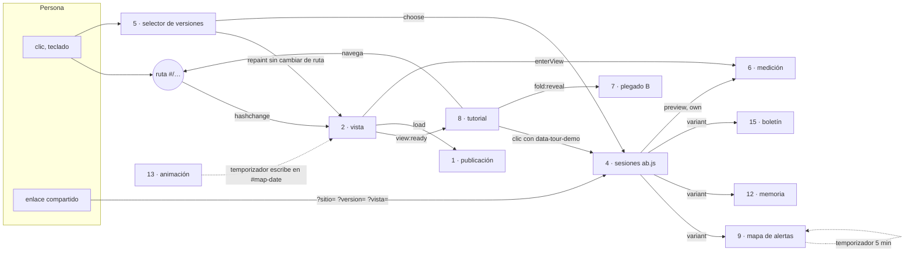

## Diagramas

### 1. Arranque y publicación

`boot()` lee `dashboard.json`; cada vista pide después sus archivos con `load(name)`. Un archivo de otra publicación
(el pipeline publicó mientras la página estaba abierta) no se mezcla: se avisa en la franja superior.

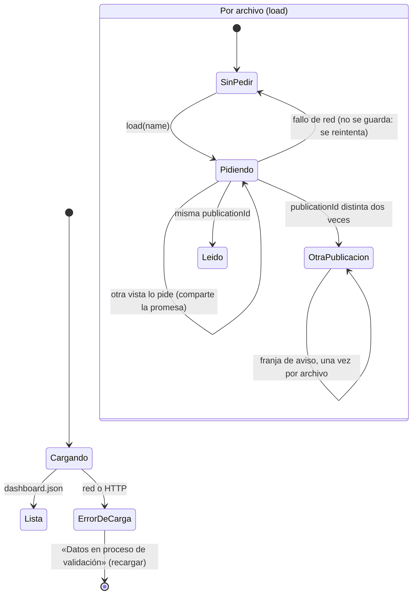

Antes de esta revisión el fallo de red se guardaba como `null` y el archivo quedaba «no disponible» hasta recargar
(E5), y dos pedidos simultáneos del mismo archivo bajaban dos veces y podían repetir su nombre en la franja.

### 2. Ruta y ciclo de una vista

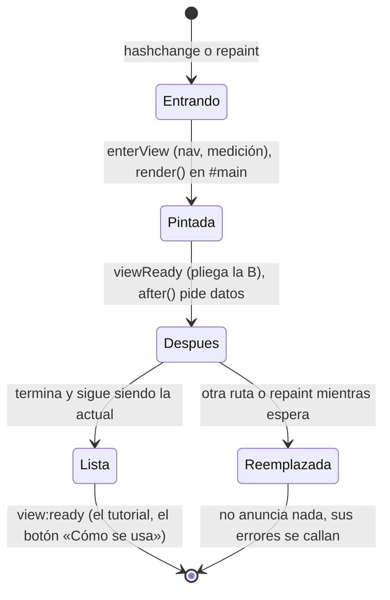

Un contador (`rendering`) marca la vista actual. La rama **Reemplazada** no anunciaba nada distinto: también
disparaba `view:ready` con su nombre viejo, y el tutorial, que espera ese evento para seguir, buscaba el paso en la
pestaña que se estaba yendo (E4).

### 3. Vigencia de cada dato

La calcula el pipeline (`freshness.py`) y el sitio solo la muestra. El peor estado de una vista colorea su panel.

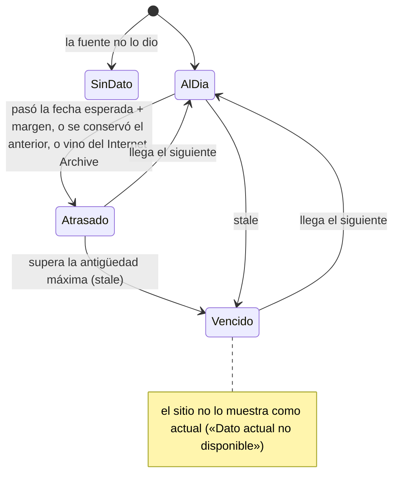

Orden para el peor: al día < sin dato < atrasado < vencido. Un dato `optional` («no aplica») no cuenta. Si todos los
datos de una vista fueran «no aplica», el panel decía «Al día: los 0 datos de esta vista…»; ahora no se muestra (E9).

### 4. Versión de un experimento

Cinco experimentos comparten la misma máquina (`mapa`, `memoria`, `noticias`, `boletin`, `sitio`).

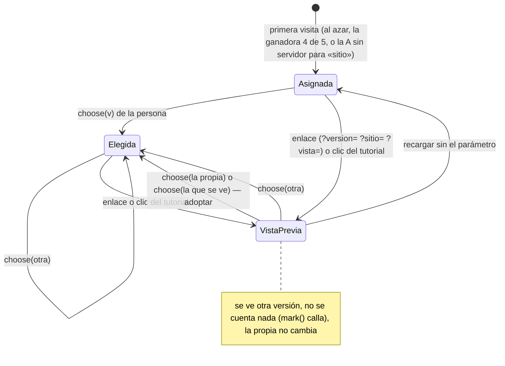

Eventos por visita (se mandan una vez al ocultarse la página): `view`, `hover`, `select`, `detail`, `use`, `choose`,
`chosen`, `keep`, `leave`. Con «No rastrear», GPC, la casilla del selector o sin servidor no se manda nada.

Antes, `choose(v)` con `v` igual a la versión que se veía no hacía nada, aunque fuera una vista previa: no había forma
de quedarse con la versión de un enlace ni con la que dejó el tutorial (E2).

### 5. Versión del sitio y selector

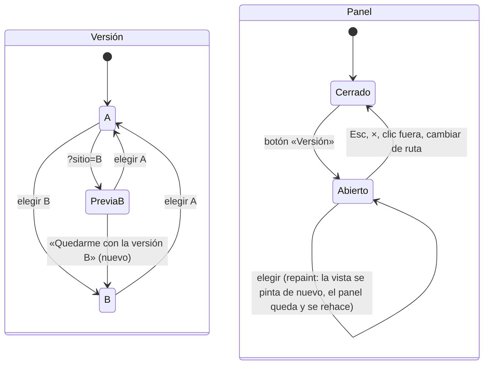

Al elegir se quitan del enlace los parámetros de vista previa `sitio` y `version` (en la ruta y en `?…` antes del
`#`): antes `?sitio=B` seguía en la barra y al recargar volvía a mandar sobre lo elegido (E2). `?vista=` no se quita
sino que pasa a decir la elegida: en la memoria, un enlace con filtros y sin vista abre el resumen. El panel
se rehace al elegir para que su aviso «desde un enlace» no quede desactualizado.

### 6. Medición anónima del uso

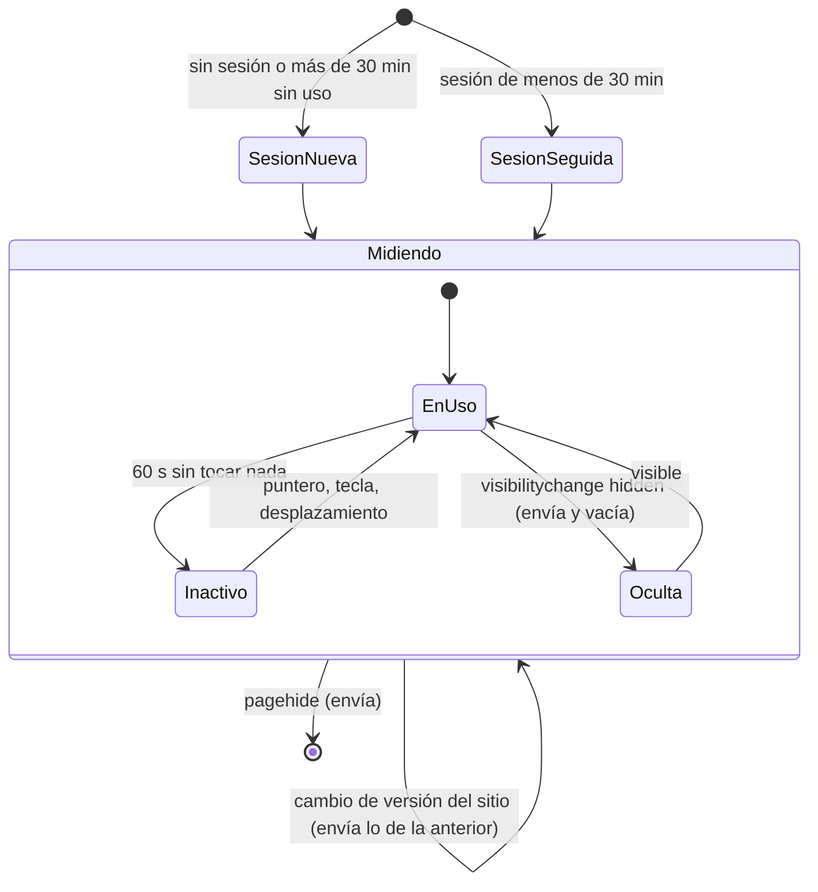

No se envía nada en una vista previa (`site().preview`) ni con la persona fuera de la medición.

### 7. Menús y plegado de la versión B

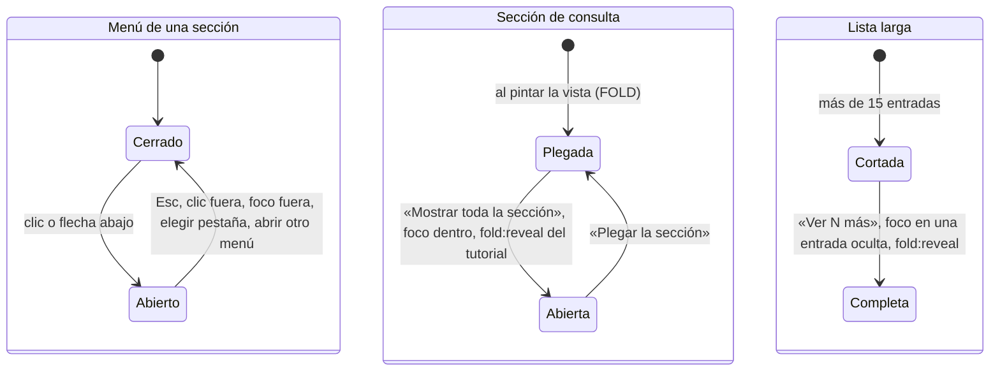

### 8. Tutorial guiado

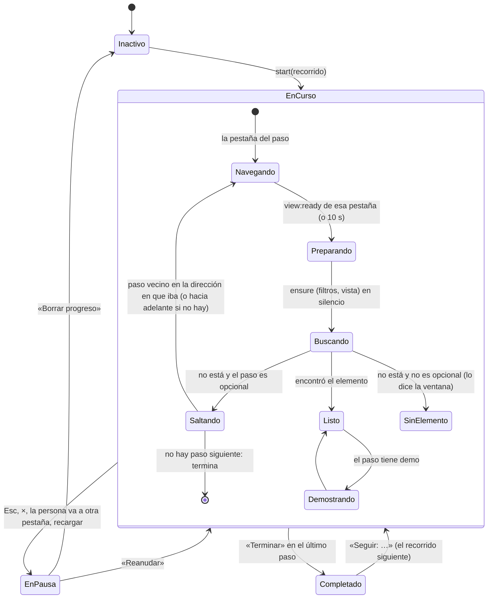

Cada paso nuevo sube un contador (`gen`); lo que quedó esperando de un paso anterior ve que ya no es el actual y se
detiene. Lo que pulsa el tutorial lleva `data-tour-demo` en `<html>` mientras dura el clic, y `ab.js` lo trata como
vista previa.

Antes: la dirección («Anterior») no se reiniciaba al empezar otro recorrido, y saltar un paso opcional hacia atrás
desde el primero no iba a ningún lado: la ventana quedaba «cargando» para siempre. Pasaba en el recorrido de la
Memoria, cuyo primer paso solo existe con un Niño en curso (E1). Y mientras navegaba, el tutorial ignoraba que la
persona se fuera a otra pestaña (E4).

### 9. Mapa de alertas de Noticias

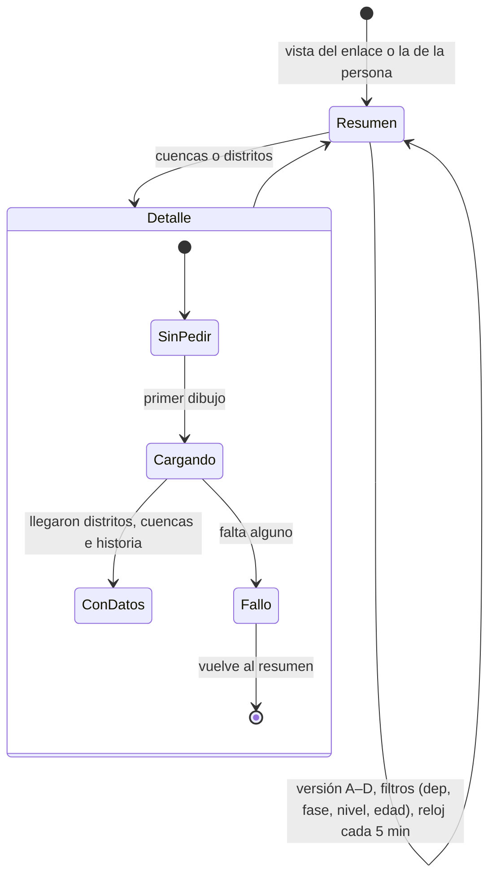

`det` era `null` tanto «sin pedir» como «cargando»: cada dibujo durante la carga (un filtro, el reloj) encadenaba otra
espera y otro dibujo al llegar los datos (E8). Ahora hay un estado «cargando» propio.

### 10. Fase de cada aviso

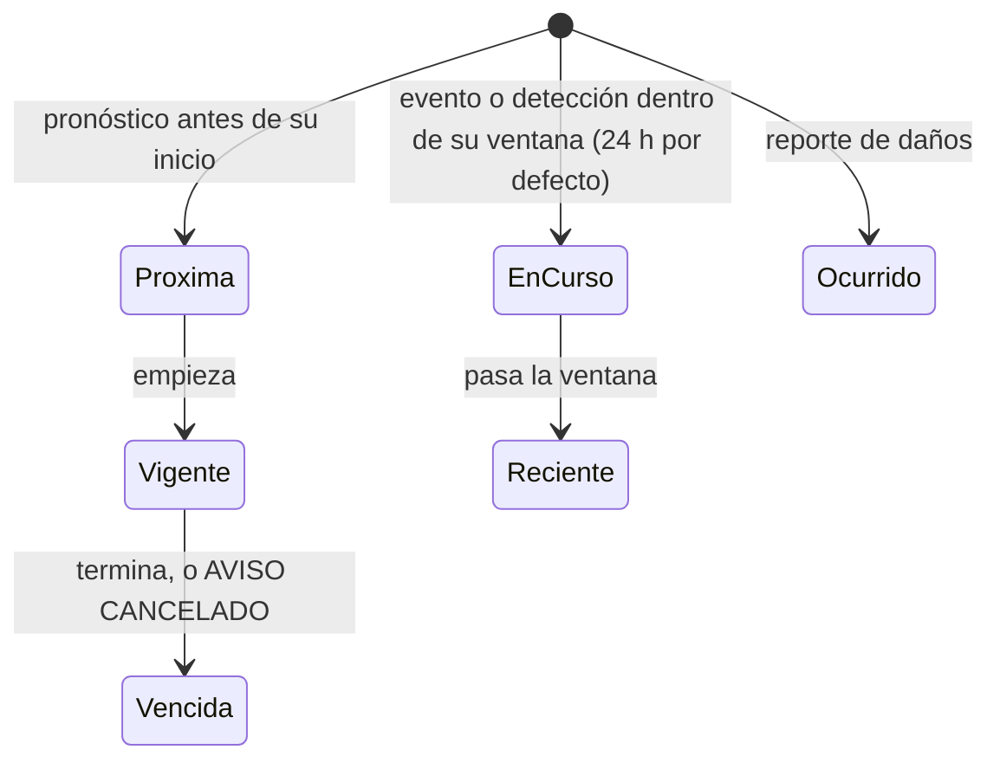

Es una función pura del reloj (`phaseOf`): el mapa la recalcula cada 5 minutos.

### 11. Pestañas y filtros de Noticias

Todo vive en el enlace (`#/noticias?tab=&tipo=&dep=&peligro=&fase=&nivel=&edad=&vista=`) y se valida al leerlo: un
valor desconocido vuelve al de por defecto en vez de dejar la lista vacía sin explicación. «Mundo» no tiene
departamento; filtrar en el mapa lleva a «oficial».

### 12. Memoria de desastres

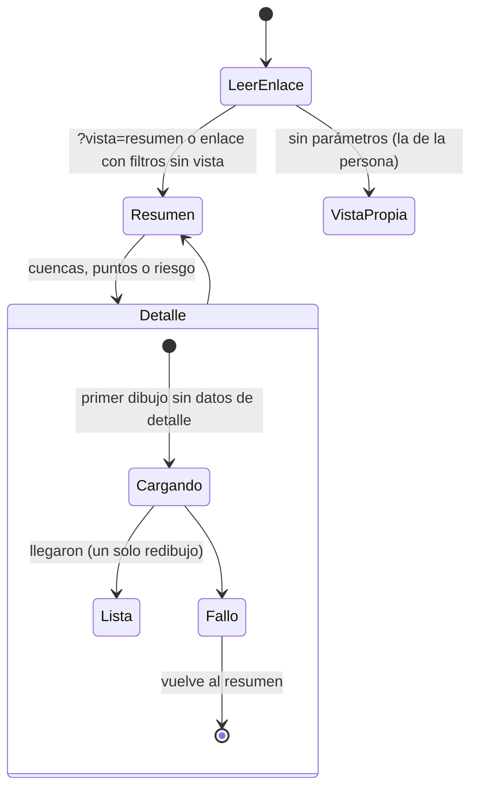

Cada dibujo escribe el estado en el enlace (`writeState`, sin los valores por defecto). El mismo arreglo de E8.

### 13. Animación del mapa

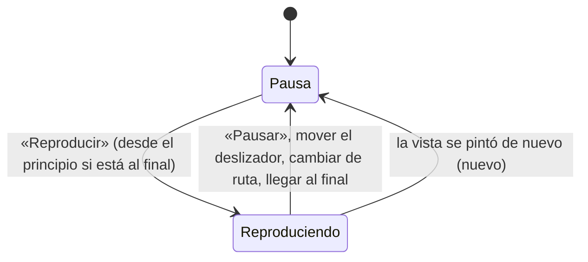

Antes, volver a pintar la vista sin cambiar de ruta (el selector de versiones) dejaba la animación vieja corriendo y
escribiendo la fecha y la tabla en el mapa nuevo (E3).

### 14. Mi zona

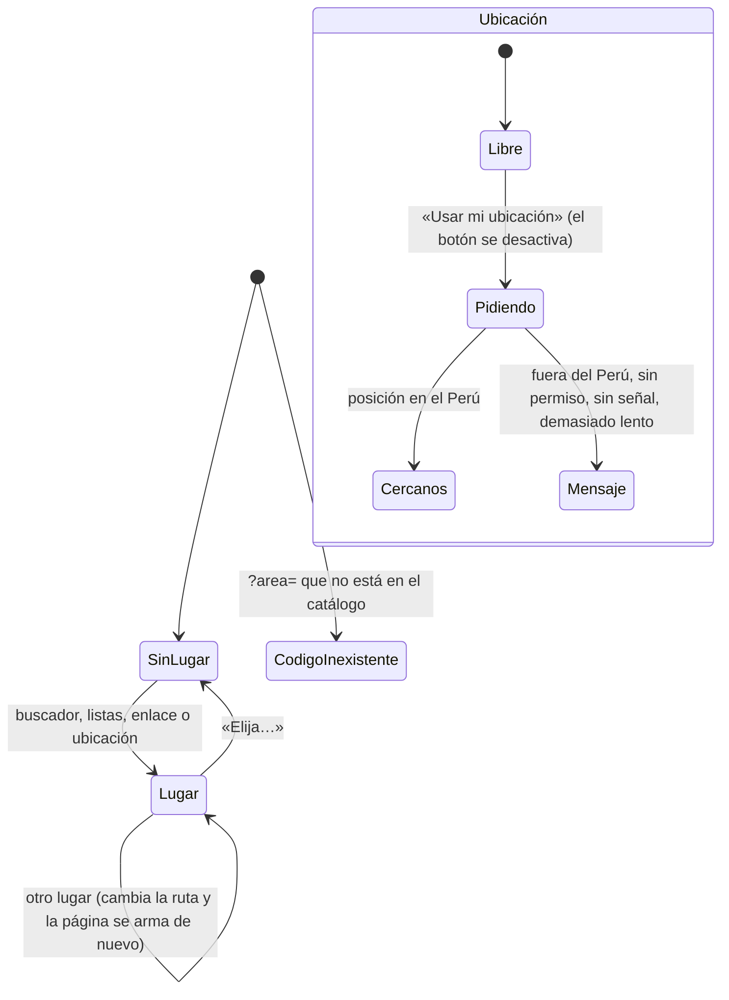

### 15. Boletín

Variante (`mapa` · `mosaico`, de `ab('boletin')`) y un departamento elegido (se elige y se suelta con el mismo clic).
El aviso «esta edición es del …» aparece cuando la actualización diaria no corrió.

### 16. Tema

`sistema` (sin nada guardado, sigue `prefers-color-scheme`) → `claro` · `oscuro` con el botón; una vez elegido ya no
sigue al sistema.

### 17. Consola: sesión y vista

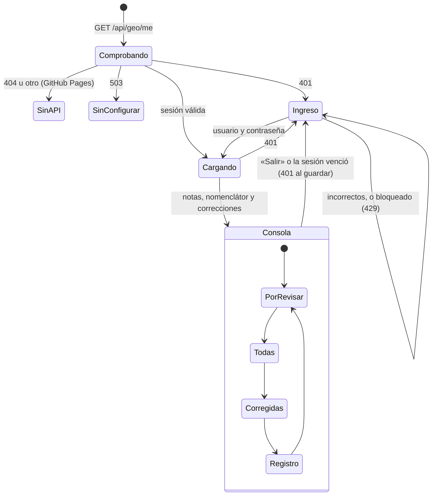

Antes, «Salir» no limpiaba la vista: quien ingresaba después en la misma pestaña empezaba en la pestaña, la búsqueda y
el registro de la persona anterior, y cada ingreso volvía a agregar los 25 departamentos al filtro (E6).

### 18. Consola: correcciones de una nota

```mermaid
stateDiagram-v2
  [*] --> Automatica: rev 0
  Automatica --> Corregida: set (rev+1)
  Automatica --> Confirmada: confirm
  Automatica --> Nacional: none
  Automatica --> Extranjera: foreign
  Corregida --> Deshecha: clear
  Confirmada --> Deshecha: clear
  Nacional --> Deshecha: clear
  Extranjera --> Deshecha: clear
  Deshecha --> Corregida: set
  Deshecha --> Deshecha: clear (rechazado, 400)
  note right of Corregida: cada cambio exige expectedRev (sin ella, 428); otro revisor en medio → 409 con la vigente; el mismo envío repetido → 200 con lo guardado
```

Cómo se protege cada escritura (bloqueo optimista, idempotencia, bandeja de salida de la subida de documentos,
reintentos) está en [fiabilidad-datos.md](fiabilidad-datos.md).

Antes se aceptaba deshacer una nota ya deshecha: sumaba una revisión vacía al historial y gastaba una escritura (E7).
El ingreso tiene su propia máquina por IP y por usuario: libre → fallos contados en una ventana de 15 minutos →
bloqueado (429) hasta que vence la ventana; un ingreso correcto borra el contador del usuario.

## Diagnóstico: estados errados y sus causas

| | Máquina | Estado errado | Causa raíz | Impacto | Corrección | Prueba |
|---|---|---|---|---|---|---|
| E1 | 8 Tutorial | La ventana queda «cargando» para siempre en un paso vacío | La dirección del último «Anterior» (`lastDir`) se heredaba entre recorridos, y saltar un paso opcional hacia atrás desde el primero no tenía destino | El recorrido de la Memoria (primer paso opcional, sin Niño en curso) se trababa al usar «Anterior» o tras usarlo en otro recorrido | `start`/`resume` reinician la dirección; sin vecino hacia atrás se sigue hacia adelante | `test_maquinas_estado.py::test_tour_back_into_a_missing_optional_first_step_does_not_hang` |
| E2 | 4, 5 Versiones | Una vista previa no se puede adoptar; el enlace sigue mandando tras elegir | `choose(v)` comparaba con la versión que se ve, no con la propia; el panel marca la que se ve; `?sitio=` no se quitaba | Quien recibe un enlace a la B no puede quedarse con la B; al recargar vuelve el aviso «desde un enlace» | `choose` adopta la vista previa; botón «Quedarme con…» en el panel; se quitan `sitio`/`version` del enlace y `vista` pasa a ser la elegida; el panel se rehace | `js/ab-session.test.mjs`, `test_a_previewed_site_version_can_be_kept…`, `test_choosing_a_map_view_from_the_panel…` |
| E3 | 13 Animación | Dos animaciones; la vieja escribe en el mapa nuevo | El temporizador solo se detenía con `hashchange`, y el selector vuelve a pintar sin cambiar de ruta; `after` conectaba controles aunque la vista ya se hubiera reemplazado | La fecha y la tabla saltan solas; dos montajes conectaban dos animaciones al mismo botón | La animación se detiene si su mapa ya no está; `after` no conecta nada si la vista se reemplazó mientras esperaba | `test_map_animation_stops_when_the_view_is_painted_again` |
| E4 | 2 Ruta, 8 Tutorial | `view:ready` de una vista que ya se fue; el tutorial no se pausa si la persona se va mientras navega | `render` anunciaba también las vistas reemplazadas; el tutorial aceptaba cualquier `view:ready`; `onHash` ignoraba los cambios mientras navegaba | El tutorial podía buscar el paso en la pestaña equivocada y esperar 10 s antes de decir «no disponible» | Solo la vista actual anuncia; el tutorial espera la de su paso; se pausa al irse a otra pestaña también mientras navega | `test_only_the_current_view_announces_it_is_ready` |
| E5 | 1 Publicación | Un archivo queda «no disponible» hasta recargar | El caché de `load` guardaba `null` también por un fallo de red; no había estado «pidiendo» | Un corte de un segundo dejaba Noticias, los gráficos o el mapa sin datos toda la visita | Promesa compartida mientras se pide; un fallo de red no se guarda; el nombre de otra publicación se avisa una vez | `test_a_network_blip_does_not_leave_a_file_unavailable_until_reload` |
| E6 | 17 Consola | La persona siguiente hereda la vista de la anterior; departamentos repetidos | `start()` agregaba opciones en cada ingreso; `showLogin` no reiniciaba la vista; un 409 dejaba la tarjeta vieja | Filtro con 50, 75… departamentos; registro de cambios de otra sesión visible | `fillNames` rehace la lista; `resetView` al salir; tras un 409 la tarjeta se rehace con la revisión nueva | `test_geo_console.py::test_reviewer_logs_in_corrects_a_place_and_sees_the_history` |
| E7 | 18 Correcciones | Deshacer una nota ya deshecha | La regla solo miraba si había revisiones, no la acción vigente | Revisiones vacías en el historial, escrituras gastadas | 400 si la acción vigente ya es `clear` | `js/geo_console.test.mjs` |
| E8 | 9, 12 Mapas | Varias esperas y redibujos por la misma carga | «Sin pedir» y «cargando» eran el mismo estado (`null` / sin datos) | Redibujos de más al llegar los datos (los archivos ya se pedían una vez) | Estado «cargando» propio (`detLoading`, `detailPending`) | recorridos existentes de los mapas |
| E9 | 3 Vigencia | «Al día: los 0 datos de esta vista…» | El peor de una lista vacía es «al día» | Panel contradictorio | No se muestra el panel sin datos que cuenten | revisión de código |
| E10 | 18 Correcciones | Escritura a ciegas que pisa la de otro revisor | `expectedRev` era opcional en la API: sin ella no se comparaba la revisión | Un cliente que no la mandara (script, n8n) perdía cambios ajenos sin aviso | 428 sin `expectedRev` | `js/geo_console.test.mjs` |
| E11 | 18 Correcciones | 409 falso «otra persona corrigió esta nota» tras un corte de red | Repetir un envío que ya se había guardado chocaba con su propia revisión | La persona recargaba y dudaba de si su cambio estaba | El mismo cambio de la misma persona, una revisión arriba, es una repetición: 200 con lo guardado; la consola repite una vez si la red falló | `js/geo_console.test.mjs`, `test_geo_console.py::test_a_correction_whose_reply_is_lost_is_retried_once_and_saved_once` |
| E12 | Subida de documentos | Commit en la rama sin registro en D1; commits repetidos | Se pedía la actualización antes de anotar la subida, y un fallo de red en ese paso respondía 500 | Un PDF subido no aparecía en la consola; al reintentar, otro commit | Bandeja de salida: se anota con la actualización pendiente y se pide después; el relevo la pide al abrir la consola; la subida es idempotente por sha256 | `js/doc_uploads.test.mjs` |
| E13 | Pipeline | La publicación del día sale con las correcciones de ayer | Un solo pedido a `/api/geo/overrides` | Un 503 pasajero retrasaba un día las correcciones | 3 intentos con espera exponencial y `Retry-After` | `test_geo.py` |

## Lo que se revisó y se deja así

- **Vista previa del tutorial en las sesiones de `ab.js`.** Tras un recorrido, el mapa sigue en la vista que dejó el
  tutorial y no se cuenta como uso de la persona hasta que vuelve a montar la pestaña (lee el enlace o su vista).
  Es lo que la persona acaba de ver; con E2 puede adoptarla. Cambiarlo haría saltar la vista al terminar el paso.
- **Archivos geográficos que fallan una vez (`geometry`, `districtShapes`, …).** Se guardan como `null` hasta
  recargar, como hacía `load`. Son archivos del propio sitio (no de la publicación del día) y su fallo deja un aviso
  claro; se deja anotado para hacerlo igual que `load` si aparece en los registros.
- **Una nota deshecha sigue fuera de «Por revisar» hasta la próxima actualización.** La publicación todavía trae la
  revisión aplicada (`geo.review`). La tarjeta lo dice: «Se aplicará en la próxima actualización del sitio».
- **El tema no sigue al sistema después de elegirlo.** Es a propósito: la elección de la persona manda.
- **Volver a pintar al cambiar de versión sube la página al principio.** El selector queda abierto y con el foco; la
  vista cambia de forma (B pliega), así que conservar la posición llevaría a un lugar distinto.

## Cuatro revisiones adversarias

Cada cambio se revisó cuatro veces buscando cómo romperlo, con preguntas distintas en cada vuelta. Lo que encontró
cada vuelta y se corrigió está marcado con ✔.

1. **Estados nuevos que crea el arreglo.** ✔ El botón «Quedarme con…» rehacía el panel durante su propio clic; el
   clic llegaba al documento con su botón ya fuera de la página y el panel se cerraba («clic fuera»). Ahora un clic
   cuyo destino ya no está en la página no cierra el panel. Sin otro hallazgo en `load` (la promesa se borra al
   terminar, después de guardar el resultado), en el tutorial (sin vecino hacia atrás siempre hay uno hacia adelante
   o se termina) ni en la consola (`resetView` corre también en el primer ingreso, antes de que haya datos).
2. **Carreras y orden de eventos.** El cambio de los radios ocurre después de que el clic recorrió el documento, así
   que rehacer el panel ahí no lo cierra. `view:ready` del tutorial: el temporizador de 10 s llama sin evento y sigue
   resolviendo. `onHash` sin la guarda de navegación: el `hashchange` que provoca el tutorial va a la ruta del paso y
   no pausa; los `ensure` de Mi zona cambian el área dentro de la misma ruta. Un `load` que falla mientras otra vista
   lo espera: las dos reciben `null` y la siguiente lo pide de nuevo.
3. **Efectos en las partes integradas.** `load` sigue devolviendo una promesa (lo usan `zona.js` con `.catch`,
   `map.js`, el asistente). La medición: adoptar una versión del sitio pasa por `chooseSite`, que envía lo medido con
   la versión anterior antes de cambiar, como al elegir. Los parámetros se quitan con `replaceState`: no hay
   `hashchange` ni se vuelve a pintar dos veces. El servidor de la consola: la consulta pide una columna más de la
   misma fila (sin escrituras ni lecturas nuevas).
4. **Pruebas que no prueban.** ✔ La prueba de la animación pasaba también sin el arreglo: esperaba hasta 10 s, el
   tiempo en que la animación vieja llega sola al final. Ahora espera 2 s. Las demás pruebas nuevas se corrieron sin
   los arreglos y fallan (E1, E2, E4, E5, E6, E7).

Después, la revisión automática del PR encontró un caso más, corregido: ✔ adoptar la vista de la memoria desde un
enlace con filtros (`#/memoria?vista=cuencas&nivel=departamento`) quitaba `vista` y la memoria abría el resumen, porque
un enlace con filtros y sin vista es de antes de las vistas. Ahora `vista` queda en el enlace con la elegida
(`test_adopting_a_memoria_view_from_a_filtered_link_keeps_showing_it`).

## Mantener esto al día

Al agregar una vista, un parámetro del enlace, un temporizador o una clave de `localStorage`, ubíquelo en el
inventario y pregunte: ¿qué pasa si la vista se vuelve a pintar sin cambiar de ruta? ¿Si llega un enlace con otro
valor? ¿Si la red falla una vez? ¿Si el tutorial lo pulsa? Las pruebas de `python/tests/test_maquinas_estado.py`
reproducen esos casos y sirven de modelo.
